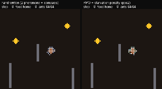

# 01 · The Ant Farm: an artificial-life terrarium

A grid terrarium with one nest, two food sources, rocks, and an evaporating, diffusing
two-channel pheromone field. Ants burn energy as they walk, pick up food, carry it home, refuel
from the colony store, and starve if they run dry. Three kinds of colony live in it:

* **hand-written**: the textbook two-pheromone forager, plus a variant that also uses the
  path-integration compass;
* **PPO**: one shared MLX network drives every ant. Each ant picks a move and a pheromone
  deposit (none / home / food) from local senses only;
* **ES**: evolution strategies over the same network (the evolutionary baseline).

Nobody is told where the food is. Each ant senses a 5-direction × 2-cell forward cone
(pheromones, rock, food, nest), whether it is carrying food, its own energy, an internal clock
(steps since the last pick-up or nest visit), and a **path-integration compass** (bearing and
distance to the nest, as real desert ants have). A `--no_compass` ablation removes the compass.
See RESULTS.md for numbers.



_The hand-written colony (left) vs. the learned PPO colony (right) on an unseen world. At step 500 a wall drops across the trail._

## Run it

All commands run from this folder. Long jobs go through the shared GPU lock.

```bash
# tests + smoke check (< 1 min): determinism, save/restore, locality of observations,
# baseline > random, PPO train+resume at tiny size
NUMBA_NUM_THREADS=4 ../.venv/bin/python -m pytest -q

# train (writes checkpoints/<run>/, logs/<run>.jsonl; resumable with --resume)
# (ppo2 = copy checkpoints/ppo1 to checkpoints/ppo2, then --run ppo2 --death 3 --minutes 58 --resume; see jobD.sh)
NUMBA_NUM_THREADS=4 ../bin/gpu_run ../.venv/bin/python train.py --run ppo1 --minutes 28
NUMBA_NUM_THREADS=4 ../bin/gpu_run ../.venv/bin/python train.py --run ppo_nocompass --no_compass --minutes 11
NUMBA_NUM_THREADS=4 ../bin/gpu_run ../.venv/bin/python es.py --run es1 --minutes 15

# evaluate (efficiency, survival, held-out layouts, pheromone ablation, route-block recovery)
NUMBA_NUM_THREADS=4 ../bin/gpu_run ../.venv/bin/python evaluate.py \
    --ppo checkpoints/ppo1 checkpoints/ppo_nocompass --es checkpoints/es1 --out results/eval.json

# demos
../.venv/bin/python demo.py --ppo checkpoints/ppo1 --es checkpoints/es1   # media/side_by_side.{mp4,gif}, _strip.png
../.venv/bin/python demo.py --ppo checkpoints/ppo2 --ppo_label "PPO + starvation penalty (ppo2)" --out media/side_by_side_ppo2
../.venv/bin/python plots.py                                  # media/efficiency.png, recovery.png, training.png
../.venv/bin/python make_demo_html.py --nets checkpoints/ppo2 checkpoints/ppo1 checkpoints/es1 checkpoints/ppo_nocompass
../.venv/bin/python tests/js_port_check.py media/demo.html checkpoints/ppo2   # JS port == Python (needs node)
```

The exact GPU-slot jobs used for the reported runs are `jobB.sh` (no-compass PPO, ES, and their
evaluation), `jobC.sh`/`jobA.sh` (two identical "tickets": whichever got a slot first trained,
evaluated and rendered ppo1; the other trained `ppo1_seed1`), and `jobD.sh` (`ppo2` = ppo1
continued with a 3× starvation penalty).

```bash
../.venv/bin/python tables.py      # the RESULTS.md tables, from results/eval*.json
# cross-review extras (each < 30 s): tuned hand-written baseline, and ppo1's final (not best) weights
NUMBA_NUM_THREADS=4 ../.venv/bin/python evaluate.py --baselines compass_tuned --out results/review_hw_tuned.json
NUMBA_NUM_THREADS=4 ANTFARM_LAST=1 ../.venv/bin/python evaluate.py --baselines --ppo checkpoints/ppo1 --out results/review_ppo1_final.json
ANTFARM_LAST=1 ../.venv/bin/python clip.py --policy checkpoints/ppo_nocompass --out media/nocompass_collapse
```

Open `media/demo.html` in any browser (it works offline and is one self-contained file) to watch two colonies
side by side in the same world. Pick a brain for each panel, draw walls, drop food, or press
"Block busiest trail".

## Files

| file | what |
|---|---|
| `sim.py` | numba simulator: batched worlds, local observations, actions, energy, pheromone diffusion and evaporation, route blocking, save/restore (`World.save/load`, RNG lives in the state) |
| `handwritten.py` | classic and compass hand-written colonies (+ `compass_tuned`, added by the cross-review), plus random, all as `obs -> action probabilities` |
| `policy.py` | MLX shared actor (+ centralised critic used only in training), numpy twin, JSON export |
| `train.py` | shared-policy PPO with checkpoint/resume |
| `es.py` | OpenAI-style ES over the same actor network |
| `evaluate.py` | all measurements → `results/eval.json` |
| `demo.py`, `render.py`, `plots.py`, `clip.py`, `tables.py` | videos, frames, charts, failure clips, markdown tables |
| `demo_template.html`, `make_demo_html.py` | in-browser terrarium (JS port of sim + brains) → `media/demo.html` |
| `tests/` | pytest suite + `js_port_check.py` |
| `checkpoints/` | `ppo1` (main), `ppo1_seed1`, `ppo2`, `ppo_nocompass`, `ppo_nocompass_collapsed` (first run, old resting cost), `es1`: weights (+ `model_best` = best on validation seeds 900-915), Adam state, counters, RNG, config |
| `results/eval*.json` | every number in RESULTS.md (`eval.json` from jobC, `_B` jobB, `_C` jobA, `_D` jobD); `review_*.json` from the cross-review |
| `logs/` | training logs (`*.jsonl` one line per episode/generation) and job outputs |
