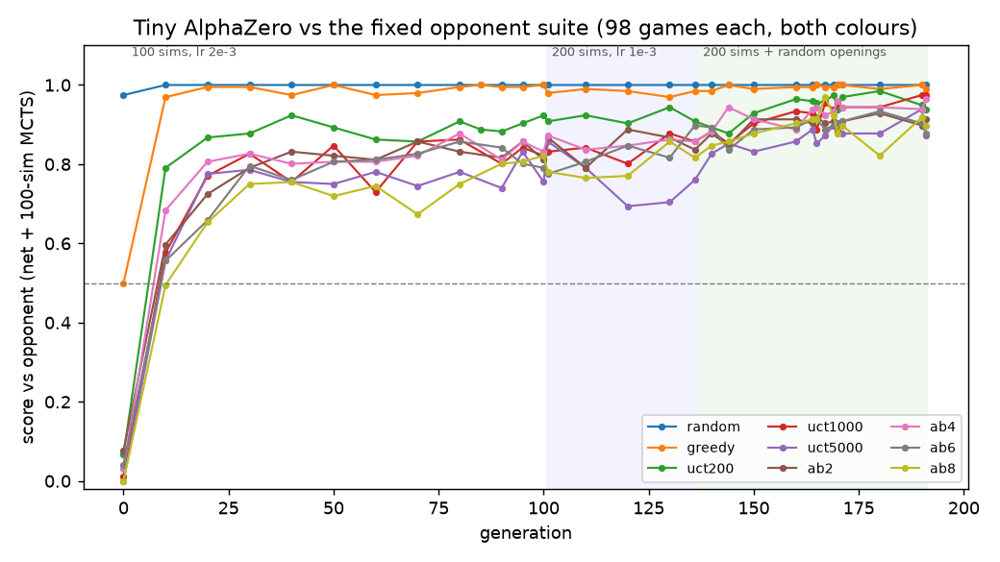
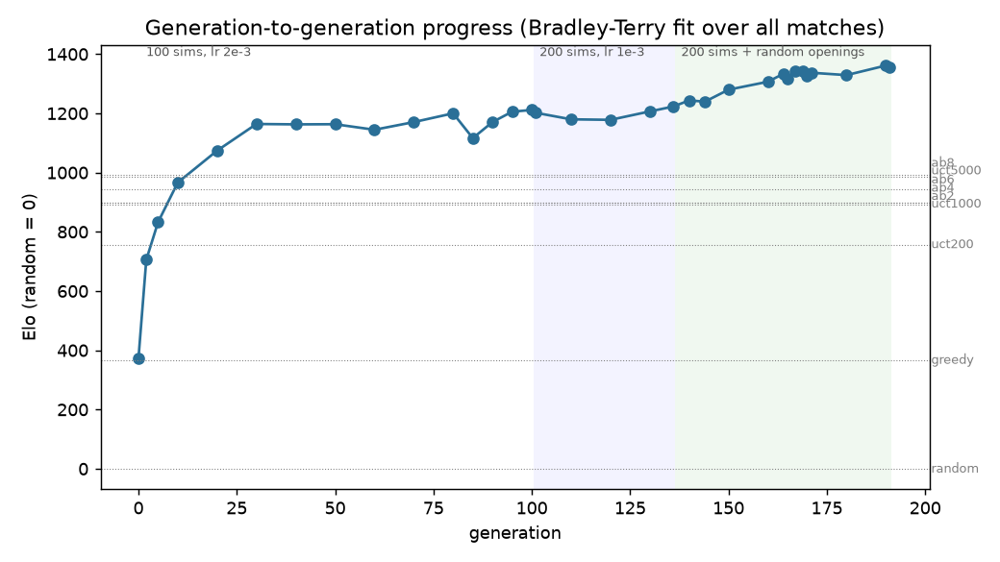
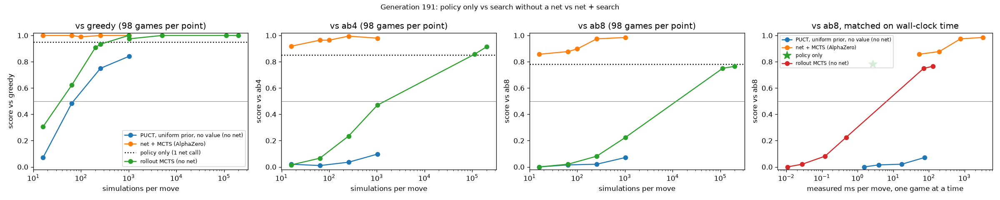
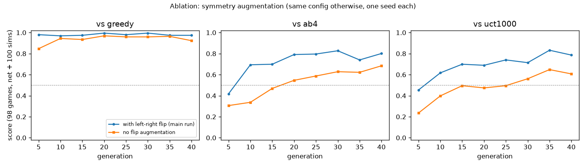
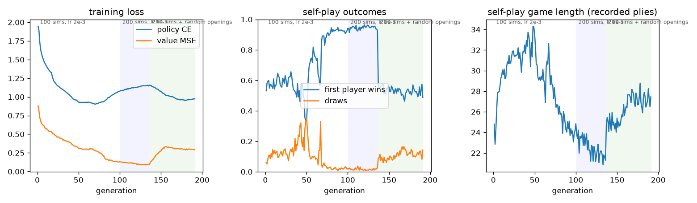

# RESULTS: Tiny AlphaZero (Connect Four)

Every number below comes from a real run. Logs: `logs/main.jsonl` (one line per generation),
`logs/main_eval.jsonl` (inline evals), `results/matches_*.json` (every arena match, 98 games each),
`results/elo.json`, `results/latency.json`, and `results/report.md` (all tables, regenerated with
`python evaluate.py report`).

**Status: done.** Everything in the "first satisfying version" is built: a complete training loop
with legal-move masking, 192 saved generations used as opponents, and a visible search tree. The
"go deeper" comparison of policy only vs search without a net vs both, under matched budgets, is
also done, plus a symmetry-augmentation ablation and a 3-seed replication of the main run and the ablation (§10).

**Headline.** A 376k-parameter ResNet trained from zero knowledge for 191 generations
(**97,792 self-play games in four ≤ 36-minute training sessions, about 2 h 25 min**) beats every fixed opponent.

- With 100 simulations per move it scores **0.90 vs alpha-beta depth 8**, 0.87 vs uct5000 (5,000 random rollouts per move) and 0.96 vs ab4, over 98 games each with both colours.
- With 1024 simulations it scores **0.98 vs ab8**.
- Its raw policy alone (one network call, no search) already scores **0.78 vs ab8** and beats uct1024 0.81.
- Elo (random = 0): final net **1355**; best baselines ab8 994 and uct5000 987.
- **It reproduces across training seeds (§10).** Two more seeds on the identical 191-generation schedule score 0.93 and 0.90 vs ab8 (seed 0: 0.90) and 0.946 / 0.957 averaged over the nine suite opponents (seed 0: 0.937), and they play seed 0's final net even head to head (0.52, 0.53). The seed-0 headline is typical, not lucky. The collapse and the phase-C fix reproduce in all three seeds. **One claim does not:** phase B's "no gain" was seed-specific (seeds 1 and 2 gained 0.66 / 0.62 head to head in phase B). The flip ablation's gap also comes out about half as large in the new seeds.

The most interesting result is a failure. Self-play discovered that the first player wins, then
collapsed into a few forcing lines, and its suite strength stalled for about 100 generations.
Random opening plies fixed it (§4). Both the collapse and the fix reproduced
with two more training seeds, but the collapse started 25–50 generations later in them (§10).

## 1. What was run

| | |
|---|---|
| game | standard Connect Four, 7 × 6, int64 bitboards (`c4.py`) |
| net | `PVNet`, 64 ch × 5 residual blocks, 376,224 params (MLX); input = 2 planes (side to move, opponent) |
| search | batched PUCT MCTS, c_puct 1.5, unvisited Q = 0; self-play adds Dirichlet(α = 1.0) noise with weight 0.25 at the root |
| self-play | 512 games in lock-step per generation; moves sampled ∝ visits for the first *T* plies, then argmax |
| training | replay buffer of the last 250k positions; about 4 samples drawn per new position; batch 1024; AdamW (wd 1e-4); random left-right flip |
| compute | four ≤ 36-minute training sessions through the shared GPU lock, each resuming from the full saved state (weights, optimizer, replay buffer, RNG); checkpoint/resume was tested before the first long run (`tests/test_mcts.py::test_pipeline_end_to_end_tiny`) |

The main run has **three phases** (all in `checkpoints/main/`):

| phase | gens | games | sims/move | lr | opening diversity | why |
|---|---|---|---|---|---|---|
| A | 1–100 | 51,200 | 100 | 2e-3 | temperature for 10 plies | default AlphaZero recipe |
| B | 101–136 | 18,432 | 200 | 1e-3 | temperature for 10 plies | sharper targets and a lower lr after A plateaued |
| C | 137–191 | 28,160 | 200 | 1e-3 | **0–4 uniformly random opening plies (not trained on) + temperature for 16 plies** | fix for the opening collapse (§4); run as two sessions |

**Throughput.** The game-parallel batched MCTS sends about 250–310 positions per network call.
Phase A averaged **14.5 s per 512-game generation and about 91k leaf evaluations per second**
(peak 134k), on a GPU shared with about 12 other projects. Phases B and C ran at 35–39k evaluations
per second: twice the simulations per move, and my own evaluation and ablation jobs were sharing
the GPU at the same time. The first job waited **27 minutes** in the GPU-lock queue before it started.

## 2. Evaluation protocol

- Every match = all **49 two-ply openings × both colours = 98 games**. The openings are the same for every match, and the colour swap cancels the first-move advantage. Score = wins + ½ draws. One 98-game score has a standard error of about ±0.03–0.05.
- Network agents search **without noise** and play the most-visited move. Suite and Elo evaluations use **100 simulations**, half the training budget of phases B and C.
- The suite (`c4.py`) has nine opponents: `random`; `greedy` (win, else block, else avoid giving a win, else random); `uct200/1000/5000` (plain UCT with that many uniformly random rollouts per move); `ab2/4/6/8` (alpha-beta at that depth with a window-count heuristic). The baselines break ties at random.
- Elo is a Bradley–Terry fit over **all 414 cached matches** (baselines among themselves, generations vs suite, generations vs each other, budget matches), with `random` = 0 and a ½-draw prior per pair.

## 3. Results

### 3.1 The fixed opponent suite (baseline round robin)

| | random | greedy | uct200 | uct1000 | uct5000 | ab2 | ab4 | ab6 | ab8 | Elo |
|---|---|---|---|---|---|---|---|---|---|---|
| **random** | – | 0.04 | 0.02 | 0.00 | 0.00 | 0.00 | 0.00 | 0.00 | 0.00 | 0 |
| **greedy** | 0.96 | – | 0.09 | 0.00 | 0.00 | 0.05 | 0.02 | 0.01 | 0.00 | 367 |
| **uct200** | 0.98 | 0.91 | – | 0.19 | 0.06 | 0.24 | 0.17 | 0.19 | 0.11 | 756 |
| **uct1000** | 1.00 | 1.00 | 0.81 | – | 0.14 | 0.45 | 0.48 | 0.40 | 0.26 | 893 |
| **uct5000** | 1.00 | 1.00 | 0.94 | 0.86 | – | 0.70 | 0.63 | 0.53 | 0.40 | 987 |
| **ab2** | 1.00 | 0.95 | 0.76 | 0.55 | 0.30 | – | 0.42 | 0.30 | 0.20 | 897 |
| **ab4** | 1.00 | 0.98 | 0.83 | 0.52 | 0.37 | 0.58 | – | 0.40 | 0.42 | 897 |
| **ab6** | 1.00 | 0.99 | 0.81 | 0.60 | 0.47 | 0.70 | 0.60 | – | 0.34 | 944 |
| **ab8** | 1.00 | 1.00 | 0.89 | 0.74 | 0.60 | 0.80 | 0.58 | 0.66 | – | 994 |

(Row player's score vs column.) Rollout MCTS improves steadily with budget. Deeper alpha-beta
helps, but the window heuristic is weak (ab2 and ab4 are tied on Elo). ab8 and uct5000 are the
strongest baselines.

### 3.2 Win rate against the fixed opponents, by generation (net + 100 sims, score over 98 games)

| gen | random | greedy | uct200 | uct1000 | uct5000 | ab2 | ab4 | ab6 | ab8 | Elo |
|---|---|---|---|---|---|---|---|---|---|---|
| 0 (untrained) | 0.97 | 0.50 | 0.07 | 0.01 | 0.00 | 0.08 | 0.03 | 0.04 | 0.00 | 371 |
| 10 | 1.00 | 0.97 | 0.79 | 0.58 | 0.56 | 0.60 | 0.68 | 0.56 | 0.49 | 966 |
| 20 | 1.00 | 0.99 | 0.87 | 0.77 | 0.78 | 0.72 | 0.81 | 0.66 | 0.65 | 1074 |
| 40 | 1.00 | 0.97 | 0.92 | 0.76 | 0.76 | 0.83 | 0.80 | 0.76 | 0.76 | 1163 |
| 70 | 1.00 | 0.98 | 0.86 | 0.86 | 0.74 | 0.86 | 0.82 | 0.83 | 0.67 | 1170 |
| 100 | 1.00 | 1.00 | 0.92 | 0.82 | 0.76 | 0.81 | 0.83 | 0.79 | 0.82 | 1211 |
| 136 | 1.00 | 0.98 | 0.91 | 0.86 | 0.76 | 0.84 | 0.86 | 0.90 | 0.82 | 1223 |
| 150 | 1.00 | 0.99 | 0.93 | 0.90 | 0.83 | 0.91 | 0.91 | 0.89 | 0.88 | 1280 |
| 170 | 1.00 | 1.00 | 0.94 | 0.95 | 0.90 | 0.88 | 0.96 | 0.90 | 0.88 | 1328 |
| **191 (final)** | 1.00 | 0.99 | 0.94 | 0.97 | 0.87 | 0.91 | 0.96 | 0.88 | **0.90** | **1355** |

Per-colour scores are stored for every match (`score_as_first` / `score_as_second` in
`results/matches_*.json`). For example, gen 191 vs ab8 scores 0.91 as first player and 0.89 as
second. Across gens 150–191, the score vs ab8 as second player ranges from 0.79 to 0.94. The full
table (every 10th generation and more) is in `results/report.md`.

### 3.3 Generation-to-generation progress

Round robin between generations 0, 2, 5, 10, 20, 40, 70, 100, 136 and 191 (later generation's score, 98 games each):

| later \ earlier | 0 | 2 | 5 | 10 | 20 | 40 | 70 | 100 | 136 |
|---|---|---|---|---|---|---|---|---|---|
| 2 | 0.89 | | | | | | | | |
| 5 | 0.99 | 0.74 | | | | | | | |
| 10 | 0.99 | 0.82 | 0.76 | | | | | | |
| 20 | 0.98 | 0.90 | 0.89 | 0.74 | | | | | |
| 40 | 0.99 | 0.93 | 0.87 | 0.80 | 0.75 | | | | |
| 70 | 0.96 | 0.93 | 0.90 | 0.83 | 0.74 | 0.57 | | | |
| 100 | 0.97 | 0.94 | 0.90 | 0.85 | 0.74 | 0.57 | 0.64 | | |
| 136 | 0.98 | 0.92 | 0.88 | 0.84 | 0.81 | 0.63 | 0.59 | 0.52 | |
| **191** | 1.00 | 0.98 | 0.94 | 0.95 | 0.88 | 0.72 | 0.78 | 0.67 | 0.71 |

Every later generation beats every earlier one. The margins shrink in phase A (gen 70 → 100: 0.64)
and vanish in phase B (gen 100 → 136: **0.52**). Phase C brings them back (gen 136 → 191: **0.71**).
Elo by generation: 0 → 371, 5 → 833, 10 → 966, 20 → 1074, 40 → 1163, 70 → 1170, 100 → 1211,
136 → 1223, **191 → 1355**.

### 3.4 Policy only vs search without a net vs net + search (matched budgets)

All with the gen-191 net. Score over 98 games:

| agent (sims/move) | vs greedy | vs ab4 | vs ab8 | single-game ms/move |
|---|---|---|---|---|
| **policy only** (argmax prior, 1 net call) | 0.95 | 0.85 | **0.78** | 2.7 |
| net + MCTS 16 | 1.00 | 0.92 | 0.86 | 53 |
| net + MCTS 64 | 1.00 | 0.96 | 0.88 | 197 |
| net + MCTS 256 | 1.00 | 0.99 | 0.97 | 772 |
| net + MCTS 1024 | 1.00 | 0.98 | **0.98** | 3,252 |
| rollout MCTS 16 | 0.31 | 0.02 | 0.00 | 0.01 |
| rollout MCTS 64 | 0.62 | 0.07 | 0.02 | 0.03 |
| rollout MCTS 256 | 0.93 | 0.23 | 0.08 | 0.12 |
| rollout MCTS 1024 | 0.97 | 0.47 | 0.22 | 0.48 |
| PUCT with no net (uniform prior, value 0) 16 / 64 / 256 / 1024 | 0.07 / 0.48 / 0.75 / 0.84 | 0.02 / 0.01 / 0.04 / 0.10 | 0.00 / 0.02 / 0.02 / 0.07 | 1.5 / 3.9 / 17 / 76 |
| **rollout MCTS, wall-time matched to net@16** (112,310 sims) | 1.00 | 0.86 | 0.75 | 72 |
| **rollout MCTS, wall-time matched to net@64** (200,000 sims, capped; *less* time than the net) | 1.00 | 0.91 | 0.77 | 129 |

Head to head: net@16 vs uct16 **1.00**, net@64 vs uct64 0.98, net@256 vs uct256 0.99,
net@1024 vs uct1024 0.98. With wall time matched: **net@16 vs uct112310: 0.75**, net@64 vs uct200000: 0.86.
The raw policy (no search) vs uct16 / uct64 / uct256 / uct1024: 1.00 / 0.95 / 0.90 / 0.81.

What this says about the division of labour:
- **Matched on simulations, it isn't close.** One learned prior + value evaluation is worth more than 1,000 random rollouts. The policy alone, with no search at all, outscores every baseline in the suite, including the strongest (0.78 vs ab8).
- **Search still adds a lot on top of the policy:** from 0.78 to 0.98 vs ab8 between 0 and 1024 sims. Most of the gain arrives by 256 sims.
- **Matched on wall-clock time, rollouts get much closer.** On this machine one batch-1 net evaluation costs about 3 ms (mostly GPU dispatch), while one random rollout costs about 0.5 µs, so rollout MCTS gets about 2,000–6,000× more simulations. At roughly equal time it reaches 0.75–0.77 vs ab8: about where the raw policy is, but still below net + search (0.86–0.88), and it loses head to head. The matching is approximate in both directions (from `results/latency.json`): uct112310 actually used 72 ms vs net@16's 53 ms (*35% more* time than the net), and uct200000 used 129 ms vs net@64's 197 ms (35% *less*, capped). The net@16 result is the cleaner one: it wins 0.75 head to head even though the rollouts had more time. In self-play the net's cost is amortised over a batch of about 300 games (about 10 µs per evaluation), which is why the batched design matters.
- **"Search without a net" with a uniform prior and no value** (PUCT that only sees terminal states) is the weakest agent by far: without rollouts or a value there is no signal until a game ends.

### 3.5 Ablation: left-right symmetry augmentation

`checkpoints/noflip/` is the same config as phase A with `--no-flip`, one seed each. It was compared at equal generation counts with the inline eval (net + 100 sims, 98 games):

| gen | flip: ab4 / uct1000 | no flip: ab4 / uct1000 |
|---|---|---|
| 5 | 0.42 / 0.45 | 0.31 / 0.24 |
| 10 | 0.69 / 0.62 | 0.34 / 0.40 |
| 20 | 0.79 / 0.69 | 0.55 / 0.47 |
| 30 | 0.83 / 0.71 | 0.63 / 0.56 |
| 40 | 0.80 / 0.79 | 0.68 / 0.61 |

Flip augmentation gives a large and consistent head start. The no-flip run needs about twice as
many generations to reach the same score. It only got 42 generations: it ran while my other jobs
shared the GPU, so it is a comparison per generation, not per wall-clock time. **Update (§10): with seeds 1
and 2 added, flip is ahead in all 30 paired cells, but the gap is about half of seed 0's** (mean +0.11 and +0.10
vs +0.20): seed 0's no-flip run was the weakest of the three.

## 4. The good kind of failure: self-play collapses into "first player wins"

Connect Four is a theoretical **first-player win** (perfect play starts in the centre). The net
discovered this, and the discovery then choked its own learning:

- In phase A the first-player win rate in self-play was about 0.55–0.65 until generation ~65. It then jumped to **0.89 by gen 70**, and averaged 0.93 over gens 91–100 and 0.95 over gens 127–136. Draws went from about 0.1–0.3 to 0.02, and games got shorter (peak 34 → 22 plies).
- The value head learned the theory. On the empty board the gen-100 net gives **+0.88 for the side to move**; after a first move in the centre it gives **−0.89 for the second player**. In the browser demo, the final net playing second against the centre opening estimates its own chances at 9% (value −0.82).
- But once self-play funnels into a few forcing lines, the 250k-position replay buffer (about 16 generations) fills with near-identical positions. **Value loss fell to 0.09** because outcomes became trivially predictable, not because the net understood more positions. **Suite strength stalled**: Elo was 1163 at gen 40 and 1223 at gen 136, and vs ab8 it stayed at 0.67–0.86 throughout. (Reviewer note: the slowdown starts around gen 30–40, *before* the first-player-win jump at gen ~65, so the collapse explains the lack of progress in gens 65–136 better than the early flattening. Only the value loss improved during the collapse; policy loss rose from about 0.95 to 1.15.) Phase B (2× simulations, ½ lr) did not help, because sharper targets add no diversity. Gen 136 vs gen 100 head to head: 0.52. (**Seeds disagree, §10:** seeds 1 and 2, which had not fully collapsed by gen 100, gained 0.66 and 0.62 head to head in phase B, with little change against the suite.)
- Phase C started each self-play game from 0–4 uniformly random plies (not trained on; this mirrors the 2-ply-opening evaluation protocol) and kept the temperature for 16 plies. Self-play first-player wins immediately dropped back to about 0.52, draws rose to 0.12, value loss rose to 0.30 (new positions to learn), and **Elo climbed again: 1223 → 1355** in 55 generations. Gen 191 beats gen 136 0.71.

The fix is cheap, but you have to notice the problem: **the value loss looked better during the collapse.**

**Across seeds (§10).** Seeds 1 and 2 collapsed too (first-player wins 0.94 over gens 127–136, draws 0.02, value
loss 0.13 / 0.11), but later: the first generation with first-player wins ≥ 0.85 was 69 for seed 0, 93 for seed 2
and 102 for seed 1 (steady only from 118). Phase C undid it in both (gens 182–191: first-player wins 0.53 / 0.52,
draws 0.12 / 0.13) and raised the suite mean by 0.07 / 0.05 (seed 0: 0.06); gen 191 beats gen 136 0.74 / 0.82 head
to head (seed 0: 0.71).

Because phase C's random 0–4 opening plies resemble the 2-ply evaluation openings, part of its gain could be the net simply seeing the evaluation's positions. The reviewer checked this from 1-ply openings (7 × 2 colours, outside the 2-ply protocol): gen 191 still beats gen 136 0.79 and gen 100 0.93, and vs ab8 (4 seeds × 14 games) gen 100 / 136 / 191 score 0.79 / 0.86 / 0.96. So the phase-C gain is not an artefact of the evaluation openings (small samples).

## 5. Visible search tree

- `media/search_tree_gen100.html` + `.png` (most instructive). The position was picked automatically as the one where search most disagreed with the raw policy, scanning 8 games against ab6. The gen-100 net's prior puts **0.92 on column 3** and only **0.04 on column 1**. After 800 simulations the visits are **401 on column 1 vs 394 on column 3**, so search pulled a move the prior nearly dismissed up to equal standing. Every other column gets ≤ 6 visits and Q ≈ −0.8 to −0.95: the search proved them losing.
- `media/search_tree.html` + `.png` (final net, gen 191). Here search mostly *confirms* the prior: 0.45 → 94% of visits on column 3. The disagreement was smaller (total variation 0.42 vs 0.76 at gen 100). That fits a policy that has absorbed much of what search would tell it.
- In the HTML you can click any node to see its board and its N, Q and P, and collapse or expand subtrees. Node area ∝ visits, colour = Q.

## 6. Demos

- `media/demo.html`: self-contained (2.0 MB, weights inlined as base64 float32 in JSON, no network), works on an iPad. You pick a colour and a thinking budget (policy only / 32 / 100 / 400 sims). It shows the net's prior, the search's visit share for its last move, and its win estimate. The JS forward pass + MCTS was checked against MLX (`node web/check_js.js`): max relative logit difference 8.8e-4. A float64 numpy reference agrees with the JS output, so the residual comes from MLX's GPU convolution precision, not the port. A 100-sim search in JS takes about 0.4–0.6 s on this Mac.
- `media/game_final_vs_ab8.gif` (final net as red wins), `media/game_ab8_vs_final.gif` (final net as yellow wins), and `media/game_gen5_vs_final.gif` (gen 191 beats gen 5). These are single games from the empty board at 200 sims; the net's visit share per column is drawn under the board on its moves.
- To reproduce: `checkpoints/main/gen_191.safetensors` + `.json`. Every generation is saved locally, so any of them can be loaded as an opponent (`arena.make_agent("net:checkpoints/main/gen_XXX:<sims>")`). Only 12 of them are in git (see README, "Checkpoints in git"). The full resumable state is in `checkpoints/main/state/` (local only).

## 7. What worked, what didn't, surprises

**Worked**
- Game-parallel batched MCTS (one tree per game, numba select/expand over all games, one MLX call per simulation step): about 90k evaluations per second with batches of about 300, and 512 games per generation in about 15 s.
- Opening diversity (random plies) as the cure for self-play collapse.
- Flip augmentation: roughly doubles sample efficiency early on.
- Inline evaluation inside the training job meant every GPU slot produced numbers, even though the GPU queue was congested.

**Didn't work**
- More simulations and a lower lr (phase B) against a diversity problem: 36 generations with no measurable gain in seed 0. In seeds 1 and 2, which collapsed later, phase B did gain head to head (0.66 / 0.62), so this holds only once self-play has collapsed (§10).

**Surprises**
- The value head learned the first-player-win theory (+0.88 for the side to move on the empty board, measured at gen 100). Self-play outcome statistics (first-player win rate, game length) flagged the collapse at gen ~65, while the value loss just kept improving. (Reviewer note: the suite had already started flattening around gen 30–40, so the collapse is not the only reason for the plateau.)
- The raw policy with zero search beats every classical baseline in the suite: 0.78 vs ab8 and 0.81 vs 1,024-rollout MCTS.
- On wall-clock time per single move, plain rollout MCTS is far more competitive than its per-simulation numbers suggest, because a batch-1 GPU call costs about 6,000 random rollouts here. In the browser, single-threaded JS runs a 100-sim search faster than MLX does for one game, for the same reason.

## 8. Caveats and things not measured

- **Seeds: three for the main schedule and the flip ablation, one for everything else.** The full 191-generation run and the 40-generation flip/no-flip pair were repeated with seeds 1 and 2 (§10). The headline, the collapse and the phase-C gain reproduce; the phase-B "no gain" and the size of the flip gap do not. Three seeds rule out a fluke but don't pin down the spread (across-seed SD of the gen-191 suite mean: 0.010). Still single-seed (seed 0 only): the 1024-sim, policy-only and wall-time comparisons (§3.4), the Elo table, the generation round robin and the search-tree observations. 98-game scores carry about ±0.03–0.05 standard error, and differences under about 0.07 are not meaningful.
- **No perfect-play reference.** I did not build a full Connect Four solver, so move accuracy against perfect play is **not measured**, and some 2-ply openings may be theoretically lost for one side. That puts an unknown ceiling below 1.0 on the scores.
- The alpha-beta baselines use a simple heuristic and no transposition table or iterative deepening; a strong solver-grade engine would be much stronger than ab8.
- The three phases change several things at once (phase B: sims and lr; phase C: random plies and temperature length). I attribute the phase-C gain to opening diversity because self-play statistics flipped immediately, but I did not separate the two phase-C changes.
- The time-matched rollout budget for net@64 hit my 200k-simulation cap, so it got *less* time than the net (129 vs 197 ms). Wall-clock numbers depend on GPU contention from other jobs. ms/move in `results/report.md` is batch-amortised; the single-game latencies are in `results/latency.json`.
- Elo is fitted over a non-uniform set of pairings; treat it as a ranking with roughly ±30 precision.
- RNG: numba's RNG in parallel loops is per-thread, so self-play is not bit-for-bit reproducible even with fixed seeds. Evaluations use fixed openings and seeds.
- Checkpoints total about 1.1 GB on disk: seed 0's 192 + 43 generations (about 370 MB with replay-buffer states) plus seeds 1 and 2 (192 generations each) and their no-flip runs (41 each). Only a 12-generation subset of seed 0 (about 17 MB) and the final checkpoint of each new run (about 6 MB) are committed to git; the rest stays on the training machine.

## 9. Next steps

1. A real solver (Pons-style bitboard alpha-beta with a transposition table) for move accuracy on held-out positions, and to label which 2-ply openings are won.
2. Separate the two phase-C changes (random plies vs longer temperature). (Seeds for the main run and the flip ablation: done, §10.)
3. Use random opening plies from generation 1 and see whether the collapse happens at all.
4. Batch the leaves of a single game with virtual loss so single-game play (and the browser demo) gets GPU batching too.
5. Try "Go deeper" variants: a smaller board (5 × 4) for a fully solvable comparison, and a value-only or policy-only network to split the division of labour further.

## 10. Seeds: does the headline reproduce?

**Short answer: yes.** Two new training seeds, run on the exact seed-0 schedule to the same generation,
land within noise of seed 0 against the suite and play it even head to head. The seed-0 headline is
**typical, if anything slightly below the median, not lucky**. Two secondary claims change, though:
**phase B did help the new seeds** (seed 0's "no gain" looks seed-specific), and **the flip-ablation gap
is about half as large** in the new seeds as in seed 0.

**What was run (2026-10-22, 11:31–12:48, idle machine, 3 concurrent GPU-lock jobs).** Seeds 1 and 2 ran the
**full three-phase schedule of seed 0, gens 1–191, with identical per-phase arguments**:
A = gens 1–100 (`train.py` defaults: 100 sims, lr 2e-3, temperature 10 plies), B = gens 101–136
(`--sims 200 --lr 1e-3`), C = gens 137–191 (`--sims 200 --lr 1e-3 --random-plies 4 --temp-moves 16`),
with inline eval every 5 generations as before. `--seed S` changes the net initialisation (checked: every conv
weight differs from seed 0's gen 0), the Python RNG and the numba self-play seeds. It took about 77 min of
wall time per seed, 66 min of it self-play + training (A 34, B 13.5, C 18.5) and the rest inline evaluation,
against about 2 h of self-play + training for seed 0 on the busy GPU.
So no shortened schedule was needed. Differences from seed 0's run, all of which should be result-neutral:
phases were split into GPU-lock sessions differently (seed 0: A, B, C1 = 137–165, C2 = 166–191; seeds 1/2:
A, B, C), and every resume restores the full state (weights, optimizer, replay buffer, RNG).
The new seeds ran `train.py` directly instead of `slot.sh`; `slot.sh` only adds evaluation after training.
Also run: the **no-flip ablation for seeds 1 and 2** (phase-A config + `--no-flip`, 40 generations,
same seeds as the flip runs, so each flip/no-flip pair shares its initial net).
Evaluation: `seeds_eval.py` uses the exact `evaluate.py` protocol (net + 100 sims, no noise, 49 two-ply
openings × both colours = 98 games, match seed 0), cached in `results/seeds/matches.json`. Seed 0's numbers are
read from the existing cache, so `results/matches_*.json`, `elo.json` and `report.md` are unchanged. Logs:
`logs/seed{1,2}.jsonl`, `logs/seed{1,2}_eval.jsonl`, `logs/noflip_seed{1,2}*.jsonl`, `logs/seeds/`.

### 10.1 Fixed suite at the same generation (score over 98 games ± binomial SE)

| seed | gen | greedy | uct1000 | uct5000 | ab4 | ab8 | mean of all 9 suite opponents |
|---|---|---|---|---|---|---|---|
| 0 (headline run) | 100 | 1.00 ± 0.00 | 0.82 ± 0.04 | 0.76 ± 0.04 | 0.83 ± 0.04 | 0.82 ± 0.04 | 0.862 |
| 1 | 100 | 0.96 ± 0.02 | 0.84 ± 0.04 | 0.80 ± 0.04 | 0.75 ± 0.04 | 0.78 ± 0.04 | 0.842 |
| 2 | 100 | 0.99 ± 0.01 | 0.90 ± 0.03 | 0.81 ± 0.04 | 0.92 ± 0.03 | 0.87 ± 0.03 | 0.899 |
| 0 | 136 | 0.98 ± 0.01 | 0.86 ± 0.04 | 0.76 ± 0.04 | 0.86 ± 0.04 | 0.82 ± 0.04 | 0.880 |
| 1 | 136 | 0.99 ± 0.01 | 0.87 ± 0.03 | 0.78 ± 0.04 | 0.87 ± 0.03 | 0.78 ± 0.04 | 0.878 |
| 2 | 136 | 1.00 ± 0.00 | 0.92 ± 0.03 | 0.87 ± 0.03 | 0.89 ± 0.03 | 0.80 ± 0.04 | 0.904 |
| 0 | 170 | 1.00 ± 0.00 | 0.95 ± 0.02 | 0.90 ± 0.03 | 0.96 ± 0.02 | 0.88 ± 0.03 | 0.935 |
| 1 | 170 | 0.99 ± 0.01 | 0.94 ± 0.02 | 0.91 ± 0.03 | 0.97 ± 0.02 | 0.91 ± 0.03 | 0.956 |
| 2 | 170 | 1.00 ± 0.00 | 0.95 ± 0.02 | 0.93 ± 0.03 | 0.97 ± 0.02 | 0.91 ± 0.03 | 0.955 |
| **0** | **191** | 0.99 ± 0.01 | 0.97 ± 0.02 | 0.87 ± 0.03 | 0.96 ± 0.02 | **0.90 ± 0.03** | **0.937** |
| **1** | **191** | 1.00 ± 0.00 | 0.96 ± 0.02 | 0.86 ± 0.03 | 0.94 ± 0.02 | **0.93 ± 0.03** | **0.946** |
| **2** | **191** | 1.00 ± 0.00 | 0.94 ± 0.02 | 0.95 ± 0.02 | 0.97 ± 0.02 | **0.90 ± 0.03** | **0.957** |
| **mean ± SE over 3 seeds** | **191** | 1.00 ± 0.00 | 0.96 ± 0.01 | 0.90 ± 0.03 | 0.96 ± 0.01 | **0.91 ± 0.01** | **0.946 ± 0.006** |

All nine opponents per cell (random, uct200, ab2, ab6 too) are in `results/seeds/matches.json`; gens 40 and 70
were evaluated as well (`python seeds_eval.py table --runs main,seed1,seed2 --gens 40,70`). The SE in the last
row is the across-seed SD / √3. Seed 0's gen 191 ranks 2nd of 3 vs ab8 and 3rd of 3 on the 9-opponent mean; at
gen 191 the three seeds are within 0.03 of each other on every opponent except uct5000 (seed 2: 0.95 vs 0.86–0.87).

**Head to head, same generation** (row seed's score vs seed 0, 98 games): gen 100: seed 1 0.42, seed 2 0.40;
gen 136: 0.41, 0.42; **gen 191: 0.52, 0.53** (seed 1 vs seed 2 at 191: 0.49). Seed 0 was ahead head to head
after phases A and B, though not against the suite, and the three final nets are level.

### 10.2 Which claims reproduce

| claim (from seed 0) | seed 0 | seed 1 | seed 2 | verdict |
|---|---|---|---|---|
| Final net beats every suite opponent (gen 191 @100 sims) | min score 0.87 (uct5000) | min 0.86 (uct5000) | min 0.90 (ab8) | **reproduces** |
| gen 191 vs ab8 | 0.90 | 0.93 | 0.90 | **reproduces** (mean 0.91) |
| Self-play collapses into "first player wins": first gen with first-player wins ≥ 0.85 | 69 | 102 (stays ≥ 0.85 from 118) | 93 | **reproduces, but later**: seed 0 collapsed earliest, 25–50 gens before the others |
| …mean first-player wins / draws / value loss, gens 127–136 | 0.95 / 0.02 / 0.09 | 0.94 / 0.02 / 0.13 | 0.94 / 0.02 / 0.11 | reproduces |
| Phase C (random openings) restores diversity: gens 182–191 first-player wins / draws / value loss | 0.52 / 0.12 / 0.30 | 0.53 / 0.12 / 0.29 | 0.52 / 0.13 / 0.26 | **reproduces** |
| Phase C gain: suite mean gen 136 → 191 | 0.880 → 0.937 | 0.878 → 0.946 | 0.904 → 0.957 | **reproduces** (+0.05 to +0.07) |
| Phase C gain: gen 191 vs gen 136 head to head | 0.71 | 0.74 | 0.82 | **reproduces** |
| Phase B (2× sims, ½ lr) gave nothing: gen 136 vs gen 100 head to head | 0.52 | **0.66** | **0.62** | **does not reproduce**: B helped seeds 1 and 2 head to head (suite mean +0.04 and +0.005, so little against the suite) |
| Flip augmentation helps early (inline eval, ab4 and uct1000 at gens 5–40, flip minus no-flip) | +0.20 mean gap | +0.11 | +0.10 | **sign reproduces in all 30 paired cells; size is about half** of seed 0's |

**Phase B, the contradicted claim.** In seeds 1 and 2 the collapse had not fully set in by gen 100 (first-player
wins 0.78 and 0.87 over gens 91–100, vs 0.92 for seed 0), so phase B still had some diverse games to learn from.
Their gen 136 beats gen 100 0.66 and 0.62 head to head (2.5–3.3 binomial SE above 0.5), though the suite barely moves.
The reviewer's 1-ply check on seed 0 had already hinted at this (gen 136 vs 100: 0.68 from 1-ply openings).
So "more sims and a lower lr do nothing" holds only once self-play has collapsed; it is not a general result.
The diagnosis that diversity, not search depth, was the bottleneck at the end of phase B still holds: all
three seeds were at 0.94–0.95 first-player wins by gens 127–136, and phase C gained in all three.

**Flip ablation, 3 paired seeds** (inline eval, ab4 / uct1000, 98 games each):

| gen | seed 0 flip / no flip | seed 1 flip / no flip | seed 2 flip / no flip |
|---|---|---|---|
| 5 | 0.42/0.45 · 0.31/0.23 | 0.49/0.47 · 0.44/0.37 | 0.51/0.49 · 0.48/0.46 |
| 10 | 0.69/0.62 · 0.34/0.40 | 0.59/0.65 · 0.46/0.50 | 0.64/0.61 · 0.49/0.53 |
| 20 | 0.79/0.69 · 0.55/0.47 | 0.78/0.69 · 0.54/0.58 | 0.79/0.83 · 0.67/0.65 |
| 30 | 0.83/0.71 · 0.63/0.56 | 0.78/0.73 · 0.69/0.65 | 0.82/0.79 · 0.73/0.69 |
| 40 | 0.80/0.79 · 0.68/0.61 | 0.73/0.77 · 0.69/0.71 | 0.83/0.82 · 0.73/0.70 |

Flip is ahead in every one of the 30 paired cells. Seed 0's no-flip run was clearly the weakest of the three
(gen 10: 0.34/0.40 vs 0.46–0.49/0.50–0.53), so the single-seed gap (0.20) overstated the effect. Across seeds it is
about 0.10–0.20. No-flip at gen 40 sits where flip was at about gen 10 (seed 0) or between gens 10 and 20
(seeds 1 and 2), so "about twice as many generations" holds roughly.

**Still single-run caveats:** three seeds is enough to say the headline is not a fluke, not to pin the spread down.
The across-seed SD of the 9-opponent mean at gen 191 is 0.010, about the size of one 98-game binomial SE. The
new seeds were evaluated with 98 games per match only (no 1024-sim, policy-only, latency or Elo runs), and
their checkpoints are not part of the Elo fit.

## 11. A real solver: move accuracy against perfect play, and which 2-ply openings are won

Follow-up to next step 1 (§9), 2026-10-22 evening. Nothing was retrained; every checkpoint, match cache and
earlier result is unchanged. New files: `solver.py`, `eval_solver.py`, `tests/test_solver.py`,
`results/solver/` (all numbers below; tables regenerated by `python eval_solver.py report` into
`results/solver/report.md` and `summary.json`), `media/solver_openings.png`, `logs/solver/`.

**Short answer.** The solver is exact (0 disagreements with full minimax on 1,300 endgame positions) and fast
enough to solve every 2-ply opening (6 s–8 min each) and, exactly, the empty board's seven first moves (2–6 min
each) without an opening book. It reproduces the known results: **the first player wins, only by playing the centre column, and only with the
last stone (ply 41)**; the exact first-move scores match Pons' published −2, −1, 0, +1, 0, −1, −2 (as recalled; not re-fetched).
On the 648 won-or-drawn positions among 1,000 held-out ones, the final net's **raw policy plays a game-theoretically optimal move 87–92% of the time**,
**net + 100 simulations 97%**, **net + 800 simulations 98–99%**, and the **alpha-beta depth-8 baseline 96% on
random-play positions but only 90% on net-play positions**. (Reviewer: on net-play positions ab8 and the raw policy
are not distinguishable overall, 0.897 vs 0.924, paired McNemar p = 0.26; ab8 is below the policy only before ply 15, p = 0.03.) Of the 49 two-ply evaluation
openings, **27 are first-player wins, 12 draws and 10 first-player losses**. So in the 98-game protocol the net
starts 37 games from a theoretically lost side, and against ab8 it still won 29 of them.

### 11.1 The solver (`solver.py`)

Pascal Pons' design (blog.gamesolver.org, the "Solving Connect 4" tutorial), re-implemented in numba on the
existing `c4.py` bitboards: negamax alpha-beta; only **non-losing moves** are searched (a forced block if the
opponent threatens one cell, immediate loss if it threatens two, never play under an opponent's winning cell);
**move ordering** by the number of winning cells the move creates, ties centre-first; a **transposition table**
(2^25-entry prime-sized table, full 49-bit key `pos + mask` canonicalised under left-right mirroring, lower and
upper bounds); **null-window iterative search** that narrows the score interval (Pons' `solve` loop, with C-style
truncating division). `weak=True` only decides win / draw / loss (window [-1, 1]); strong solving gives Pons'
exact score (`22 − k` for a win with the winner's k-th stone), which `win_ply` turns into the ply the game ends
at under perfect play. A node budget bounds every search; when it trips, the search unwinds without writing to the
table and the position is reported unsolved. Speed: 2.7–6.9 M nodes/s per process tonight under load (median 3.3 M,
from nodes / seconds of the 40 solves over 5 s in `solved.jsonl`; load average 10–13 from other builders). (Reviewer:
an earlier "about 6 M nodes/s on the idle machine" is in no log and was removed.)

### 11.2 Verification

- **Against brute force** (`python eval_solver.py verify`, `results/solver/verify_bruteforce.json`): plain full
  minimax (no pruning, no table) on **1,300 positions with 4–16 empty cells** (100 per count; half reached by
  uniform random play, half by the greedy baseline, so not all are already decided). Compared: the exact score,
  the weak result and the win/draw/loss of every legal move. **1,300 / 1,300 agree, 0 mismatches.** In 475 of them the
  solver needed more than 10 nodes, so the search, not only the immediate-threat rules, was tested.
  `tests/test_solver.py` repeats a smaller version (125 positions) plus win-distance decoding, the node-budget
  abort (no stale table entries afterwards) and mirror symmetry (4 tests, about 2 s).
- **Reviewer re-check (fresh seeds 777 / numba 4242, not the builder's 2024):** 330 new positions with 4–14 empty cells
  (one third mostly-greedy play): exact score, weak result, per-move win/draw/loss **and the exact score of every child**,
  with the table left warm between solves: **330 / 330 agree** (83 needed more than 10 nodes). On 50 late (ply ≥ 18)
  held-out positions, a fresh weak solve of the position itself, of its mirror image, and the sign of a strong solve all
  equal the stored label (max over children): 0 inconsistent. `brute_force` shares no search code with the solver (no
  table, no pruning, no non-losing-move filter, no `winning_spots`); it uses only `c4.py`'s rule functions
  (`can_play`, `winning_move`, `play`, `is_full`), which `tests/test_c4.py` covers.
- **Known facts.** Sources, quoted from memory and not re-fetched tonight: Allis (1988, MSc thesis "A
  Knowledge-based Approach of Connect-Four") and, independently, James D. Allen (1988) solved the game: the first
  player wins by starting in the centre column; starting in either adjacent column lets the second player draw;
  starting in any of the four outer columns loses (the summary in Wikipedia's Connect Four article). Pons'
  online solver (connect4.gamesolver.org) gives the first-move scores as −2, −1, 0, +1, 0, −1, −2 for columns a–g:
  the centre wins with the first player's last (21st) stone, at ply 41.
  - **Weak solve of the seven first moves** (each a separate search, `results/solver/solved.jsonl`, kind `ply1`):
    a, b, f, g lose; c, e draw; **d wins**. That matches Allis / Allen exactly.
  - **The 2-ply table agrees with it independently.** Taking the minimum over the second player's seven replies in
    the 49-opening table below gives the same values for every first move (a: L, b: L, c: D, d: W, …), from 25
    separate searches.
  - **Win distance:** strong solves of the four mirror-unique replies to 1. d give first-player scores
    **d‑a +4, d‑b +2, d‑c +2, d‑d +1** (and by mirror d‑e +2, d‑f +2, d‑g +4). The second player's best reply is
    therefore the centre (d‑d), and the first player still wins with stone 21, **at ply 41: score +1, as reported**.
    (Each took 15–81 s.)
  - **Exact first-move scores** (strong solves of the four mirror-unique 1-ply positions, 130–376 s each, kind
    `strong` in `solved.jsonl`): **a −2, b −1, c 0, d +1** (and e 0, f −1, g −2 by mirror), from the first
    player's view. **That is exactly Pons' −2, −1, 0, +1, 0, −1, −2.** In game terms: after 1. d the first player wins at
    ply 41; after 1. b the second player wins with their last stone (ply 42); after 1. a, with their 20th (ply 40).

### 11.3 Held-out test positions

`python eval_solver.py positions` → `results/solver/positions.json`. Two sets of **500 positions each**, built
from the empty board with fixed seeds. Each game draws a target ply **uniformly from 8 to 30** and plays to it.
Games that end before the target are thrown away and replayed, and positions that repeat (up to mirroring) are
dropped. The position is the board at the target ply, with that side to move.

- **random** (seed 1001): both sides move uniformly at random. Because random games often end early, the kept
  plies skew low: median 15, quartiles 11 / 20.
- **net** (seed 1002): both sides sample gen 191's raw policy at temperature 1. Median ply 17, quartiles 12 / 22.
  **This set is in-distribution for the net, and partly overlaps its training data.** (Reviewer correction: an earlier
  version said "these are not training positions". In fact **134 of the 500 net-set positions (27%), mostly plies 8–10,
  are in the final replay buffer** `checkpoints/main/state/replay.npz` (250k positions, the last ~16 generations of
  self-play), matched up to mirroring; earlier buffers were not saved, so this is a lower bound. 75 of the 134 are won
  or drawn. Split on those 291 won+drawn positions: policy 0.933 in the buffer (n = 75) vs **0.921 outside it (n = 216)**;
  + 100 sims 0.960 / 0.968; + 800 sims 0.973 / 0.986; ab8 0.827 / 0.921. So the net-set headline barely moves
  (0.924 → 0.921 outside the buffer). `results/solver/review_buffer_overlap.json`.) The random set is the real held-out
  test, off the net's distribution: only 3 of its 500 positions are in the buffer, all lost, so none enters the accuracy.

All 1,000 positions were solved (a weak solve of every legal child; budget 3·10^8 nodes per position, never hit;
at most 10 s per position; 0 unsolved). Value for the side to move: random set 327 won / 30 drawn / 143 lost;
net set 269 / 22 / 209.

### 11.4 Move accuracy

A move counts as optimal if it keeps the position's value: in a won position any move that still wins (not
necessarily the fastest), in a drawn one any move that still draws. **Lost positions are left out** (every move is
"optimal" there): 143 in the random set and 209 in the net set. Agents (`python eval_solver.py agents`,
`results/solver/agent_moves.json`) are the ones from the arena, with the same seeds. gen 191 **policy** argmax (no search);
**gen 191 + PUCT MCTS** at **100** and **800** simulations (no noise, ties broken with rng seed 0); the **ab8**
baseline (depth-8 alpha-beta with the window heuristic, random tie-breaks, numba seed 0). The "random move" row is
the exact expected accuracy of a uniformly random legal move, computed from the labels.

Accuracy over won + drawn positions (± binomial SE; n = 357 random-set and 291 net-set positions):

| agent | random set | won (n=327) | drawn (n=30) | net set | won (n=269) | drawn (n=22) |
|---|---|---|---|---|---|---|
| random legal move (expected) | 0.461 | 0.482 | 0.236 | 0.578 | 0.601 | 0.290 |
| gen 191 policy only | 0.871 ± 0.018 | 0.890 | 0.667 | 0.924 ± 0.015 | 0.941 | 0.727 |
| gen 191 + 100 sims | 0.975 ± 0.008 | 0.988 | 0.833 | 0.966 ± 0.011 | 0.970 | 0.909 |
| gen 191 + 800 sims | **0.986 ± 0.006** | 0.997 | 0.867 | **0.983 ± 0.008** | 0.989 | 0.909 |
| ab8 (baseline) | 0.964 ± 0.010 | 0.976 | 0.833 | 0.897 ± 0.018 | 0.903 | 0.818 |

By ply (won + drawn positions; n in `results/solver/report.md`):

| agent | random 8–14 | random 15–21 | random 22–30 | net 8–14 | net 15–21 | net 22–30 |
|---|---|---|---|---|---|---|
| policy only | 0.904 | 0.864 | 0.812 | 0.942 | 0.888 | 0.938 |
| + 100 sims | 0.973 | 0.980 | 0.969 | 0.967 | 0.955 | 0.975 |
| + 800 sims | 0.973 | 1.000 | 0.984 | 0.975 | 0.978 | 1.000 |
| ab8 | 0.932 | 0.980 | 1.000 | 0.860 | 0.876 | 0.975 |

Mistakes by kind (count of positions):

| agent | random set: win→draw / win→loss / draw→loss | net set: win→draw / win→loss / draw→loss |
|---|---|---|
| policy only | 2 / 34 / 10 | 6 / 10 / 6 |
| + 100 sims | 1 / 3 / 5 | 4 / 4 / 2 |
| + 800 sims | 0 / 1 / 4 | 2 / 1 / 2 |
| ab8 | 3 / 5 / 5 | 11 / 15 / 4 |

What this says:
- **Search fixes most of the policy's errors.** 100 simulations cut the policy's errors by 80% on the random
  set (46 → 9) and by 55% on the net set (22 → 10). 800 simulations leave 5 errors in each set.
- **The policy is worse off its own distribution.** It is right 92% of the time on positions like its own games but
  87% on random-play positions. There, 34 of its 46 errors throw away a win completely (win→loss), and
  accuracy falls with ply (0.90 → 0.81), as random boards get messier. The net trained only on its own games,
  so this is the expected direction. Search makes up for it: with 100+ simulations the two sets are level.
- **ab8 is the opposite.** It is strong in tactical, random-play positions (0.964 vs the policy's 0.871, paired McNemar
  p < 0.001; perfect from ply 22, n = 64) but weaker in quiet, net-like early positions: at plies 8–14 of the net set
  ab8 0.860 vs policy 0.942 (n = 121; 14 vs 4 discordant, p = 0.03, and most of these early positions are in the
  net's training buffer, see 11.3). At plies 15–21 they are level (0.876 vs 0.888, p = 1.0), and over the whole net set
  the difference is not significant (p = 0.26; outside the buffer both score 0.921). Net + 100 sims beats ab8 on the net
  set (p < 0.001), not on the random set (p = 0.50). That is consistent with the arena: a single network call (policy only) beats ab8 0.78. (Reviewer-revised: paired tests added; an earlier "below the raw policy before ply 22" was not significant.)
- **Drawn positions are the hardest** for every agent (0.67–0.91, but n = 22–30, so ±0.06–0.10). Holding a draw
  often means seeing a long-range zugzwang, and drawn positions are rare in both sets (4–6%).
- (Reviewer) 800 vs 100 simulations is not significant on either set alone (4 vs 0 and 6 vs 1 discordant, p = 0.125 each).
- These accuracies are for one move per position. Over a whole game, small per-move error rates compound,
  so 98.6% per move does not mean "nearly perfect games".

### 11.5 Which 2-ply openings are won (`media/solver_openings.png`)

Weak solve of the 25 mirror-unique 2-ply openings (6–481 s each, 4 processes, 2,175 s summed, busy machine).
Value for the **first player** with perfect play from there (rows: first move; columns: the reply):

| first \ reply | a | b | c | d | e | f | g |
|---|---|---|---|---|---|---|---|
| a | W | L | L | L | W | L | W |
| b | W | D | L | D | W | W | W |
| c | W | W | D | D | D | D | W |
| d | W | W | W | W | W | W | W |
| e | W | D | D | D | D | W | W |
| f | W | W | W | D | L | D | W |
| g | W | L | W | L | L | L | W |

**27 W, 12 D, 10 L.** After 1. d every reply loses. After 1. a the second player wins with b, c, d or f; after
1. b only with c (b or d draw). After 1. c, the replies c, d, e and f hold the draw and a, b, g lose. An edge reply
(a or g) loses for the second player after every first move: all 14 such openings are first-player wins.

**What this means for the 98-game protocol.** Each opening is played once from each side, so a perfect player
facing a perfect player scores exactly 0.5 on this protocol (37 wins, 24 draws, 37 losses). Scores above 0.5
come only from the opponent's mistakes. I replayed the headline matches with move records (same seeds; the
scores reproduce the cached ones exactly) and crossed every game with its opening's value
(`python eval_solver.py protocol`, `results/solver/protocol.json`). Results for the net's side, by its
game-theoretic value after the opening:

| gen 191 @100 vs | score | from a won side: W / D / L | from a drawn side | from a lost side |
|---|---|---|---|---|
| ab8 | 0.898 | 33 / 2 / 2 | 24 / 0 / 0 | **29 / 2 / 6** |
| uct5000 | 0.872 | 34 / 0 / 3 | 20 / 1 / 3 | **31 / 0 / 6** |

The net turned 29 of 37 theoretically lost starts into wins against ab8, and all 24 drawn starts. It also
**lost 2 won starts to ab8 and 3 to uct5000**, so the net + 100 sims still makes outright errors in real games.
This adds to §8's caveat: the protocol has no ceiling below 1.0 against weak opponents, but it carries a 0.5
"perfect-play" anchor.

### 11.6 Caveats and not measured

- Weak (win/draw/loss) labels only for the test positions and 2-ply openings. "Optimal" means "keeps the
  value", not "fastest win / slowest loss". Exact scores were computed only for the seven first moves and the
  replies to 1. d.
- The test set is 1,000 positions at plies 8–30 (no positions before ply 8, so the first moves of a game are
  covered only by the opening table and the agents' arena results). One sampling seed per set; the SE above is
  binomial over positions.
- MCTS accuracy is for one search per position with a fixed rng; ab8 uses random tie-breaks (one seed).
- Accuracy for the 1024-sim agent, for earlier generations, and for seeds 1 and 2: not measured.
- Speed numbers in this section were taken under load (load average 10–13, other builders training).

## Round 5 turn 1: design handoff

Historical pre-run status. The measured Round 5 section follows below.

**Turn 1: implementation prepared; GPU experiment not measured.** The design is in
`DESIGN_R5.md`. The comparison uses a frozen gen-191
backbone, fresh solver-labelled positions, complete validation including drawn/early groups,
six learned candidates, 576 rule settings and six logistic regularizers. Simulation totals
are exact; time matching charges gate overhead and is explicitly unqualified outside ±10%.

Astra's CPU-only check: 36 candidate/solver checks in 0.6208 s (57.99/s), excluding warm-up,
from `results/r5/astra_cpu_check.json`. This small probe does **not** measure MLX or end-to-end
throughput. Main data and training workloads expand using live measured rates until their
allowances, rather than stopping at a small fixed step count.

Learned-vs-fixed error rates, calibration, game scores, actual decision times and round-5
model checkpoint/demo: **not measured / not generated yet**. Claude must run the ≤100 s
save/kill/resume smoke before the 24-minute main and 8-minute evaluation. Preserve failures
and trace the eventual numbers to `results/r5/main/`.

Known scope limits: replay exclusion covers all retained buffers, not unavailable overwritten
history; solver timeouts are retained and the labelled population is conditioned on the
3M-node cap. Report full group counts and timeout coverage. Batched time results are throughput,
not single-game latency. What worked/didn't and learning surprises remain **not measured**.

CPU verification: **27 tests passed in 1.28 s**, including legacy rules/solver,
new allocation/metrics, paired-game accounting and secondary comparisons. Evidence:
`logs/r5/astra_numpy_tests.log`, `results/r5/astra_verification.json`. Python compilation
and shell syntax checks pass. These checks do not validate MLX execution.

## Round 5: Learn when to think longer

**TL;DR (Claude review, plain language).** The question: can MCTS spend extra thinking on the moves where it is likely to blunder, and so beat "the same number of simulations on every move"? On fresh, exactly solved Connect Four positions the answer for this implementation is **no once both get the same wall-clock time.** The final and largest test used 12,480 fresh positions, with the fixed search retuned on fresh validation. Plain 32-simulation search made **548** value-losing moves. At matched time (every arm within 1.5% of fixed's clock) every adaptive gate made more: learned head 568, value uncertainty 570, entropy 573, rule 584, logistic 652.

Counting simulations instead of milliseconds changes the picture. A classical rule asks a 6-ply alpha-beta search whether it agrees with the quick 8-simulation move. It then takes simulations from the many boards where the two agree and gives them to the few where they disagree: in each batch of 64, about 51 boards stay at 8 simulations and about 13 get up to 128. With exactly the same simulation total it cut mistakes to **445**, 19% fewer (95% CI 13–25% fewer, McNemar p=8e-10). This is a new result, not a replication. In turn 1 a rule selected by calibration NLL showed no such gain (10 vs 11 and 61 vs 60). It appeared only after the rule was re-selected on move errors, and it rests on this one fresh test, although the turn-1 secondary old split points the same way (rule 22 vs fixed 27 in both runs). The learned mistake head gave a small, borderline gain: 517 mistakes, 31 fewer (CI 8–55), p=0.012. That does not survive correction for 12 comparisons, and the gain did not appear on validation, where the learned gate's chosen setting was worse than fixed. The equal-simulation comparison is not compute-matched for the rule, because its 6-ply alpha-beta check is not counted as simulations.

Both facts hold because the search runs 64 boards in lockstep, one network call per round. A batch therefore takes as long as its *largest* budget. Raising a few boards to 64 or 128 simulations makes the batch run 64–128 rounds instead of 32, so it is 1.7–3.6× slower for the same total simulations. Under a fixed clock that overhead swallows the benefit of reallocating.

What this means: you can detect where search should think longer (a cheap alpha-beta disagreement check does it well), but in batched GPU MCTS that only pays if the scheduler regroups risky boards into their own batches, or if boards are searched one at a time. At equal simulations the classical check far outperformed the learned head. At matched time both lose to fixed (568 and 584 vs 548). On the learned head, the two turn-1 runs (384 and 1,536 test boards, nested data) agree. Learned and fixed were level at equal simulations (11 vs 11, 61 vs 60 mistakes), learned was worse at matched time (14 vs 11, 73 vs 60), and learned-vs-fixed game scores were 0.495 / 0.492. Details are in "Turn-2 follow-up" and "Reviewer audit" below.

**Turn-1 runs (Astra's turn-2 audit of the main and ac_large receipts). TL;DR: the learned mistake predictor did not beat fixed-budget MCTS.** At equal simulations it tied fixed search on the small test (11 errors each) and made one extra error on the larger test (61 vs 60), while taking 3.55× / 3.69× as long. At matched time it made 14 vs 11 errors and 73 vs 60. The larger rule was the best adaptive time allocator (65 errors), still behind fixed. Games scored slightly below 0.5. Better calibration did not establish better allocation.

Sources: `results/r5/{main,ac_large}/evaluation.json` and `games.json`; independent recomputation/provenance checks in `results/r5/turn2_analysis.json` from `r5_analyze.py`. `media/r5_review.png` summarizes the measured results. AC/load-average 3–7 and concurrent projects are Claude's reported run conditions; the timings below are recorded wall times.

### Setup, coverage and selection

Both runs freeze the same gen-191 backbone and train six small mistake heads. The target is whether the **8-simulation probe's move loses game-theoretic value**, not whether extra search will repair it. The allocators rank unlabelled blocks of 64 positions. Fixed search gets 32 simulations per board; adaptive search distributes exactly the same total between a floor of 8 and a cap of 128. It is batch scheduling, not an online one-board latency test. Every board receives a legal move; no abstention.

| Run | Train / validation / test | Recorded train / eval seconds | Final steps per candidate | Selected head / step | Validation drawn positions |
|---|---|---|---|---|---|
| main | 29,491 / 384 / 384 | 1438.01 / 479.12 | 86,528–86,656 | width 64, seed 73 / 512 | 22 |
| ac_large | 60,355 / 1,536 / 1,536 | 2638.01 / 718.30 | 337,664–337,792 | width 128, seed 73 / 1,664 | 90 |

Data counts/coverage: each run's `frozen.json`; steps/times: `logs/r5/{main,ac_large}_{train,eval}.log`; selected weights/config: `checkpoints/r5_{main,ac_large}/selected/head.json`. Selection used only equal-update rounds; the wall guard interrupted the final unselected round. Smoke passed in **11.736 s**, including exact RNG/optimizer resume and SIGKILL/restart (`logs/r5/claude_smoke.log`; the reported `smoke_driver.log` filename does not exist).

**These are nested-data runs, not independent seeds.** All 384 main validation boards and all 384 main test boards occur in their respective larger splits. Training overlaps on 29,225 boards, so the train sets are largely shared but not strict prefixes. Five larger-test boards and one larger-validation board occur in the main head's training set; they do **not** occur in the larger head's training set. Do not evaluate the main head on the whole larger test and call it held out. The selected heads also differ in width and learning rate; the larger test changes risk prevalence and block composition, so this does not isolate a data-size effect.

The audit verified dataset/checkpoint hashes, zero within-run split overlap, and zero overlap with all **six retained replay buffers** and the old solver split, including mirrors. Overwritten historical replay remains unverifiable. All accepted labels are exact; 9/393 main test candidates and 37/1,573 larger test candidates exceeded the 3M-node cap. Every timeout was in the early group: 9/137 and 37/549 early candidates. Thus the reported population excludes some of the hardest early boards. Accepted validation/test sets each contain all three ply groups; none was trimmed during selection or evaluation (`frozen.json`, `data/unsolved.jsonl`).

On the **shared 384 test boards**, both runs have 11 learned and 11 fixed equal-simulation errors. Main/larger learned matched-time errors on those boards are 14/16. The rule changes from 10 to 12 equal-simulation errors on the shared subset. These cached comparisons (`turn2_analysis.json.shared_test_errors`) still mix different adaptive block compositions and measured time allowances; they do not isolate training-data size.

### Allocation accuracy and efficiency

`uncertainty` is 1−|value|; `disagreement` measures policy/visit disagreement; `rule` is the validation-tuned alpha-beta/uncertainty/threat formula. `logistic` is an additional trained classical predictor. Error rates include 130 / 491 already-lost boards, where no legal move can further lower the win/draw/loss value; the group results expose this class imbalance.

**Net avoided = rescued probe errors minus newly introduced errors**, relative to each board's 8-simulation probe, not relative to fixed-32. The probe made 18 / 89 errors (raw policy: 36 / 146). Milliseconds are total batched decision time, including features, predictor, tree allocation/sorting and final move extraction. `Avoided/1k sim` is the requested per-simulation rate multiplied by 1,000. Negative comparisons with fixed are visible in the error column; higher per-simulation efficiency at a smaller total simulation count is not an equal-simulation win.

**main:** source `results/r5/main/evaluation.json`, fields `summary` and `records`.

| Budget / signal | Errors | Net avoided | Simulations | Total ms | Avoided/ms | Avoided/1k sim |
|---|---:|---:|---:|---:|---:|---:|
| equal sims / fixed | 11 | 7 | 12,288 | 126.93 | 0.05515 | 0.5697 |
| equal sims / learned | 11 | 7 | 12,288 | 450.68 | 0.01553 | 0.5697 |
| equal sims / entropy | 16 | 2 | 12,288 | 442.26 | 0.00452 | 0.1628 |
| equal sims / uncertainty | 15 | 3 | 12,288 | 448.04 | 0.00670 | 0.2441 |
| equal sims / disagreement | 16 | 2 | 12,288 | 437.21 | 0.00457 | 0.1628 |
| equal sims / rule | 10 | 8 | 12,288 | 651.88 | 0.01227 | 0.6510 |
| equal sims / logistic | 11 | 7 | 12,288 | 452.58 | 0.01547 | 0.5697 |
| time / fixed | 11 | 7 | 12,288 | 126.93 | 0.05515 | 0.5697 |
| time / learned | 14 | 4 | 4,931 | 128.96 | 0.03102 | 0.8112 |
| time / entropy | 17 | 1 | 5,035 | 128.56 | 0.00778 | 0.1986 |
| time / uncertainty | 17 | 1 | 5,035 | 129.19 | 0.00774 | 0.1986 |
| time / disagreement | 16 | 2 | 5,048 | 128.56 | 0.01556 | 0.3962 |
| time / rule **UNMATCHED** | 18 | 0 | 3,072 | 240.44 | 0.00000 | 0.0000 |
| time / logistic | 14 | 4 | 5,009 | 129.02 | 0.03100 | 0.7986 |

**ac_large:** source `results/r5/ac_large/evaluation.json`, fields `summary` and `records`.

| Budget / signal | Errors | Net avoided | Simulations | Total ms | Avoided/ms | Avoided/1k sim |
|---|---:|---:|---:|---:|---:|---:|
| equal sims / fixed | 60 | 29 | 49,152 | 514.90 | 0.05632 | 0.5900 |
| equal sims / learned | 61 | 28 | 49,152 | 1899.36 | 0.01474 | 0.5697 |
| equal sims / entropy | 85 | 4 | 49,152 | 1850.51 | 0.00216 | 0.0814 |
| equal sims / uncertainty | 74 | 15 | 49,152 | 1834.77 | 0.00818 | 0.3052 |
| equal sims / disagreement | 82 | 7 | 49,152 | 1866.98 | 0.00375 | 0.1424 |
| equal sims / rule | 61 | 28 | 49,152 | 1872.63 | 0.01495 | 0.5697 |
| equal sims / logistic | 65 | 24 | 49,152 | 1863.72 | 0.01288 | 0.4883 |
| time / fixed | 60 | 29 | 49,152 | 514.90 | 0.05632 | 0.5900 |
| time / learned | 73 | 16 | 19,932 | 524.50 | 0.03051 | 0.8027 |
| time / entropy | 87 | 2 | 20,075 | 522.93 | 0.00382 | 0.0996 |
| time / uncertainty | 78 | 11 | 20,036 | 521.59 | 0.02109 | 0.5490 |
| time / disagreement | 86 | 3 | 20,049 | 521.28 | 0.00576 | 0.1496 |
| time / rule | 65 | 24 | 19,321 | 520.83 | 0.04608 | 1.2422 |
| time / logistic | 75 | 14 | 20,023 | 521.70 | 0.02684 | 0.6992 |

Main's AB8 rule exceeded the time allowance by **89.4%**, exceeded it in all six blocks, and performed no simulations beyond the probe. That row is an observed failure, not an equal-time comparison. Every other main time arm and every larger time arm was within 3.8% on every block; aggregate overruns were ≤1.9%. Timings are brief measurements during a shared-machine run, not isolated latency distributions.

In the larger simulation comparison, fixed rescues 36 errors and introduces 7; learned rescues 30 and introduces 2. The learned gate makes fewer new errors but fails to repair enough existing ones. It improves the drawn subgroup (11/89 errors vs fixed's 15/89) while worsening won positions (50/956 vs 45/956). At matched time learned loses that draw benefit (15/89) and makes 58 won-position errors. On the small test, learned/fixed simulation errors by early/middle/late group are 5/2/4 versus 7/1/3. All group counts are retained in the evaluation files.

Paired exploratory checks: learned vs fixed has 3 improvements / 3 regressions on main and 17 / 18 on the larger simulation test (exact McNemar p=1 in both). At larger matched time the counts are 2 / 15 (p=0.00235, unadjusted across comparisons). The raw error counts support no learned advantage. The one-error rule advantage on main is likewise not persuasive.

The cost gap is not mainly the tiny head: entropy/disagreement also take roughly 3.5–3.6× fixed's time at equal simulations. The implementation runs up to 128 serial tree steps on a shrinking active batch instead of 32 steps on the full batch. This explains a throughput penalty structurally; timings do not separately identify dispatch, tree-copy and predictor costs. The time arm also preallocates 1,024-simulation trees. These results qualify this implementation, not every possible adaptive-search system.

### Game results

Sources: each `games.json`, independently recomputed in `turn2_analysis.json`. Both colours per start; learned and logistic share starts within paired batches. Costs are **32 simulations per decision on average across the active batch**, not equal total game time or necessarily 32 for each move. All pairs finished; no censoring. Confidence intervals bootstrap paired-start batches (16 starts / 32 games), preserving within-batch dependence.

| Run / allocator vs fixed | W / D / L | Games | Score | Batch-bootstrap 95% CI | Total decision-time ratio |
|---|---:|---:|---:|---|---:|
| main / learned | 1567 / 192 / 1601 | 3,360 | 0.49494 | 0.48631–0.50327 | 3.17× |
| main / logistic | 1549 / 192 / 1619 | 3,360 | 0.48958 | 0.48021–0.49836 | 3.15× |
| ac_large / learned | 2486 / 291 / 2567 | 5,344 | 0.49242 | 0.48503–0.49963 | 3.14× |
| ac_large / logistic | 2472 / 311 / 2561 | 5,344 | 0.49167 | 0.48456–0.49860 | 3.17× |

Logistic, not the rule, was the validation-selected classical game opponent in both runs. Rule/entropy/value/disagreement game scores and time-matched game scores are **not measured**. The first 105 paired-start batches of the larger run reuse main's start seeds; these game results are also not independent replication. Neither learned game score exceeds 0.5; the larger estimate is slightly below it.

### Calibration and overtraining

Sources: `evaluation.json.calibration`; the constant predictor uses the **training** error prevalence, computed in `turn2_analysis.json`. Lower NLL/Brier/ECE is better; ECE uses ten bins and can look small when positives are rare.

| Run / predictor | NLL | Brier | ECE | Draw-group NLL / ECE |
|---|---:|---:|---:|---|
| main / learned | 0.18271 | 0.04791 | 0.03130 | 0.52434 / 0.16674 |
| main / rule | 0.18278 | 0.04358 | 0.03693 | 0.48840 / 0.12030 |
| main / logistic | 0.18789 | 0.04722 | 0.02151 | 0.53273 / 0.11249 |
| main / constant train prevalence | 0.19170 | 0.04495 | 0.01643 | not measured |
| ac_large / learned | 0.18148 | 0.04915 | 0.01697 | 0.43817 / 0.07488 |
| ac_large / rule | 0.21216 | 0.05330 | 0.04188 | 0.48461 / 0.07722 |
| ac_large / logistic | 0.19559 | 0.05149 | 0.00777 | 0.45330 / 0.11120 |
| ac_large / constant train prevalence | 0.22148 | 0.05461 | 0.00492 | not measured |

Main's learned Brier score is worse than the constant and rule baselines, despite better NLL than the constant. The larger head improves NLL/Brier over both trained classical predictors, while logistic has the lowest ECE among the three nonconstant predictors. Draw calibration remains worse than overall calibration (20 / 89 test draws). A low global calibration error is not evidence that the ranking identifies *repairable* mistakes.

The clock budgets were filled, but most optimization was unnecessary: the selected checkpoints appeared at **round 4 / 13**, followed by **673 / 2,626 rounds** without a new selection. Final training losses were near zero. Observed median end-to-end data rates were **38.94 / 40.01 boards/s**; aggregate head-update rates were **874 / 2,124 steps/s** (`*_train.log`, `turn2_analysis.json`). Filling a budget is not the same as improving generalization; further training is not the next useful experiment.

### Baseline and test-selection audit

**No test labels selected the models or classical settings.** Selection functions receive train/validation arrays only; full validation includes early, middle, late and drawn boards. Test boards are featurized before training and later used for unlabelled score ranking, warm-up and measured time allowances; no test mistake count enters selection. The best head was chosen over many repeated validation checks, so validation overfitting is possible even though the test remains held out within each run.

Classical tuning was broad but not perfectly aligned with the question: 576 calibration settings span AB depths 2/4/6/8, three signals, four weights, four biases and three scales. Bias/scale largely preserve ordering, so these are at most 48 underlying ranking formulas, not 576 different allocators. Main chose AB8 + 0.5×value uncertainty; the larger run chose AB4 + 1×value uncertainty. Both include the fixed 0.25×threat term. Logistic tested six ridge values (.0001–10), all converged; selected ridge .0001 took 41 / 32 L-BFGS iterations. Both classical selectors used the same complete-validation macro-NLL as the head, not downstream mistakes or time cost (`selected/baselines.json`, `r5_baselines.py`).

**The fixed baseline was not tuned as hard.** Its 32-simulation allowance, PUCT=1.5, and the adaptive 8/128 floor/cap were fixed in advance. Only one fixed operating point was evaluated. Thus the stronger requirement to tune fixed search and allocation settings on the downstream objective was not fully met in turn 1. This omission cannot establish an adaptive win—fixed already wins—but limits claims about an optimal operating point. *(The turn-2 follow-up below retunes fixed PUCT and every gate's floor/cap on fresh validation.)*

Secondary old-split results (1,000 boards, known historical replay overlap): fixed makes 27 errors; main learned/rule/logistic make 24/22/25, and larger learned/rule/logistic make 26/22/26. Entropy/value/disagreement make 41/35/42 in both runs. These are secondary comparisons, not new held-out evidence (`secondary.json`).

### Demo, failures and next step

The original demos were written successfully: `media/r5_main.html` (26,969 bytes) and `media/r5_ac_large.html` (29,222 bytes). Silence came from the renderer having no print statement. It now emits `demo_written` with path, byte count and failure-board count, and supports `--demo-out` to preserve earlier renders. New self-contained copies `media/r5_main_review.html` and `media/r5_ac_large_review.html` include calibration, game costs and 11 / 12 failure boards. The original media, checkpoints, logs and measured results were preserved.

What worked: exact simulation accounting, full-validation selection, resumable training, a useful risk predictor on the larger test, and preserved failures. What did not: the aggressively concentrated allocation, throughput efficiency, and prolonged training after early validation selection. The AB8 time failure and good calibration without better play are the useful surprises.

**Turn-2 follow-up: measured.** See the next subsection. The design: `r5_followup.py` freezes the larger head and logistic weights. It excludes both earlier runs' six splits plus retained replay and old solver positions, and uses fresh validation/test seeds. It tunes PUCT for fixed and every gate, and floors 8/24 and caps 64/128, against complete-validation move errors. The rule gets 48 formulas over the same search grid. Fresh test blocks are scored only after selection.

CPU verification: **32 tests passed** (`logs/r5/astra_turn2_tests.log`), including cached-versus-direct search continuation, the complete 639-trial tuning grid, fresh-seed/exclusion resume, demo acknowledgement and smoke-sized game accounting. HTML structure and original/new demo hashes are recorded in `results/r5/turn2_demo_check.json`; the summary PNG was visually inspected. No MLX execution occurred in Astra's turn.

### Turn-2 follow-up: fresh positions, retuned fixed search (measured)

**Run.** 2026-10-24 on AC. Smoke 1.93 s, 6 scored positions, 639 trials (`logs/r5/turn2_smoke.log`). Full run 357.79 s through `gpu_run` (`logs/r5/turn2_floor.log`). Outputs: `results/r5/turn2_floor/{config,selection,evaluation}.json`, `test.npz`, `blocks/`, `data/`, and the demo `media/r5_turn2_floor.html` (30,579 bytes, 14 methods, 12 learned-arm failure boards). The frozen source is `checkpoints/r5_ac_large/selected`; its hashes are recorded in `config.json`. The follow-up creates no new weights.

**Data.** Fresh validation has 1,536 boards: 512 early, 512 middle, 512 late; 97 drawn, 983 winnable, 456 lost. Fresh test has **12,480** boards (195 blocks of 64): 4,160 per ply group; 702 drawn, 7,941 winnable, 3,837 lost. Seeds: val 50242223, test 50242237. Reviewer checks with NumPy: 12,480 unique canonical (mirror-aware) test keys, recomputed from `pos`/`mask`. Zero overlap with the 63,687 keys of the six turn-1 splits, zero with the 756,894 retained-replay and old-solver keys, and zero between validation and test. The solver's 3M-node cap excluded 356 of 12,836 test candidates and 45 of 1,581 validation candidates, all in the early group (`data/builder.json`, `data/unsolved.jsonl`). As in turn 1, the population therefore leaves out some of the hardest early boards. Another 62 test and 6 validation candidates were rejected as already seen: a within-run duplicate, or a key in an excluded earlier set. The 3,837 lost test boards cannot register a mistake, since every legal move scores −1, so the effective denominator is 8,643 non-lost boards (`nonlost_error` in `summary`).

**Selection (validation only).** 639 trials (`selection.json`), all scored by the same macro objective: mean move-error rate over all / early / middle / late / drawn. Fixed has one free knob at a fixed 32-simulation budget, PUCT ∈ {0.75, 1.5, 3}. That gave 3 trials, scoring 67 / 70 / 71 validation mistakes, and 0.75 (a grid edge) was chosen. Each adaptive gate had 12 trials (3 PUCT × floor {8,24} × cap {64,128}). The rule had 576 (48 formulas × 12).

| Arm | PUCT | Floor / cap | Validation mistakes (of 1,536) |
|---|---:|---|---:|
| fixed | 0.75 | 32 / 32 | 67 |
| learned | 0.75 | 24 / 64 | 73 |
| entropy | 0.75 | 24 / 64 | 73 |
| uncertainty | 1.5 | 24 / 128 | 70 |
| disagreement | 0.75 | 24 / 64 | 65 |
| rule (AB6 + 0.5×uncertainty + 0.25×threats) | 1.5 | 8 / 128 | 51 |
| logistic | 1.5 | 8 / 128 | 66 |

Rule formula from `selection.json`: `depth=2` indexes AB depths (2,4,6,8), so it is a 6-ply search. The rule's validation edge does not depend on PUCT: the same formula at PUCT 0.75 scored 59. The rule had 190× more selection trials than fixed. That inflates its *validation* score but cannot bias the fresh test, which was generated after `selection.json` was written. Fixed is fairly tuned along its only axis, although 0.75 is the grid edge and lower PUCT was not tried.

**Test results.** Source: `results/r5/turn2_floor/evaluation.json` → `summary`. Each simulation arm totals exactly 399,360 = 32 × 12,480. "vs fixed" is the paired mistake difference against fixed on the same boards, with a 95% bootstrap CI over the 195 blocks of 64 and an exact McNemar p (unadjusted; 12 comparisons). Reviewer recomputation: the per-board mistakes rebuilt from `records` + `test.npz` reproduce every `summary` count exactly. Net avoided is measured against each gate's own 8-simulation probe. The probes differ slightly by PUCT: 781 probe mistakes at 0.75, 783 at 1.5.

| Budget / arm | Mistakes | vs fixed [95% CI] | McNemar p | Net avoided | Simulations | Total ms | Avoided/ms | Avoided/1k sim |
|---|---:|---|---:|---:|---:|---:|---:|---:|
| fixed (both budgets) | 548 | — | — | 233 | 399,360 | 4,839 | 0.0481 | 0.583 |
| equal sims / learned | 517 | −31 [−55, −8] | 0.012 | 264 | 399,360 | 8,526 | 0.0310 | 0.661 |
| equal sims / entropy | 545 | −3 [−22, +17] | 0.85 | 236 | 399,360 | 8,455 | 0.0279 | 0.591 |
| equal sims / uncertainty | 558 | +10 [−17, +37] | 0.49 | 225 | 399,360 | 16,183 | 0.0139 | 0.563 |
| equal sims / disagreement | 542 | −6 [−26, +14] | 0.63 | 239 | 399,360 | 8,337 | 0.0287 | 0.598 |
| equal sims / rule | **445** | **−103 [−137, −69]** | 8e-10 | 338 | 399,360 | 17,288 | 0.0196 | 0.846 |
| equal sims / logistic | 580 | +32 [−4, +67] | 0.081 | 203 | 399,360 | 16,103 | 0.0126 | 0.508 |
| time / learned | 568 | +20 [+4, +36] | 0.010 | 213 | 325,065 | 4,898 | 0.0435 | 0.655 |
| time / entropy | 573 | +25 [+8, +43] | 0.0035 | 208 | 326,004 | 4,899 | 0.0425 | 0.638 |
| time / uncertainty | 570 | +22 [−3, +47] | 0.088 | 213 | 309,488 | 4,909 | 0.0434 | 0.688 |
| time / disagreement | 562 | +14 [−3, +30] | 0.12 | 219 | 326,651 | 4,897 | 0.0447 | 0.670 |
| time / rule | 584 | +36 [+7, +65] | 0.013 | 199 | 148,018 | 4,909 | 0.0405 | 1.344 |
| time / logistic | 652 | +104 [+74, +134] | 4e-11 | 131 | 171,951 | 4,903 | 0.0267 | 0.762 |

Time matching holds. Fixed's recorded block time is the median of three runs, while each adaptive arm is a single run; that slightly favours fixed's `seconds` figure but does not affect deadline matching. Aggregate time ratios are 1.012–1.014 and every one of the 195 blocks in every time arm is within 0.875–1.070 of fixed's measured block time (`records[].seconds / fixed_seconds`). Fixed has the highest avoided-per-ms in both regimes, so on the task's headline efficiency metric no adaptive signal wins. The rule's equal-simulation gain is spread across ply groups: early 172 vs 196, middle 149 vs 194, late 124 vs 158. Drawn-board mistakes were 106 vs 130. At matched time the rule loses in the middle and late groups (206 vs 194, 187 vs 158).

**Why equal simulations and equal time disagree.** `Search.advance` runs one batched network call per round for every board still below its target. A batch therefore costs roughly its largest per-board budget in rounds, plus overhead. The measured equal-simulation times scale with the cap, not with the total. Cap-64 gates take 1.72–1.76× fixed's time; cap-128 gates take 3.33–3.57× (aggregate `seconds`). In the time arm, the rule could afford only 148,018 simulations (37% of fixed's). Its 6-ply alpha-beta check costs about 0.1 ms per board. That is inferred from rule vs logistic at the same PUCT, floor and cap, and is about a quarter of fixed search's 0.39 ms per board. Settings were selected for equal-simulation errors, not for time, as planned in advance. A time-tuned gate might do somewhat better, but no time-selected configuration was measured.

**Verdict.** On fresh positions, with the fixed baseline now tuned on fresh validation, no adaptive signal beats fixed search at matched time. Four of six have paired CIs entirely on the worse side (learned, entropy, rule, logistic); entropy and logistic remain significant after a 12-comparison Bonferroni correction. At matched simulations, the classical alpha-beta rule is a large win across all ply groups, but its alpha-beta lookahead is uncounted compute. It is also new in this test: the turn-1 rules, selected by calibration NLL with AB8/AB4 formulas and PUCT 1.5, showed no equal-simulation gain (10 vs 11, 61 vs 60), so the −19% rests on one fresh test plus the consistent turn-1 secondary split (22 vs 27). The learned head is a marginal, uncorrected, validation-inconsistent gain.

**What worked:** fresh, leak-checked, fully labelled positions at 8× the turn-1 test size, which gives tight paired intervals. Exact simulation accounting. Time matching on every block. A cheap classical detector of risky moves (6-ply alpha-beta disagreement).

**What didn't:** every learned or uncertainty-based signal, and every signal under a matched clock.

**Surprise:** the classical rule's per-simulation edge is large (−19%), while the learned head trained on solver labels barely moves the needle. The head never sees alpha-beta features (`learner_features` zeroes them), so the useful information was the lookahead, not the board pattern.

**Next steps:**
1. Schedule across batches: regroup high-risk boards into their own full-width batches, so extra simulations don't stall the rest.
2. Select allocator settings on a time objective.
3. Measure single-board sequential latency, where per-board budgets do translate into time.
4. Give fixed a lower PUCT (below 0.75).
5. Try the alpha-beta check as a cheap veto in games.

**Not measured in the follow-up:** calibration of the predictors on the fresh positions (no probabilities are stored in `records`), games, lower PUCT for fixed, time-selected allocator settings, independent training seeds (one frozen head), and single-board latency.

### Reviewer audit (Claude, round 5)

Every number in this Round 5 section was traced to a file. The turn-1 tables, groups, rescues/introductions, probe/policy counts and calibration rows match `results/r5/{main,ac_large}/evaluation.json` exactly. Data counts and timeouts (9/393, 37/1,573; early 9/137, 37/549) match `frozen.json`. Train/eval seconds, steps, selected steps, 582 baseline trials, and median data/train rates (38.94/40.01 boards/s, 874/2,124 steps/s) match the logs. Smoke 11.736 s matches `claude_smoke.log`. Secondary 27 / 24 / 22 / 25 / 26 / 22 / 26 / 41 / 35 / 42 match `secondary.json` (random + net sets). Game W/D/L, scores and batch-bootstrap intervals were recomputed from `games.json` (CI within ±0.0005 of the stated values under a different bootstrap seed). Recomputed in NumPy independently of `r5_analyze.py`: the McNemar counts 3/3, 17/18 and 2/15 (p=0.00235); the shared-384 errors (11/11, 14/16, 10/12); the nested-split overlaps (29,225 train; main-train ∩ larger-val 1 and ∩ larger-test 5; larger-train ∩ main splits 0); validation/test draws (22/20, 90/89); and per-block time ratios (main AB8 rule 1.31–2.12×; every other turn-1 time block ≤1.038). Demo byte counts match `ls`. NumPy tests: 32 passed in 1.49 s (reviewer rerun). No corrections to the turn-1 numbers were needed. The changes are the TL;DR above, this follow-up, and the stale "follow-up not measured" wording.

**Test-selection check.** In `r5_followup.py`, `select()` sees only validation arrays and caches. `selection.json` is written before any test block is generated. Test labels enter only `finalize()` for scoring. Turn-1 selection functions see only train/val (unchanged from Astra's audit). No test-driven choice was found.
