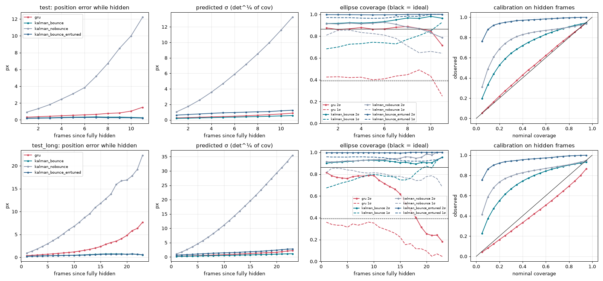
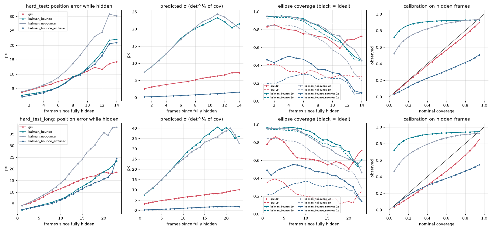

# Results: Object Permanence Olympics

All numbers come from real runs on the fixed held-out test splits (1000 sequences each, rendered
deterministically: the same frames go to every tracker). Pixel units are on the 64×64 frame. Ball radius is 3.5 px.

All three **Measure** items (reappearance error, identity switches, calibration of the predicted
location distribution) are measured below for both worlds. Nothing is marked "not measured".

## TL;DR
- **The learned tracker does have object permanence.** The CNN+GRU keeps reporting each ball while it
  is fully hidden. On in-distribution test occlusions its hidden-frame error is **0.44 px** (median
  0.35). Its uncertainty is **well calibrated**: 1σ/2σ ellipse coverage on hidden frames is
  **0.42 / 0.87**, against an ideal of 0.39 / 0.865.
- **A correctly specified Kalman filter still wins in the world it was built for.** In the base world (constant
  velocity, wall bounces, distinct colours) the filter's motion model is exactly the simulator's.
  With bounce reflection and a wall-aware detector, its hidden error is **0.25 px**, and its error just after
  reappearance is **0.26 px** (GRU: 0.36). Without bounce handling it falls to 2.12 px hidden error.
- **Longer occlusions than in training expose the network.** On `test_long` (walls 18–26 px vs.
  10–16 px in training) the GRU's error grows with time hidden (0.60 px → 1.62 px for 16+ frame
  occlusions), but its σ does not grow fast enough. 2σ coverage drops from 0.85 to **0.66**, so it is
  confidently wrong outside the occlusion lengths it was trained on. The Kalman filter's error stays flat at 0.35–0.58 px.
  A control model trained on walls covering those lengths is calibrated there (2σ 0.85 on 16+-frame occlusions),
  so this is a data-coverage effect, not a limit of the architecture.
- **Go-deeper world (identical balls, collisions, 30% secret velocity changes behind the wall):**
  the network is the **only calibrated tracker** (all-frame 2σ coverage 0.86, NLL 3.38 vs 6.81 / 489 for the two Kalman tunings; a wider val grid improves the NLL-tuned Kalman filter to 6.12, see "What didn't work" #4). It re-acquires balls that secretly turned much faster (reappear error 3.2 vs 7.1 px) and keeps its probability mass behind the wall (81% vs 33%). The Kalman filter is still more accurate on average (hidden error 4.3 vs 5.4 px). **Good failure:** the GRU learned "balls bounce off each other", so in a world where identical balls pass through each other it swaps their identities on 51% of touching sequences (Kalman: 5%).

## Setup (what was built)
| piece | details |
|---|---|
| data | `sim.py`. 64×64 RGB, 40 frames, 2–3 balls (r = 3.5 px, speed 0.6–2.2 px/frame per axis, elastic wall bounces), 1–2 full-height grey walls, Gaussian pixel noise σ = 0.02. Balls are fully visible in frames 0–1. Splits are fixed by seed: train 40k, val 1k, test 1k, **test_long** 1k (one 18–26 px wall; every sequence has at least one ≥8-frame occlusion that ends inside the clip). Mean completed occlusion: 4.2 frames in train/test (max 15) vs **10.3 frames in test_long** (p90 15, max 27). |
| hard variant | same, plus **identical yellow balls** (slot k = k-th ball from the left at frame 0, so identity has to come from motion), **ball–ball elastic collisions**, and **hidden turns**: when a ball becomes fully hidden, its velocity is redrawn with p = 0.3. Same split sizes and the same longer-occlusion test. |
| model | `model.py`. Per-frame CNN (5→32→64→64→64 channels, CoordConv x/y inputs, 3 stride-2 convs) → FC 512 → 1-layer **causal** GRU(256) → head on [GRU state, frame features] → per slot: mean (2), log σx, log σy, ρ (full 2×2 covariance). 2.99 M params. It only sees frames 0..t when predicting frame t, so the hidden-ball predictions involve no future leakage. |
| loss | Gaussian NLL, **β-NLL (β = 0.5)** weighting, normalized per slot, plus a mean-squared-error warm-up that decays to 0 by mid-training (see "what didn't work"). AdamW 1e-3, cosine decay, batch 32 sequences × 40 frames, mirror augmentation. |
| training | base: 12k steps in two process segments (steps 0–1.5k ≈ 7 min, then a resume to 12k ≈ 38 min, which shortened the schedule; see below). hard: 10.5k steps (stage 1, stopped by the 40-min guard) + warm-restart continuation to 20k steps (stage 2). |
| baseline | `kalman.py`. Colour-threshold detector plus constant-velocity Kalman filter per ball, fed a measurement only when the ball is detected; otherwise it coasts. The detector is **wall-aware**: if a blob is cut by a wall, x comes from the uncut edge ± R, with a 0.10 px edge offset calibrated on val. Measurement noise scales with 1/visible area. **Bounce handling: yes (`kalman_bounce`, reflects mean and covariance at the box edges) and no (`kalman_nobounce`); both are reported.** Occluders don't affect motion. For identical balls, connected components are assigned to tracks with the Hungarian algorithm on Mahalanobis distance (gated only when there are fewer detections than tracks). |
| fairness | Both trackers get the same noisy frames and output the same thing: a mean and full covariance per slot per frame. Kalman q and r were grid-searched (12 × 11 × bounce on/off = 264 configs) on **val** (300 sequences), never on test, selected by mean NLL over all ball-frames, which is the network's training objective. A second operating point tuned for hidden-frame error is also reported (`kalman_bounce_errtuned`). |

Metric definitions (`metrics.py`):
- **hidden err**: frames where the ball is 100% behind a wall.
- **last-hidden err**: the blind estimate on the last fully hidden frame of each completed occlusion.
  This is the cleanest "where will it come out" number.
- **reappear err**: the first frame the ball is partly visible again. Both trackers have already used that frame.
- **NLL**: 2-D Gaussian NLL in px (per-frame values clipped to ≤ 1e4 before averaging).
- **1σ / 2σ cov**: fraction of true positions inside the 1σ / 2σ ellipse. For a calibrated 2-D Gaussian
  that is **0.393 / 0.865**. Higher means under-confident; lower means over-confident.
- **ID switches**: a frame counts as identity-confused if some permutation of the predicted slots matches
  the true balls better than the identity assignment by more than 2 px (summed). A switch is an entry into that state.

## Base world (distinct colours, constant velocity + bounces)

**test** (1000 sequences; 2245 completed occlusions)

| tracker | visible err | hidden err (mean/median) | hidden NLL | hidden 1σ / 2σ cov | last-hidden err | reappear err | all-frame NLL | all 1σ / 2σ cov | ID switches /seq |
|---|---|---|---|---|---|---|---|---|---|
| gru | 0.12 | 0.44 / 0.35 | 0.56 | 0.42 / 0.87 | 0.54 | 0.36 | -1.30 | 0.63 / 0.94 | 0.000 |
| kalman_bounce | 0.07 | 0.25 / 0.16 | 0.05 | 0.72 / 0.92 | 0.28 | 0.26 | -1.48 | 0.84 / 0.95 | 0.000 |
| kalman_nobounce | 0.10 | 2.12 / 0.99 | 4.11 | 0.83 / 0.91 | 2.71 | 1.89 | -0.28 | 0.74 / 0.91 | 0.000 |
| kalman_bounce_errtuned | 0.08 | 0.22 / 0.12 | 1.18 | 0.97 / 1.00 | 0.25 | 0.23 | 0.42 | 0.99 / 1.00 | 0.000 |

Hidden-frame error (px) by occlusion length (frames fully hidden):

| tracker | 1-2 (n=449) | 3-4 (n=1004) | 5-7 (n=630) | 8-11 (n=148) | 12-15 (n=14) |
|---|---|---|---|---|---|
| gru | 0.38 (2σ 0.84) | 0.39 (2σ 0.88) | 0.43 (2σ 0.87) | 0.55 (2σ 0.88) | 1.04 (2σ 0.82) |
| kalman_bounce | 0.22 (2σ 0.93) | 0.22 (2σ 0.92) | 0.29 (2σ 0.91) | 0.27 (2σ 0.96) | 0.20 (2σ 1.00) |
| kalman_nobounce | 1.08 (2σ 0.91) | 1.52 (2σ 0.91) | 2.04 (2σ 0.93) | 3.86 (2σ 0.90) | 7.94 (2σ 0.79) |
| kalman_bounce_errtuned | 0.20 (2σ 1.00) | 0.20 (2σ 1.00) | 0.26 (2σ 0.99) | 0.23 (2σ 1.00) | 0.19 (2σ 1.00) |

**test_long** (1000 sequences; 1926 completed occlusions)

| tracker | visible err | hidden err (mean/median) | hidden NLL | hidden 1σ / 2σ cov | last-hidden err | reappear err | all-frame NLL | all 1σ / 2σ cov | ID switches /seq |
|---|---|---|---|---|---|---|---|---|---|
| gru | 0.12 | 0.90 / 0.59 | 1.91 | 0.33 / 0.76 | 1.64 | 0.84 | -0.51 | 0.54 / 0.89 | 0.000 |
| kalman_bounce | 0.07 | 0.37 / 0.20 | 1.04 | 0.74 / 0.92 | 0.50 | 0.42 | -0.78 | 0.81 / 0.94 | 0.000 |
| kalman_nobounce | 0.10 | 4.22 / 1.73 | 5.49 | 0.83 / 0.92 | 7.52 | 4.74 | 0.92 | 0.74 / 0.91 | 0.015 |
| kalman_bounce_errtuned | 0.09 | 0.35 / 0.17 | 1.92 | 0.95 / 1.00 | 0.50 | 0.42 | 0.88 | 0.98 / 1.00 | 0.000 |

Hidden-frame error (px) by occlusion length (frames fully hidden):

| tracker | 5-7 (n=323) | 8-11 (n=1063) | 12-15 (n=368) | 16-40 (n=172) |
|---|---|---|---|---|
| gru | 0.60 (2σ 0.85) | 0.71 (2σ 0.80) | 0.90 (2σ 0.77) | 1.62 (2σ 0.66) |
| kalman_bounce | 0.35 (2σ 0.88) | 0.33 (2σ 0.93) | 0.41 (2σ 0.92) | 0.58 (2σ 0.89) |
| kalman_nobounce | 2.49 (2σ 0.90) | 3.29 (2σ 0.92) | 4.71 (2σ 0.93) | 7.18 (2σ 0.95) |
| kalman_bounce_errtuned | 0.35 (2σ 1.00) | 0.33 (2σ 1.00) | 0.38 (2σ 1.00) | 0.55 (2σ 0.99) |

Kalman configs: {"kalman_bounce": {"q": 0.01, "r": 0.2, "bounce": true}, "kalman_nobounce": {"q": 0.5, "r": 0.14, "bounce": false}, "kalman_bounce_errtuned": {"q": 0.01, "r": 0.8, "bounce": true}}

*Columns: error while hidden, predicted σ, ellipse coverage, and a reliability diagram on hidden frames.
Top row: test. Bottom row: test_long.*

What the plots show:
- On in-distribution occlusions the GRU's reliability curve on hidden frames lies **on the diagonal**.
  It learned honest uncertainty from data alone. The NLL-tuned Kalman filter is under-confident at 1σ
  (0.72 coverage vs 0.39). With q pinned at the grid floor (0.01), extra width comes mostly from r. The
  error-tuned Kalman filter is under-confident everywhere.
- On `test_long`, after about 12 hidden frames (near the training maximum of 15; occlusions that long are rare in training)
  the GRU's error accelerates while its σ grows roughly linearly, so coverage collapses: 2σ coverage is 0.18 at 23
  frames hidden. **It extrapolates its motion model reasonably but its uncertainty model doesn't extrapolate.**
- The no-bounce Kalman filter shows why the motion model matters. Its σ grows the right way, but its mean
  sails through the box edge whenever a ball bounces while hidden.

### Control: is the long-occlusion overconfidence just missing data?
The same recipe was retrained on `train_wide` (walls 10–26 px, mean occlusion 6.6 frames, max 27), which covers `test_long`'s
range (`checkpoints/base_wide`, `results/eval_base_wide.json`, `media/curves_base_wide.png`). The 40-minute guard stopped it at step 10,032 of 12k
(LR 1.2e-4, not fully annealed), so it is slightly under-trained compared with `base`: in-distribution `test` hidden error is 0.55 vs 0.44 px.

| GRU on test_long | hidden err | hidden 1σ / 2σ cov | hidden NLL | last-hidden err | 16+-frame occlusions: err (2σ cov) |
|---|---|---|---|---|---|
| base (walls 10–16) | 0.90 | 0.33 / 0.76 | 1.91 | 1.64 | 1.62 (0.66) |
| base_wide (walls 10–26) | **0.74** | **0.43 / 0.87** | **1.52** | **1.15** | **0.99 (0.85)** |

**Calibration recovers completely once training covers those occlusion lengths.** 2σ coverage on 16+-frame occlusions goes from 0.66 to
0.85, so the failure in the TL;DR is a data-coverage effect, not a limit of the architecture: the uncertainty model
interpolates well and does not extrapolate. The Kalman filter (0.37 px) is still ~2× more accurate in this linear world.

## Go-deeper world: identical balls, collisions and secret turns behind the wall

The hard model is the same architecture and loss, trained on `hard_train`: stage 1 ran 10.5k steps, then a warm-restart
continuation brought it to 20k steps. The Kalman filters use Hungarian association and were re-tuned on `hard_val`.

**hard_test** (1000 sequences; 2085 completed occlusions)

| tracker | visible err | hidden err (mean/median) | hidden NLL | hidden 1σ / 2σ cov | last-hidden err | reappear err | all-frame NLL | all 1σ / 2σ cov | ID switches /seq |
|---|---|---|---|---|---|---|---|---|---|
| gru | 2.27 | 5.44 / 3.77 | 5.55 | 0.37 / 0.81 | 6.00 | 3.52 | 3.38 | 0.44 / 0.86 | 0.153 |
| kalman_bounce | 2.22 | 4.29 / 1.12 | 8.75 | 0.91 / 0.93 | 4.38 | 4.80 | 6.81 | 0.93 / 0.94 | 0.181 |
| kalman_nobounce | 2.47 | 6.57 / 3.11 | 8.54 | 0.82 / 0.93 | 6.57 | 6.92 | 6.57 | 0.90 / 0.95 | 0.156 |
| kalman_bounce_errtuned | 1.82 | 3.85 / 0.67 | 385.42 | 0.22 / 0.45 | 3.65 | 4.12 | 488.91 | 0.30 / 0.61 | 0.158 |

Hidden-frame error (px) by occlusion length (frames fully hidden):

| tracker | 1-2 (n=665) | 3-4 (n=777) | 5-7 (n=496) | 8-11 (n=120) | 12-15 (n=20) | 16-40 (n=7) |
|---|---|---|---|---|---|---|
| gru | 4.25 (2σ 0.79) | 4.72 (2σ 0.81) | 5.02 (2σ 0.83) | 6.53 (2σ 0.80) | 7.11 (2σ 0.77) | 10.83 (2σ 0.77) |
| kalman_bounce | 3.59 (2σ 0.93) | 3.15 (2σ 0.95) | 2.86 (2σ 0.97) | 5.17 (2σ 0.93) | 9.70 (2σ 0.77) | 14.84 (2σ 0.73) |
| kalman_nobounce | 4.69 (2σ 0.93) | 4.74 (2σ 0.95) | 4.77 (2σ 0.96) | 8.87 (2σ 0.94) | 12.09 (2σ 0.79) | 24.08 (2σ 0.68) |
| kalman_bounce_errtuned | 2.54 (2σ 0.40) | 2.41 (2σ 0.46) | 2.87 (2σ 0.53) | 4.79 (2σ 0.40) | 8.58 (2σ 0.37) | 14.82 (2σ 0.17) |

Hidden occlusions split by whether the ball secretly changed velocity behind the wall:

| tracker | turned: hidden err | turned: NLL | turned: 2σ cov | turned: reappear err | straight: hidden err | straight: NLL | straight: 2σ cov | straight: reappear err |
|---|---|---|---|---|---|---|---|---|
| gru | 5.32 | 5.31 | 0.80 | 3.23 | 5.15 | 5.51 | 0.82 | 3.66 |
| kalman_bounce | 5.77 | 8.43 | 0.94 | 7.07 | 3.11 | 8.01 | 0.94 | 3.73 |
| kalman_nobounce | 7.07 | 8.24 | 0.95 | 7.80 | 5.46 | 8.09 | 0.94 | 6.51 |
| kalman_bounce_errtuned | 5.38 | 435.10 | 0.18 | 6.43 | 2.62 | 293.27 | 0.55 | 3.03 |

**hard_test_long** (1000 sequences; 1992 completed occlusions)

| tracker | visible err | hidden err (mean/median) | hidden NLL | hidden 1σ / 2σ cov | last-hidden err | reappear err | all-frame NLL | all 1σ / 2σ cov | ID switches /seq |
|---|---|---|---|---|---|---|---|---|---|
| gru | 3.14 | 8.42 / 6.54 | 6.71 | 0.29 / 0.73 | 11.51 | 6.36 | 4.36 | 0.42 / 0.84 | 0.303 |
| kalman_bounce | 2.43 | 5.42 / 1.67 | 8.81 | 0.91 / 0.94 | 7.18 | 6.88 | 7.19 | 0.93 / 0.95 | 0.237 |
| kalman_nobounce | 3.21 | 10.26 / 5.55 | 9.22 | 0.79 / 0.92 | 14.12 | 13.12 | 7.51 | 0.87 / 0.94 | 0.290 |
| kalman_bounce_errtuned | 3.35 | 5.10 / 1.02 | 310.73 | 0.29 / 0.50 | 6.24 | 6.53 | 513.54 | 0.29 / 0.56 | 0.261 |

Hidden-frame error (px) by occlusion length (frames fully hidden):

| tracker | 1-2 (n=281) | 3-4 (n=24) | 5-7 (n=278) | 8-11 (n=882) | 12-15 (n=323) | 16-40 (n=204) |
|---|---|---|---|---|---|---|
| gru | 4.27 (2σ 0.79) | 7.86 (2σ 0.72) | 6.95 (2σ 0.73) | 7.15 (2σ 0.73) | 8.51 (2σ 0.73) | 10.92 (2σ 0.69) |
| kalman_bounce | 2.31 (2σ 0.98) | 6.10 (2σ 0.83) | 4.58 (2σ 0.96) | 3.93 (2σ 0.97) | 5.32 (2σ 0.95) | 7.87 (2σ 0.91) |
| kalman_nobounce | 4.66 (2σ 0.97) | 9.45 (2σ 0.84) | 7.39 (2σ 0.93) | 7.34 (2σ 0.96) | 9.95 (2σ 0.93) | 15.28 (2σ 0.87) |
| kalman_bounce_errtuned | 2.65 (2σ 0.43) | 5.15 (2σ 0.24) | 4.17 (2σ 0.41) | 3.02 (2σ 0.58) | 5.16 (2σ 0.49) | 7.40 (2σ 0.46) |

Hidden occlusions split by whether the ball secretly changed velocity behind the wall:

| tracker | turned: hidden err | turned: NLL | turned: 2σ cov | turned: reappear err | straight: hidden err | straight: NLL | straight: 2σ cov | straight: reappear err |
|---|---|---|---|---|---|---|---|---|
| gru | 8.92 | 7.03 | 0.70 | 5.66 | 7.98 | 6.59 | 0.73 | 6.64 |
| kalman_bounce | 9.36 | 8.44 | 0.96 | 9.34 | 3.98 | 8.52 | 0.95 | 5.89 |
| kalman_nobounce | 12.32 | 8.89 | 0.94 | 12.83 | 8.82 | 8.75 | 0.93 | 13.23 |
| kalman_bounce_errtuned | 9.77 | 362.04 | 0.10 | 10.47 | 3.15 | 208.51 | 0.63 | 4.94 |

Kalman configs: {"kalman_bounce": {"q": 0.8, "r": 5.0, "bounce": true}, "kalman_nobounce": {"q": 0.8, "r": 5.0, "bounce": false}, "kalman_bounce_errtuned": {"q": 0.035, "r": 0.07, "bounce": true}}

What changes when the world stops being linear-Gaussian:
- **Only the GRU has honest uncertainty.** All-frame 2σ coverage is 0.86 (ideal 0.865) and all-frame NLL is **3.38**,
  against 6.81 for the NLL-tuned Kalman filter (6.12 after the reviewer's wider grid, see "What didn't work" #4) and 489 for the error-tuned one. The Kalman filter can be accurate *or* calibrated, not both.
  Its NLL-optimal setting (r = 5 px) is under-confident everywhere (1σ coverage 0.93). Its accurate setting
  (r = 0.07 px) is confidently wrong after every identity swap or hidden turn: 2σ coverage on hidden frames
  is 0.45, and only 0.18 on occlusions where the ball turned.
- **Accuracy: the Kalman filter still wins on mean position error** (hidden 3.85–4.29 px vs 5.44; visible median 0.15 vs 0.93 px).
  The GRU's localization is ~6× less precise than the base model's (0.93 vs 0.17 px median on visible balls).
  This isn't identity confusion: the permutation-invariant visible median is also 0.93 px. *Cross-review caveat:* much of this is the
  identity *convention*, expressed as hedging rather than swapping (which a permutation-invariant metric can't see). When two balls
  start at almost the same x, "k-th from the left" is ambiguous from pixels and the GRU puts both slots near their midpoint. On
  `hard_test`, its visible error is 6.6 px (median 3.5) for the 69 sequences whose frame-0 x-gap is < 1 px, against 1.2 px (median 0.70) for
  the 576 with gap > 8 px. Even the clean cases (0.70 px median) are ~7× the base model's test visible median of 0.10 px (`results/eval_base.json`; the 0.17 px quoted above matches the base model's *val mean* error, not a test median), so binding does cost precision too. Binding "the k-th ball from the
  left at frame 0" to a slot costs precision, and the model was still improving when training stopped (val error 3.4 → 2.7 px over stage 2).
- **Hidden turns.** The GRU's hidden error is the same whether or not the ball turned (5.32 vs 5.15 px). It
  hedges, which is the right thing to do because nothing in the frames reveals the turn. The Kalman filter bets on a straight line:
  3.11 px when it's right and 5.77 px when it's wrong. After reappearance the GRU re-acquires a turned ball
  much faster: reappear error **3.23 vs 7.07 px**.
- **Error growth while hidden** (plot, column 1): the GRU's error grows roughly linearly, while the Kalman
  filter's grows faster (velocity errors from collisions and turns compound). They cross at ~9 hidden frames on
  `hard_test` and ~20 on `hard_test_long`. On `hard_test_long` the GRU is again over-confident for long occlusions
  (2σ coverage on hidden frames 0.73).
- **The GRU knows where a hidden ball can be.** On hidden frames of `hard_test_long`, **81%** of the GRU's
  x-probability mass lies inside the wall that hides the ball, against **33%** for the Kalman filter. Its
  ellipses are tall and narrow (median σx/σy = 0.55) because a fully hidden ball must be behind the wall, so x is bounded while y isn't.
  The Kalman filter's ellipses are round (σx/σy = 1.00) and spill into visible space where the ball demonstrably is not.
  In the base world both trackers are tight enough that this barely matters (98% vs 97%). See `results/shape_analysis.json`.

### Identity, and a learned physics prior that backfires
Identity switches on `hard_test`: GRU 0.153 per sequence, Kalman variants 0.156–0.181. On `hard_test_long`: GRU 0.303,
Kalman variants 0.237–0.290. To see which ingredient matters, the *same* hard model was evaluated (no retraining) on
test worlds with one factor at a time (`evaluate.py --splits abl_*`, `results/eval_hard_ablation.json`). The
Kalman filters keep their `hard_val`-tuned q/r. Nothing was re-tuned per ablation world, so both trackers are applied
out of distribution in the same way:

| test world | tracker | visible err (mean / median) | hidden err | all-frame NLL | all 2σ cov | ID switches /seq |
|---|---|---|---|---|---|---|
| identical only | gru | 4.23 / 1.07 | 6.89 | 17.48 | 0.80 | 0.416 |
| identical only | kalman_bounce | 0.91 / 0.12 | 1.72 | 5.32 | 0.99 | 0.061 |
| identical only | kalman_bounce_errtuned | 0.37 / 0.07 | 1.27 | 72.56 | 0.70 | 0.033 |
| identical + collisions | gru | 2.34 / 0.97 | 5.65 | 3.33 | 0.87 | 0.170 |
| identical + collisions | kalman_bounce | 1.88 / 0.13 | 3.86 | 6.42 | 0.95 | 0.162 |
| identical + collisions | kalman_bounce_errtuned | 1.87 / 0.07 | 3.40 | 472.44 | 0.62 | 0.149 |
| identical + hidden turns | gru | 4.33 / 1.10 | 7.21 | 23.64 | 0.80 | 0.416 |
| identical + hidden turns | kalman_bounce | 1.40 / 0.13 | 2.66 | 5.87 | 0.97 | 0.095 |
| identical + hidden turns | kalman_bounce_errtuned | 0.65 / 0.07 | 1.66 | 142.32 | 0.67 | 0.058 |
| full hard (identical + collisions + turns) | gru | 2.27 / 0.93 | 5.44 | 3.38 | 0.86 | 0.153 |
| full hard (identical + collisions + turns) | kalman_bounce | 2.22 / 0.15 | 4.29 | 6.81 | 0.94 | 0.181 |
| full hard (identical + collisions + turns) | kalman_bounce_errtuned | 1.82 / 0.08 | 3.85 | 488.91 | 0.61 | 0.158 |

**The GRU is worst in the *easiest* world.** With identical balls and **no** collisions, balls pass through each
other. That never happens in its training data, where balls always bounce off each other. On sequences where two balls touch, the GRU
ends with swapped identities **51%** of the time (Kalman: 5%). It confidently "bounces" balls that actually
crossed. On sequences with no contact both are fine (3.7% vs 0.4%). Where collisions *are* real, the GRU's learned physics beats
the constant-velocity filter on touching sequences: 0.26 vs 0.31 switches per sequence, 14% vs 28% swapped at the end
(`results/identity_by_contact.json`). The hidden-turn-only world shows the same thing, because it also lacks collisions.
Clip: `media/demo_hard_crossing_swap_abl_ident.gif`.
This is the good kind of failure. The network learned a real regularity of its world (balls bounce off each other)
and applies it where it doesn't hold.

## What didn't work (kept on purpose)
1. **Plain Gaussian NLL collapsed slots** (`logs/failed/train_base_plainNLL.log`,
   `checkpoints/failed_base_plainNLL_step2500/`). After 2500 steps the red slot tracked at 0.3 px.
   Green and blue had "given up": σ ≈ 17 px, mean ≈ 24 px off, roughly the frame centre. The NLL kept falling
   (val NLL −1.8) because the model is rewarded for confidently fitting one slot and putting huge variance on the
   others. With σ that large, the mean gradient is ∝ 1/σ², so those slots never recover. Fixes, in order of
   effect: β-NLL (β = 0.5) plus an MSE warm-up got 2 of 3 slots in 800 steps. **Per-slot loss normalization**
   finished the job: slot 2 is absent in about half the sequences, so it got half the gradient. After that,
   all three slots reached ~1.4 px in 1000 steps.
2. **The mirror augmentation broke the identical-ball labels** (`logs/failed/train_hard_flipbug.log`).
   For identical balls, slot = left-to-right order at frame 0, and a horizontal flip reverses that order.
   Half the batches contradicted the other half, so the model sat at ~16 px for 3000 steps. Fixed by re-sorting slots after flipping.
3. **GPU contention.** With 12 projects sharing 4 GPU slots, step time varied from 55 to 225 ms. The first
   successful base launch (20k-step schedule) would have broken the 45-minute rule, so it was stopped at its
   step-1500 checkpoint and resumed with a 12k-step cosine schedule and a 40-minute wall-clock guard. The
   resume was verified beforehand: kill at step 200, resume, val NLL keeps falling.
4. The Kalman tuning on the hard variant runs into the **grid edge at r = 5 px** (measurement σ of 5 px for a
   ball you can see perfectly). That isn't a tuning bug. Mean NLL is dominated by rare catastrophic identity swaps, where a
   tight Gaussian sits on the wrong ball, so the NLL-optimal filter learns to distrust its own detector. That
   is why the error-tuned operating point is reported too. It is much more accurate and catastrophically over-confident.
   *Cross-review check:* extending the grid on `hard_val` (r up to 30, q 0.35–2) moves the NLL optimum to
   q = 0.5, r = 7 (val NLL 6.06 vs 6.41). On `hard_test` that filter gets all-frame NLL **6.12** (vs 6.81 in the table),
   2σ coverage 0.96, hidden error 4.91 px, turned-ball reappear error 7.03 px. The GRU's 3.38 still wins by a wide margin, so
   no conclusion changes. The error-tuned point (r = 0.07) is also on a grid edge, but r = 0.03/0.05 are not better on val.

## Surprises
- The Kalman filter's biggest single improvement wasn't tuning. It was the **wall-aware detector**. On val (300 sequences,
  bounce filter, each version tuned on a small q/r grid), hidden error is 1.21 px with the naive centroid of the
  visible sliver and **0.28 px** with the wall-aware estimate. Half-hidden balls give a biased centroid right
  when the filter is estimating the velocity it will coast on.
- The GRU's coverage numbers on in-distribution hidden frames are close to ideal **without any post-hoc
  calibration**, despite the β-NLL reweighting.

## Next steps
- Covering longer occlusions in training fixes calibration there (control above). The open question is whether *any*
  architecture choice (e.g. an explicit "time since last seen" input, or a σ head that grows with it) extrapolates σ past the training range.
- Give the network an explicit binding mechanism (slot attention, or feeding back its own previous
  estimates) for identical balls. Compare against a proper multi-hypothesis or IMM tracker, which is the fair classical
  opponent for hidden velocity changes.
- Mixture-of-Gaussians output for hidden turns: the true posterior after a possible turn is multi-modal.

## Gaps
- No packages were missing. Training time per run was capped by GPU contention, so neither model is trained to convergence. The hard model was still improving.

## Round 5: Remember several possibilities, then look

### TL;DR (plain language; Claude review, 2026-10-24)

- **The identity fix worked.** Turn 2 gave every tracked ball its own copy of the same small network, fed with that ball's
  frame-0 position. Swapping the cues now swaps the outputs exactly (equivariance error 0.0 px; turn 1: 19.6 px). Balls that
  start almost side by side (x-gap < 1 px, 48 sequences) are now tracked to **0.42–0.46 px** while visible. In turn 1 the
  error was 5.2–5.5 px. Final identity swaps fell to 1.4–1.6% of sequences (turn 1: 7–11%).
- **But the "physics-aware" particle filter was starved, not beaten.** Astra's filter models the joint state of all balls,
  collisions and secret turns correctly, but it ran with a fixed **512 particles** (never tuned). Its effective sample
  size fell to about 3% of the particles in a typical sequence. With **4096 particles** and a quick validation-only retune
  (reviewer run, labelled separately), it is within about 0.1 px of the GRUs on visible balls (0.52 vs 0.41/0.46 px).
  It is level on hidden balls (3.15 vs 3.18/3.33 px) and on identity (0.025 switches per sequence vs 0.023/0.037). With
  uncertainty-chosen looks it has the lowest hidden error of any tracker (2.41 px). **Against a fairly resourced filter,
  the learned models' tracking advantage shrinks to about 0.1 px on visible balls and about 0.3 px on near-tie starts
  (x-gap < 1: 0.42–0.46 vs 0.75 px), with hidden error and identity tied.** A 16384-particle run got 0.25 px visible
  error on validation, but it was not evaluated on the fresh set.
- **What the learned models clearly win:** the error just after a ball comes back out (1.15–1.27 px vs 2.6–3.2 px).
  The mixture also wins on probability quality. Its median per-sequence NLL is −0.10, against 2.24 for the strengthened
  filter and 0.28 for the Gaussian GRU. Part of the filter's gap comes from its crude fixed-width output density, not
  from its tracking.
- **Good failure: the Gaussian GRU's all-frame NLL of 7.05 comes from three sequences.** In each, a query loses its ball
  (a ball stalls behind a wall after a pile-up, or two balls come out of the same wall). The query then sits on the
  *other* visible ball with σ ≈ 0.3 px while 20–30 px off. The worst 47 frames (0.1%) carry 91% of its total NLL, and the
  per-frame median is 0.03. Because the per-ball queries do not know about each other, two of them can claim the same
  ball. That happens in 9 (Gaussian) and 14 (mixture) of 512 sequences. The mixture fails the same way, but its spare
  modes keep the penalty bounded (worst frame 24 nats). "Mixture 0.19 vs Gaussian 7.05" is a difference in tails, not
  in typical tracking.
- **Looking once helps a little, and choosing *when* to look helps the learned trackers almost not at all.** One look
  removes most of the spread at that frame (mixture 1.85 → 0.47 px²). For the mixture, uncertainty-timed beats
  random-timed by only 0.037 nats/frame [95% CI 0.019–0.058], with the same later-error gain (0.09 vs 0.10 px). That is
  statistically reliable but practically negligible. The Gaussian contrasts are noise from the three outlier sequences.
  The filters' bigger gains are mostly artefacts of tails and particle collapse (details below).
- Caveats: one training seed, and the architecture and training length (6k → 120k steps) changed together. Both GRUs
  also carry 20k steps of pretraining.

### Turn 2 (final): setup and actual compute

- **Model.** `BoundCueTracker` (`r5_turn2_model.py`): a CNN encodes each video once. The same GRU and head weights then
  run once per query, with that query's noisy frame-0 cue (σ 0.25 px), presence, object count and wall geometry at every
  step, in the initial state and in the head. Both heads (K=1 Gaussian, K=3 full-covariance mixture) copy the same
  original `hard/final` CNN/GRU (SHA-256 `3ad40681…a32`) and the same new cue-path initialisation. Query order is permuted
  in training.
- **Training.** 120,000 paired batch-8 steps (960k clips per head ≈ 24 passes over the 40k `hard_train`), with random
  one-wall looks in 2/3 of clips. Three resumed segments: 1953.6 + 1801.5 + 1422.8 s = **86.3 min active**
  ([t2_train_ac_1](logs/r5/t2_train_ac_1.log)/[2](logs/r5/t2_train_ac_2.log)/[3](logs/r5/t2_train_ac_3.log),
  [selection.json](checkpoints/r5_t2_ac/selection.json)). The paired best step was chosen on `hard_val[256:384]` by the mean
  of both heads' val NLL: **step 100000** (pair 0.438; Gaussian 0.902, mixture −0.025).
- **Validation curve (same log).** Gaussian val NLL is spiky: 8.52 at 40k, 13.75 at 80k, 0.90 at 100k, 4.83 at 101k, 2.50
  at 120k. The mixture falls steadily: 1.94, 0.67, −0.025, 0.016, **−0.256 at 120k**. So the selected step is a Gaussian
  trough, and the mixture is reported from a step that was not its own best. Visible val error at 100k is 0.39 px
  (Gaussian) and 0.43 px (mixture).
- **Cue probes** on `hard_val[384:416]` ([t2_probe_turn1.json](results/r5/t2_probe_turn1.json),
  [t2_probe_selected.json](results/r5/t2_probe_selected.json)). Permuting the cues moves the turn-1 model's outputs by a
  mean of 19.6 px (it was **not** equivariant). The turn-2 model gives 0.0 px for both heads. Replacing every cue with the cues' mean (an
  out-of-distribution ablation) changes outputs after frame 3 by 0.40/0.35 px in turn 1 and by 15.2/15.0 px in turn 2.
  Turn 1 largely ignored the cue after the first frames.
- **Classical tuning (Astra's protocol).** 424 candidates in 266.3 s on `hard_val[0:24]`, confirmed on `[64:128]`
  ([t2_tuning_ac.json](results/r5/t2_tuning_ac.json)). PF selection: q=0.5, r=1, miss=0.35, bandwidth 4 px, all
  interior. **The particle count was fixed at 512 and never searched**, so `boundary_parameters: []` hides the binding
  constraint (see the strengthened PF below). Kalman: q=0.5, r=14.
- **Thresholds and evaluation.** Thresholds are each tracker's 75th percentile on `hard_val[128:160]`
  ([t2_thresholds_ac.json](results/r5/t2_thresholds_ac.json)). The headline is **512 new sequences, seeds 52024000+i**,
  complete in 126.8 s ([t2_fresh_ac.json](results/r5/t2_fresh_ac.json)). The secondary set is `hard_test[0:64]` in 15.2 s
  ([t2_legacy_ac.json](results/r5/t2_legacy_ac.json)). The turn-2 smoke, including SIGKILL/resume, passed in 9 s
  ([t2_smoke.log](logs/r5/t2_smoke.log)).
- **Reviewer-strengthened particle filter (separately labelled).** The code and physics are unchanged. Only the compute
  and settings differ: 4096 particles; q ∈ {0.15, 0.3, 0.5} × miss ∈ {0.2, 0.35} × KDE bandwidth ∈ {0.5, 1, 1.5, 2.5, 4}
  were searched on the untouched `hard_val[160:224]`. Selected: q=0.3, r=1, miss=0.35, bandwidth 0.5 px. **The bandwidth is
  at the grid's lower edge.** Sources: [review_pf4096_sweep.json](results/r5/review_pf4096_sweep.json) and
  [review_pf4096_tuning.json](results/r5/review_pf4096_tuning.json). Thresholds were recalibrated on `hard_val[128:160]`
  ([review_pf4096_thresholds.json](results/r5/review_pf4096_thresholds.json)). Kalman settings are unchanged. Fresh 512
  took 465.6 s; inference is 0.089 s per sequence vs 0.006 s for a GRU
  ([review_pf4096_fresh.json](results/r5/review_pf4096_fresh.json), [legacy](results/r5/review_pf4096_legacy.json)).
  The GRUs got about 86 min of GPU fine-tuning plus pretraining. The filter got about 1.5 min of CPU tuning.

### Turn 2 headline: 512 fresh sequences (seeds 52024000+i)

Sources: rows 1–12 from [t2_fresh_ac.json](results/r5/t2_fresh_ac.json) `summary.<tracker>.<policy>`, PF-4096 rows from
[review_pf4096_fresh.json](results/r5/review_pf4096_fresh.json). The per-sequence median NLL comes from
`per_sequence.*.all.nll` (recomputed in [review_diagnostics.json](results/r5/review_diagnostics.json)
`per_sequence_nll`). Errors, NLL and coverage are weighted by object-frames (visible n=31,355, hidden 4,495, reappear
1,095). Identity is averaged per sequence. "PF-512" is Astra's filter; "PF-4096" is the reviewer-strengthened one.

| Tracker / policy | Visible px | Hidden px | Reappear px | All NLL (mean) | All NLL (per-seq median) | Hidden NLL | All C1 / C2 | Hidden C1 / C2 | Switches/seq | Final swaps |
|---|---:|---:|---:|---:|---:|---:|---:|---:|---:|---:|
| gaussian / never | 0.408 | 3.182 | 1.274 | 7.047 | 0.281 | 16.132 | 0.404 / 0.846 | 0.342 / 0.782 | 0.023 | 1.37% |
| gaussian / random | 0.395 | 2.947 | 1.194 | 6.306 | 0.268 | 8.279 | 0.404 / 0.846 | 0.344 / 0.780 | 0.020 | 1.56% |
| gaussian / uncertainty | 0.406 | 2.889 | 1.152 | 7.360 | 0.250 | 12.785 | 0.402 / 0.845 | 0.334 / 0.774 | 0.021 | 1.56% |
| mixture / never | 0.461 | 3.330 | 1.252 | 0.191 | −0.101 | 4.165 | 0.446 / 0.870 | 0.342 / 0.788 | 0.037 | 1.56% |
| mixture / random | 0.443 | 3.045 | 1.169 | 0.172 | −0.109 | 4.044 | 0.445 / 0.871 | 0.339 / 0.791 | 0.029 | 1.37% |
| mixture / uncertainty | 0.386 | 3.080 | 1.178 | 0.133 | −0.113 | 3.833 | 0.444 / 0.871 | 0.329 / 0.784 | 0.025 | 1.56% |
| kalman / never | 3.259 | 7.167 | 7.856 | 6.282 | 5.946 | 7.565 | 0.897 / 0.968 | 0.892 / 0.961 | 0.180 | 16.80% |
| kalman / random | 3.203 | 6.788 | 7.307 | 6.241 | 5.935 | 7.465 | 0.899 / 0.969 | 0.895 / 0.963 | 0.172 | 16.02% |
| kalman / uncertainty | 3.244 | 6.433 | 6.648 | 6.254 | 5.914 | 7.421 | 0.899 / 0.968 | 0.901 / 0.964 | 0.170 | 16.21% |
| PF-512 / never | 1.792 | 4.904 | 5.480 | 5.688 | 4.789 | 6.253 | 0.914 / 0.949 | 0.746 / 0.912 | 0.125 | 7.81% |
| PF-512 / random | 2.021 | 4.792 | 5.334 | 5.904 | 4.776 | 6.291 | 0.914 / 0.944 | 0.765 / 0.906 | 0.141 | 8.59% |
| PF-512 / uncertainty | 1.408 | 4.360 | 4.449 | 5.376 | 4.758 | 6.061 | 0.933 / 0.963 | 0.788 / 0.926 | 0.111 | 6.05% |
| **PF-4096 (review) / never** | 0.520 | 3.145 | 3.205 | 8.813 | 2.239 | 14.989 | 0.838 / 0.965 | 0.591 / 0.923 | 0.025 | 1.76% |
| **PF-4096 (review) / random** | 0.550 | 2.909 | 3.089 | 10.525 | 2.194 | 15.180 | 0.844 / 0.964 | 0.632 / 0.928 | 0.027 | 1.76% |
| **PF-4096 (review) / uncertainty** | 0.435 | 2.407 | 2.580 | 5.339 | 2.131 | 6.464 | 0.853 / 0.968 | 0.656 / 0.933 | 0.020 | 1.17% |

**Binding check (never-peek visible error by initial x-gap, same files, `visible_by_initial_xgap`).** For x-gap < 1 px
(48 sequences): Gaussian 0.458, mixture 0.416, Kalman 2.904, PF-512 2.626, PF-4096 0.747 px. For x-gap ≥ 8 px (280
sequences): 0.322, 0.318, 3.311, 1.396, 0.375 px. In turn 1 (different seeds, 6 sequences), the < 1 px bin was 5.46
(Gaussian) and 5.18 (mixture) px.

**Legacy secondary (`hard_test[0:64]`, never-peek; [t2_legacy_ac.json](results/r5/t2_legacy_ac.json),
[review_pf4096_legacy.json](results/r5/review_pf4096_legacy.json)).** Visible / hidden / reappear px, all NLL,
switches/seq:
- Gaussian: 0.436 / 2.803 / 1.201, NLL 0.596, 0.016 switches
- Mixture: 0.389 / 2.733 / 0.938, NLL 0.165, 0.016 switches
- Kalman: 3.847 / 8.363 / 8.247, NLL 6.318, 0.203 switches
- PF-512: 1.511 / 4.700 / 5.114, NLL 5.256, 0.125 switches
- PF-4096: 0.374 / 3.074 / 3.254, NLL 2.429, 0.016 switches

The Gaussian's catastrophic tail does not occur in these 64 sequences.

### Why the 512-particle filter looked weak (reviewer diagnosis)

- **The structure is right; it ran out of particles.** `r5_classical.particle_track` is a *joint* filter. One particle is
  a full 2–3-ball state, moved by the simulator's own move/bounce/elastic-collision/hidden-turn transition, and scored with
  an exact sum over detection-to-ball assignments (misses and clutter included). It can represent collisions and
  identity. The per-slot Kalman with Hungarian assignment is the structurally weak baseline. But PF-512 collapses: its
  median per-sequence minimum ESS is 3.2% of particles (≈16), and the 5th-percentile sequence falls to ≈2 particles
  (`per_sequence.particle.never[*].diagnostics.min_ess_fraction`). There is no rejuvenation or MCMC move step and no
  re-initialisation from unexplained detections. Once the cloud commits to the wrong hidden trajectory, it cannot recover.
- **The error is a tail, not imprecision.** PF-512's median visible error is 0.44 px, but 5.6% of visible frames are off
  by > 3 px (p99 38.5 px) and carry 71% of its visible error. 1,326 of those 1,757 frames come after the ball was hidden
  ([review_diagnostics.json](results/r5/review_diagnostics.json) `tails`). The tuned q = 0.5 px/frame velocity noise and
  4 px KDE are compensations for the collapse. The simulator has no velocity noise outside turns.
- **Particle-count scaling** (same code, `hard_val[160:224]`,
  [review_pf_scaling.json](results/r5/review_pf_scaling.json)), visible error and hidden error:
  - 512 particles: 1.91 px visible, 4.76 px hidden
  - 4096 particles: 0.46 px visible, 3.55 px hidden
  - 4096 particles with q = 0.15: 0.37 px visible, 2.44 px hidden
  - 16384 particles: 0.25 px visible, 2.75 px hidden

  Switches per sequence fall from 0.156 to 0.016–0.031. The baseline was compute-limited. The 16384-particle result is
  validation-only and was not evaluated on the fresh set. A fair final opponent should
  also add a resample-move step (or a detection-driven birth proposal) and an adaptive output density.
- **The NLL comparison is partly a density-format handicap.** The PF reports a fixed isotropic Gaussian KDE. At 4 px
  bandwidth, even a perfectly placed visible-ball estimate cannot score below about log(2π·16) ≈ 4.6 nats, so PF-512's
  visible NLL of 5.59 sits on that floor. At 0.5 px, the PF-4096 median is good (2.24/sequence), but rare lost tracks
  give 600+ nat sequences and a mean of 8.8. Neither bandwidth is right for both visible and hidden frames.

### Good failure: confident identity loss (Gaussian) and two queries on one ball

- In 3 of 512 fresh sequences, the Gaussian GRU puts a query on the wrong ball with σ ≈ 0.3–0.4 px while 20–30 px away.
  Those are sequences 198, 453 and 401, with per-sequence NLL 1670, 909 and 292. Seven sequences contain frames with
  NLL > 50 (61 frames); the worst 47 frames alone carry 91% of all its NLL. Excluding them, its mean NLL is 0.58. Its median frame NLL is
  0.03, and its 10%-trimmed per-sequence NLL is 0.35 (the mixture's is −0.03). Source:
  [review_diagnostics.json](results/r5/review_diagnostics.json) `tails["gaussian/never"]`.
- **Sequence 401** ([strip](media/r5_t2_review_gaussian_overconfident_seq401.png)): three balls meet behind one wall, and
  a collision almost stops one of them there. Both GRUs move that query onto a ball that leaves the wall. The Gaussian
  does so with a tiny ellipse, and the mixture spreads mass. PF-512 also loses this ball, but with a broad ellipse instead of a confident one.
- **Sequence 198** ([strip](media/r5_t2_review_two_queries_one_ball_seq198.png)): a ball turns secretly behind the wall
  while a second ball is also hidden. When they come out, both GRU queries lock onto the same ball for the rest of the
  clip. The queries run independently and nothing enforces "one ball per query". The diagnostic counts frames where two
  slots sit within 2 px of each other while their balls are > 10 px apart. That happens in 9 (Gaussian) and 14
  (mixture) of 512 sequences, against 2 for PF-512 and 6 for Kalman.
- The mixture does not track better: on visible frames it is 0.46 vs 0.41 px, and on hidden frames 3.33 vs 3.18 px.
  Median hidden-frame NLL is about the same (3.76 vs 3.72). Its NLL advantage is sharper visible densities (median
  visible frame −0.95 vs −0.41) plus bounded tails. The planned mixture-minus-Gaussian hidden-NLL contrast is −5.51
  [−14.16, −0.04] (`contrasts`). That is outlier mass, not a typical-sequence effect. On legacy it is −0.008
  [−0.33, +0.22].

### Did a look help? (turn 2)

Sources: `summary.<tracker>.<policy>.peek` and `contrasts` in the fresh files above. Spread is the trace of the predictive
covariance at the look frame, before → after. For the PFs it includes the constant KDE term 2·bw² (32 px² at bw 4, 0.5 px²
at bw 0.5). Gains are relative to never-peek on frames after the look. Positive is better. The U−R column is the
per-sequence mean all-frame NLL, uncertainty minus random (negative favours uncertainty), with 95% bootstrap CIs over
sequences.

| Tracker | Random: spread px² | Random: later err / NLL gain | Uncertainty: spread px² | Uncertainty: later err / NLL gain | Fresh U−R [CI] | Legacy U−R [CI] |
|---|---|---|---|---|---|---|
| gaussian | 1.58 → 0.40 | 0.079 / +1.62 [−0.11, 5.10] | 1.44 → 0.21 | 0.038 / −1.10 [−7.51, 3.27] | +1.45 [−1.90, 5.96] | −0.064 [−0.129, −0.019] |
| mixture | 2.64 → 1.17 | 0.097 / +0.026 [0.001, 0.059] | 1.85 → 0.46 | 0.092 / +0.036 [0.011, 0.070] | **−0.037 [−0.058, −0.019]** | −0.034 [−0.049, −0.018] |
| kalman | 188.9 → 138.7 | 0.213 / +0.077 | 239.1 → 157.5 | 0.183 / +0.035 [−0.062, 0.132] | +0.017 [−0.048, 0.084] | −0.049 [−0.117, −0.012] |
| PF-512 | 38.2 → 35.0 | **−0.228 / −0.313 [−0.561, −0.085]** | 42.6 → 34.7 | 0.522 / +0.369 [0.102, 0.648] | −0.446 [−0.674, −0.238] | −0.014 [−0.230, 0.192] |
| PF-4096 (review) | 4.67 → 2.24 | 0.019 / −1.53 [−5.37, 2.09] | 7.06 → 2.53 | 0.197 / +4.28 [−0.57, 10.08] | −3.91 [−8.06, −0.01] | +3.10 [−2.45, 11.61] |

- **The look does remove uncertainty at the moment it is taken** for every tracker. The learned trackers lose 56–85% of
  their spread at that frame, and the effect carries into later frames: later error falls 0.04–0.10 px.
- **Uncertainty-timed vs random-timed.** For the mixture, uncertainty timing is better on both splits, but only by 0.03–0.04
  nats/frame. Its later-error gain is the same as random (0.092 vs 0.097 px). This is a reliable but negligible effect.
  The Gaussian's fresh contrasts are dominated by the three catastrophic sequences: which policy happens to avert or
  trigger them flips the sign.
- **The PF-512 "win" is half a filter pathology.** Its *random* look makes later predictions worse (−0.31 NLL, −0.23 px).
  A correctly specified Bayesian filter should not lose from an extra observation on average. A sharp view collapsing an
  already depleted 512-particle cloud does. With 4096 particles the random look no longer hurts error (+0.02 px), and the
  uncertainty look gains 0.20 px [0.06, 0.34] in later error. Its NLL contrasts are driven by a few lost-track
  sequences and do not replicate on legacy.
- The Kalman filter's large spread reductions do not turn into better predictions, as in turn 1.

### Confounds and limits (turn 2)

- **Architecture and training exposure changed together** (6k → 120k paired steps, plus the new shared per-query design).
  The turn-1 → turn-2 improvement cannot be attributed to binding alone.
- **Pretraining compute is not matched.** Both GRUs start from `hard/final` (about 20k earlier steps on `hard_train`), and
  turn 2 adds 86 GPU-minutes. The filters have no training. The reviewer PF uses about 15× the GRU's per-sequence
  inference time (0.089 vs 0.006 s).
- **Selection.** There is one training seed. The paired best step (100k) was chosen at a Gaussian validation trough, so
  the mixture's own best (120k, val NLL −0.256 vs −0.025) was not used. Bootstrap CIs resample sequences only and say
  nothing about seed variance.
- The reviewer PF's bandwidth (0.5) sits at its grid edge and was chosen on 64 validation clips. A full resample-move or
  MHT tracker was **not** built or measured.
- The identity metric (permutation-confusion entries, 2 px margin) does not count two queries sharing a ball. Those cases
  are reported separately above.

**What worked:** exact cue equivariance and near-tie binding; mixture density quality; reappearance accuracy; complete,
resumable training within the 45-min-per-run rule (33/30/24 min segments); fully complete fresh and legacy evaluations.
**What didn't:** the learned trackers do not beat a properly resourced physics-aware filter on visible, hidden or identity
accuracy. Uncertainty-timed looks add essentially nothing over random ones for the learned trackers. The Gaussian head is
catastrophically overconfident when a query loses its ball.
**Next steps:** add mutual exclusion between queries (joint attention across queries, or a Hungarian-matched set loss)
to stop double claims. Build a fair filter opponent with resample-move or MHT plus an adaptive density (per-slot
Silverman or a covariance-matched Gaussian mixture), and compare at matched wall-clock. Run 2–3 training seeds. Select
each head on its own validation curve.

**Turn-2 demos:** [fixed sequence 0](media/r5_t2_ac_fixed_sequence0.png) and
[least-helpful mixture look](media/r5_t2_ac_least_helpful_look.png) (sequence 37, chosen by the worst later-NLL gain).
Reviewer good-failure strips: [seq 401](media/r5_t2_review_gaussian_overconfident_seq401.png) and
[seq 198](media/r5_t2_review_two_queries_one_ball_seq198.png).

### Turn 1 (preliminary; superseded by turn 2)

**Turn 1 is preliminary.** *Reviewer check (2026-10-24): every turn-1 number below matches `fresh_ac.json`, `legacy_ac.json` and `tuning_ac.json`. The particle filter here is the same particle-starved 512-particle filter diagnosed in turn 2, so its rows understate a fair joint filter.* These 128 fresh sequences were examined to design turn 2, so they are no longer an untouched headline set. Values below were checked against retained JSON summaries and their per-sequence arithmetic; Astra did not run MLX.

The mixture improves never-peek all-frame NLL (3.222 vs 3.518), but the planned hidden-NLL contrast remains uncertain: -0.171 [-0.409, +0.021] nats/sequence-mean (95% paired bootstrap CI, 127 sequences with hidden frames). The particle filter with uncertainty peeks has the fewest confusion-entry events (0.109/sequence) and lowest visible error (1.582 px); the mixture has the lowest final-swap fraction (7.03%). Identity, precision and density quality are different outcomes. Source: [fresh_ac.json](results/r5/fresh_ac.json), `summary` and `contrasts`.

#### Turn-1 setup and actual compute

- Common warm source: `checkpoints/hard/final`, SHA-256 `3ad40681584360c9bdc214e7fc14fa71734c2bf989e796fc019cfcc7ac184a32`. Both heads received the same batch-8 inputs, noisy 0.25 px slot cues, original wall geometry, and random peeks in 2/3 of training clips. Extra pretraining is shared between the heads and is not matched classical compute.
- **6000 paired updates took 206.16 s (29.10 paired steps/s), not 105 minutes.** The fixed step ceiling ended segment 1; segments 2/3 were skipped. Validation pixel NLL still improved from step 3100 to 6000: Gaussian 3.220 → 3.046; mixture 3.204 → 3.016. Source: [train_ac_1.log](logs/r5/train_ac_1.log), `VAL` and `PAIR_DONE`; checkpoint history. The original runtime estimate was badly wrong.
- Classical search completed 168 candidates in 78.10 s on `hard_val[0:16]`, confirming finalists on `[64:112]`. PF: q=0.5, r=1, miss=0.35, P=512, KDE bandwidth=4 px. **q and miss are upper grid boundaries.** Kalman q=0.5, r=14 is interior. Source: [tuning_ac.json](results/r5/tuning_ac.json), `selected`, `boundary_parameters`, `rows`.
- Thresholds are each tracker’s validation 75th percentile, calibrated on `hard_val[128:144]`: [thresholds_ac.json](results/r5/thresholds_ac.json). Both look policies spend one view per sequence, with 100% request coverage; never spends zero. Decisions use t−1 information; physical motion does not change.
- Complete evaluations: fresh 128/128 in 32.75 s (seeds 51034000+i); legacy `hard_test[0:64]` 64/64 in 15.94 s. Source: the two evaluation JSONs and [fresh_ac.log](logs/r5/fresh_ac.log)/[legacy_ac.log](logs/r5/legacy_ac.log). Claude’s [smoke log](logs/r5/claude_smoke1.log) records a 7-second pass, including actual SIGKILL/resume equivalence.

#### Preliminary fresh split: all trackers and policies

Source for every cell: [fresh_ac.json](results/r5/fresh_ac.json), `summary.<tracker>.<policy>`. Pixel errors are posterior-mean errors; NLL is the full reported distribution’s unclipped pixel-density NLL. Coverage uses the x-then-y Rosenblatt transform (nominal 0.393/0.865), not a mixture moment ellipse. Errors/NLL/coverage are weighted by object-frames; identity fractions are per sequence. Natural opaque-view masks stay fixed across peek policies.

| Tracker / policy | Visible px | Hidden px | Reappear px | All NLL | Hidden NLL | All C1 / C2 | Switches/seq | Final swaps |
|---|---:|---:|---:|---:|---:|---:|---:|---:|
| gaussian / never | 2.168 | 5.493 | 3.682 | 3.518 | 5.696 | 0.411 / 0.847 | 0.164 | 10.94% |
| gaussian / random | 2.172 | 5.295 | 3.616 | 3.496 | 5.566 | 0.411 / 0.846 | 0.172 | 10.94% |
| gaussian / uncertainty | 1.920 | 4.873 | 3.286 | 3.267 | 5.207 | 0.416 / 0.855 | 0.148 | 7.81% |
| mixture / never | 2.060 | 5.416 | 3.642 | 3.222 | 5.403 | 0.398 / 0.850 | 0.141 | 9.38% |
| mixture / random | 2.066 | 5.245 | 3.595 | 3.227 | 5.360 | 0.398 / 0.850 | 0.141 | 9.38% |
| mixture / uncertainty | 1.843 | 4.869 | 3.310 | 3.101 | 5.077 | 0.397 / 0.854 | 0.133 | 7.03% |
| kalman / never | 2.893 | 6.103 | 7.056 | 6.148 | 7.429 | 0.905 / 0.973 | 0.141 | 11.72% |
| kalman / random | 2.943 | 5.715 | 6.664 | 6.149 | 7.339 | 0.905 / 0.972 | 0.141 | 11.72% |
| kalman / uncertainty | 2.970 | 5.281 | 5.758 | 6.153 | 7.232 | 0.907 / 0.972 | 0.133 | 11.72% |
| particle / never | 2.231 | 5.306 | 5.543 | 6.057 | 6.449 | 0.900 / 0.932 | 0.180 | 11.72% |
| particle / random | 2.124 | 5.371 | 5.561 | 6.097 | 6.613 | 0.905 / 0.938 | 0.141 | 7.81% |
| particle / uncertainty | 1.582 | 4.257 | 4.457 | 5.486 | 6.011 | 0.920 / 0.950 | 0.109 | 7.81% |

Hidden calibration remains weaker than all-frame calibration: never-peek Gaussian C1/C2 is 0.316/0.772 and mixture 0.299/0.764. The much broader classical densities trade NLL for coverage; high coverage alone is not success. The identity metric counts entries into a permutation-confused state with a 2 px margin; it can miss midpoint hedging.

#### Did a look help?

Source: [fresh_ac.json](results/r5/fresh_ac.json), `summary.<tracker>.uncertainty.peek`, and both evaluation files’ `contrasts.<tracker>/uncertainty_minus_random/all_nll`. Positive spread/later-error/later-NLL gains mean improvement versus never; negative uncertainty-minus-random contrasts favor uncertainty. Contrast means/CIs give each sequence equal weight, so they need not equal differences of the object-frame-weighted NLL table. CIs are conditional on one training seed.

| Tracker | Spread removed px² | Later error gain px | Later NLL gain | Fresh: uncertainty − random NLL [95% CI] | Legacy: same contrast [95% CI] |
|---|---:|---:|---:|---|---|
| gaussian | 5.287 | 0.446 | 0.363 | -0.234 [-0.492, -0.040] | +0.164 [-0.059, +0.575] |
| mixture | 5.184 | 0.380 | 0.162 | -0.126 [-0.271, -0.032] | +0.002 [-0.079, +0.127] |
| kalman | 73.918 | 0.103 | 0.003 | -0.002 [-0.074, +0.094] | -0.055 [-0.132, -0.014] |
| particle | 5.614 | 0.821 | 0.643 | -0.527 [-1.028, -0.050] | -0.028 [-0.303, +0.239] |

On fresh data, the Gaussian, mixture and particle uncertainty policies beat random in the stored paired NLL intervals. **Kalman does not:** its −0.002 point contrast has an interval spanning zero. Its 73.918 px² spread reduction yields only 0.003 later NLL gain. “Removing uncertainty” without better predictions is not useful sensing. The GRU advantage does not replicate on the 64 legacy sequences: both uncertainty-versus-random intervals cross zero. The mixture’s tiny weighted legacy NLL decrease and near-zero equal-sequence contrast should not be described as a confirmed gain.

#### Binding failure and turn-2 diagnosis

Source: [fresh_ac.json](results/r5/fresh_ac.json), `summary.<tracker>.never.visible_by_initial_xgap`. These are never-peek comparisons under matched information; only six sequences have an initial x-gap below 1 px.

| Tracker | Visible error, x-gap <1 px (6 seqs) | Visible error, x-gap ≥8 px (79 seqs) |
|---|---:|---:|
| gaussian | 5.457 px | 1.358 px |
| mixture | 5.178 px | 1.186 px |
| kalman | 2.449 px | 2.933 px |
| particle | 0.841 px | 1.630 px |

The cue is already added at **every step** in turn 1. Both checkpoint position-cue projection matrices have 3072 nonzero weights (norms 0.733/0.738); see [turn2_cue_audit.json](results/r5/turn2_cue_audit.json), produced by `r5_turn2_utils.py`. Thus literal zero cue use is **not established**. Source inspection shows the stronger problem: a single global cue embedding feeds a shared hidden state and three separately indexed heads; labels are always sorted left-to-right. Ignoring or weakly using the cue still offers a shortcut. Under-training is plausible from the falling validation curve, but no intervention has isolated its contribution yet. The runner-only cue-permutation/mean-cue probe will measure sensitivity on validation.

What worked: mixture density prediction, finite calibrated outputs, reproducible checkpoint/resume, and useful adaptive looks on one fresh sample. What did not: reliable near-tie binding, consistent peek benefit across samples, and fully bracketed PF tuning. The surprise was throughput: the supposed long training schedule was only 3.4 minutes. A winner is not declared for multimodal hidden-state tracking.

Preserved demos: [fixed sequence 0](media/r5_ac_fixed_sequence0.png) and [least-helpful mixture look](media/r5_ac_least_helpful_look.png). The second is selected by the worst subsequent NLL gain and deliberately retains a failure; it is not representative performance. The original source and scripts are archived in `results/r5/turn1_source_snapshot/` with hashes.

#### Turn 2 handoff (historical)

Astra's turn-2 plan is in [DESIGN_R5_T2.md](DESIGN_R5_T2.md); its measured results are in the turn-2 sections above.
