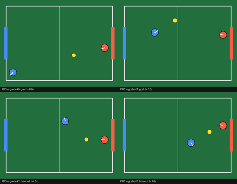

# 20 · Roomba Rocket League

A top-down 2D robot-soccer arena in numpy. One learned differential-drive "roomba" (PPO, MLX) learns to
reach the ball and score against a scripted goalie. It's compared with a scripted attacker on held-out
starts and in cross-play against two defender styles it never trained against.



Headline numbers and failures are in [RESULTS.md](RESULTS.md). The fixed run (run 4) scores 73% against the training goalie on held-out starts, vs 2% for the scripted attacker. Against an unseen line keeper it scores 0.2%, vs 49% for the scripted attacker. Run 1 learned to pin the ball in the corner, and the main run (run 2) collapsed; run 4 fixed two PPO bugs together (unbounded action mean, CPU/GPU log-prob mismatch), and which one mattered more was not separated. One training seed. The scripted attacker is a weak striker against the goalie (it drives at the goal centre); a reviewer's off-centre-aim version reaches 4.2%, so PPO's margin is ~17×, not 36×. The GIF above is run 4 (blue drives in reverse into the ball).

## The arena (`env.py`)
- The field is 2.0 m × 1.4 m, and each end wall has a 0.6 m goal mouth. Blue (the learner) attacks the right goal and defends the left.
- Both robots are differential-drive discs (r = 7 cm). The action is a pair of (left, right) wheel commands in [-1, 1]. Top speed is 0.8 m/s for the learner and 0.56 m/s (0.7×) for the scripted opponent. Top turn rate is 6 rad/s. The drive is kinematic: no inertia.
- The ball (r = 4 cm) has exponential rolling friction (0.8/s), robot–ball restitution 0.5, wall restitution 0.7 and a speed cap of 2.5 m/s. dt = 0.05 s and a match lasts 300 steps (15 s), or ends earlier on a goal.
- Every env is batched over a leading axis, so 256 matches step together in plain numpy (no numba needed).
- The observation has 23 numbers: own pose, ball position and velocity (world and ego frame), opponent pose, goal vectors in ego frame, and time.
- The reward is +10 for a goal and −10 when the ball enters our goal (from either robot). On top of that there is potential shaping Φ' − Φ with Φ = −0.5·|robot−ball| − 2·|ball−goal|, plus a one-off +0.5 on the learner's first touch. (Run 1 paid +0.05 on every contact step instead, which was farmable: see RESULTS.)

## Scripted robots (`scripted.py`)
| name | role | seen in training? |
|---|---|---|
| `goalie` | defender: guards from a point 0.22 m out on the ball–goal line and rushes the ball when it gets within 0.45 m of its goal | **yes** (the training opponent) |
| `keeper` | defender: a line keeper that stays on its goal line and mirrors the ball's predicted y | no (cross-play) |
| `chaser` | striker: gets behind the ball and pushes it toward the learner's goal | no (cross-play) |
| `attacker` | **baseline** for the learner's seat: lines up behind the ball on the goal→ball line, then drives through it | n/a |
| `random` | uniform random wheel commands | n/a |

## Run it
All commands run from this folder. Thread caps follow the lab rules.

```bash
export OMP_NUM_THREADS=4 NUMBA_NUM_THREADS=4
./smoke.sh                                    # end-to-end at tiny size, about 20 s
../bin/gpu_run ../.venv/bin/python ppo.py --minutes 18 --envs 256 --minibatch 4096 --ent 0.002 \
    --out checkpoints/ppo.npz --log logs/train.jsonl        # the main run (18 min wall clock)
# run 4 (bug-fixed, used for the demo, 10 min):
../bin/gpu_run ../.venv/bin/python ppo.py --minutes 10 --envs 256 --minibatch 4096 --ent 0 --lr-anneal 1 \
    --keep-best 1 --tanh-mean 1 --relp 1 --out checkpoints/run4_tanh_relp.npz --log logs/run4_tanh_relp.jsonl
../.venv/bin/python eval.py --ckpt checkpoints/run4_tanh_relp.npz --out results/eval_run4_final.json
../.venv/bin/python demo.py --ckpt checkpoints/run4_tanh_relp.npz       # -> media/*.gif, *.mp4 (the demo)
../.venv/bin/python probe_reverse.py checkpoints/run4_tanh_relp.npz     # reverse-dribbling probe
../.venv/bin/python eval.py --ckpt checkpoints/ppo.npz --episodes 500   # -> results/eval.json
../.venv/bin/python eval.py --ckpt checkpoints/run2_snapshot_10min.npz --out results/eval_run2_snapshot_10min.json
../.venv/bin/python demo.py --ckpt checkpoints/run2_snapshot_10min.npz --outdir media/run2_snapshot_10min
../.venv/bin/python demo.py --ckpt checkpoints/ppo.npz --outdir media/run2_final
../.venv/bin/python tables.py results/eval.json                        # markdown table
# run 1 (touch-bonus bug, pinning exploit) reproduces with --touch-bonus every; its checkpoint is
#   checkpoints/run1_touchbonus.npz (clips in media/run1_touchbonus/)
# run 3 (ablation, collapse fix): --ent 0 --lr-anneal 1 --keep-best 1 --minutes 12 --out checkpoints/run3_ent0_anneal.npz
../.venv/bin/python plot_train.py logs/train.jsonl media/training_curve.png
```

## Follow-up (round 3): training against a defender pool
Does opponent variety fix the cross-play collapse? `pool.py` defines a mixed training pool (fixed goalie,
a randomized-parameter goalie family, the chaser); the line keeper is held out. `ppo_pool.py` is `ppo.py`
with the pool swapped in (same run 4 flags). Results in RESULTS.md, section "Follow-up 1".
Caveat: the one run was compute-starved (41 M steps vs run 4's 182.6 M; wall-clock schedule compressed), so it is
not a test of whether pools work.

```bash
export OMP_NUM_THREADS=4 NUMBA_NUM_THREADS=4
../bin/gpu_run ../.venv/bin/python ppo_pool.py --pool 0,1,2 --minutes 10 --envs 256 --minibatch 4096 --ent 0 \
    --lr-anneal 1 --keep-best 1 --tanh-mean 1 --relp 1 --seed 0 \
    --out checkpoints/pool/pool_mixed.npz --log logs/pool_mixed.jsonl
../.venv/bin/python eval.py --ckpt checkpoints/pool/pool_mixed.npz --out results/pool/eval_pool_final.json
../.venv/bin/python eval.py --ckpt checkpoints/pool/pool_mixed_best.npz --out results/pool/eval_pool_best.json
../.venv/bin/python tables_pool.py results/pool/eval_pool_final.json results/pool/eval_pool_best.json
../.venv/bin/python demo_pool.py --ckpt checkpoints/pool/pool_mixed.npz --outdir media/pool
../.venv/bin/python plot_pool.py logs/pool_mixed.jsonl media/pool/pool_training_curve.png
```
Files: `pool.py`, `ppo_pool.py`, `tables_pool.py`, `demo_pool.py`, `plot_pool.py`, `checkpoints/pool/`, `results/pool/`,
`media/pool/`, `logs/pool_mixed.*`.

## Layout
```
env.py          batched arena physics, resets, curriculum, held-out corner region, bookkeeping
scripted.py     goalie / keeper / chaser defenders, scripted attacker baseline, random
ppo.py          MLX PPO (64x64 tanh MLPs, GAE, truncation bootstrap, wall-clock budget, checkpointing;
                flags --tanh-mean/--relp are the run 4 fixes, --lr-anneal/--keep-best from run 3)
eval.py         held-out evaluation table (3 start sets x 3 opponents x 3 policies)
demo.py         renders the clips in media/ from the checkpoint
render.py       PIL renderer + GIF/MP4 writer
plot_train.py   training curve
smoke.sh        tiny end-to-end check
tables.py       eval json -> markdown table
checkpoints/    run4_tanh_relp.npz = run 4 final (the demo); ppo.npz = run 2 (main run) final;
                run2_snapshot_10min.npz = run 2 at update 2450;
                run1_touchbonus.npz = pinning exploit; run3_* = ablation. Each .npz has weights + obs
                normaliser, and the matching .json has config + training stats
logs/           train.jsonl (one line per PPO update), train.out, uptime at start/end
probe_reverse.py  measures reverse driving / rear-of-robot ball contact
review_checks.py  reviewer: off-centre-aim attacker baseline + CPU-vs-GPU log-prob probe -> results/review_checks.json
results/        eval.json (run 2 final + baselines), eval_run{1,2_snapshot,3,4}_*.json, probe_reverse.txt
media/          run 4 demo clips (ppo_vs_goalie/keeper/chaser, scripted_vs_goalie, ppo_goals, ppo_pin_exploit),
                run{2,3,4}_training_curve.png, and subfolders run1_touchbonus/ (pinning exploit), run2_snapshot_10min/, run2_final/
```
