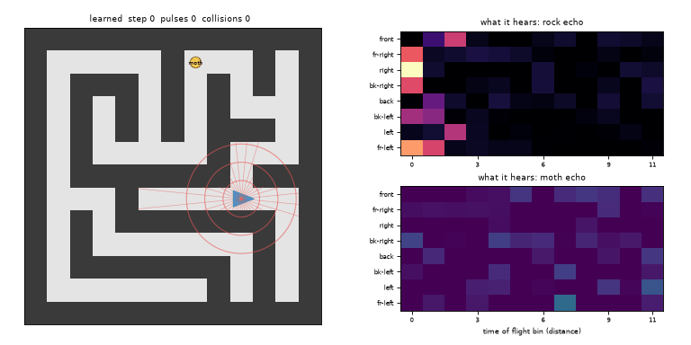

# 22 · Bat School — Learn to See With Sound

A bat in a dark cave maze sees nothing. It can only **pulse** (spend a little energy on a call) and
listen to the **echoes**. A recurrent policy (MLX, PPO + GRU) learns both *where to move* and
*when another pulse is worth it*, and has to find the moth hiding at the exit of mazes it has never
seen before.

**Result:** it completes 100 % of held-out 6×6 and 7×7 mazes with almost no bumps. It ends up pulsing
after moves but not after turns. A scripted wall follower with that same rule completes 99 % with only
7–9 % more pulses, so the learned edge is mostly shorter routes, not a smarter pulse schedule. See
RESULTS.md.



## The world
- **Mazes:** perfect mazes (randomised DFS), 4×4 to 6×6 cells for training (a fixed pool of 3000,
  seed 1000); held-out pools of 200 mazes each at 5×5, 6×6 and 7×7 (seeds 5005, 6006, 7007).
  `tests/test_bat.py` checks by layout hash that no held-out maze appears in the training pool.
  7×7 is bigger than anything seen in training.
- **Body:** the bat sits at a cell centre facing N/E/S/W. Moves: forward, turn left, turn right.
  Walking into rock is a **collision** (bat stays, feels a bump). Episode limit 6 × cells steps.
- **Echo model** (`bat_env.py`): a pulse sends 32 rays; each ray reflects off the first rock it hits
  at distance *d*. Time of flight ∝ 2d sets the arrival bin (12 bins, one corridor width each);
  attenuation `exp(-0.1 d)/(1+0.5 d)` sets the loudness. Rays are summed into 8 head-relative
  sectors → an **8 × 12 rock echo profile**. The moth returns a distinct echo in a second 8 × 12
  channel when a ray reaches it before rock. Gaussian noise (σ 0.03) on every bin and 5 % per-ray
  dropout. No pulse = silence (all zeros).
- **Observation** (199 numbers): the two echo profiles, a "heard" flag, the bump flag, the previous
  move and pulse, and elapsed-time fraction. **Never the map, position or heading.**
- **Reward** (training only): +2 for the moth, −0.01 per step, −0.05 per collision, −0.02 per pulse,
  +0.1 for entering a cell for the first time in the episode (shaping uses true state; reward is not
  an observation).

## Agents
| name | what |
|---|---|
| `bat_learned` | MLX policy: MLP echo encoder → GRU(128) → move head (3), pulse head (2), value. Sampled actions. |
| `bat_learned_greedy` | same, argmax actions |
| `bat_forced_k{1,2,4}` | same move policy, but the pulse head is overridden to pulse every k steps (fixed-rate sensing) |
| `wallfollow_k{1,2,3,4}` | right-hand wall follower reading the **same noisy echo profile** (rock in the first time bin of front/right/left sectors = blocked; moth echo → turn toward it), pulsing every k steps; between pulses it runs its queued plan, else walks forward blind and turns right after a bump |
| `bat_no_memory` / `bat_no_memory_forced_k1` | ablation (eval only): the same checkpoint with its GRU state wiped before every step, with its own pulses or forced pulses every step |
| `random_walk` | uniform random moves, no pulses |
| `wallfollow_event` | (added in review) the same wall follower, but it pulses only when its plan queue is empty, i.e. a decision is due next step. The scripted form of "pulse after moves, not after turns" |

## Run it
```bash
cd 22_bat_school
./smoke.sh                                    # tests + tiny train/eval/demo, ~1 min
../.venv/bin/python -m pytest -q tests        # unit tests only

# main training run (18 min wall clock cap, through the shared GPU lock)
OMP_NUM_THREADS=4 ../bin/gpu_run ../.venv/bin/python train.py --minutes 18 --envs 256 --T 64 --lr 3e-4 --pulse_cost 0.02 --out checkpoints/bat

# held-out evaluation: main table, echo-noise robustness, hard pulse budgets -> results/eval.json
OMP_NUM_THREADS=4 ../.venv/bin/python evaluate.py --ckpt checkpoints/bat --out results/eval.json

# when does the bat pulse? (decision log on 6x6 held-out) -> results/pulse_analysis.json
../.venv/bin/python pulse_analysis.py --ckpt checkpoints/bat

# demos
../.venv/bin/python demo.py --ckpt checkpoints/bat --agent learned --out media/bat_learned.gif
../.venv/bin/python demo.py --agent wf1 --out media/wallfollow_k1.gif
../.venv/bin/python plot.py                   # media/training_curves.png, media/pulse_tradeoff.png
```

## Files
```
bat_env.py        maze generator, ray echo model, vectorised env, wall-follower + random baselines
model.py          MLX GRU policy (hand-written GRU cell so hidden state resets mid-sequence), save/load
train.py          PPO + GRU training loop, wall-clock capped, checkpoints every 25 iterations
evaluate.py       held-out evaluation of every agent -> results/eval.json
leak_check.py     reviewer: re-evaluate with the elapsed-time feature zeroed / fixed T -> results/leak_check*.json
pulse_analysis.py pulse rate by situation (after forward vs turn, junctions...) -> results/pulse_analysis.json
demo.py           GIF renderer: maze, bat, pulse rays/rings, and the echo profile it hears
plot.py           training curves and pulses-vs-success plot
tests/test_bat.py held-out disjointness, maze/echo sanity, baseline sanity, GRU sequence == step
smoke.sh          end-to-end smoke check
checkpoints/      bat.safetensors + bat.json (weights + config), bat_log.jsonl (training log),
                  train_stdout.txt, launch_uptime.txt, train_stdout_aborted_bug.txt (first, broken launch)
*smoke*           files written by smoke.sh (ignored via .gitignore)
results/          eval.json (main table, robustness, budgets), pulse_analysis.json; *_seed1.json = second seed
                  (training numbers in RESULTS.md come from checkpoints/bat_log.jsonl)
media/            GIFs and PNGs
```


## Round 5: deciding when to listen

The follow-up is isolated in `*_r5.py` and `tests_r5/`; the earlier commands and
artifacts remain intact. Read [DESIGN_R5.md](DESIGN_R5.md) for the experiment.

```sh
# NumPy checks only; no MLX import (Astra can run this).
OMP_NUM_THREADS=4 OPENBLAS_NUM_THREADS=4 VECLIB_MAXIMUM_THREADS=4 NUMBA_NUM_THREADS=4 ../.venv/bin/python -m pytest -q tests_r5
# Claude only: GPU-locked end-to-end smoke, including forced-kill/resume.
../bin/gpu_run ./smoke_r5.sh
```

`env_r5.py` adds moving shutters, ambiguous echoes, charged sensing and a visible
budget; `baseline_r5.py`/`tune_r5.py` provide the two tuned classical schedulers.
`policy_r5.py`/`train_r5.py` implement recurrent PPO with full-validation selection;
`eval_r5.py` records the budget sweep and sensing behaviors; `demo_r5.py` reloads
selected weights to render successes and failures. `io_r5.py` holds atomic,
resumable single-file checkpoints; `math_r5.py` holds NumPy GAE; `check_mlx_r5.py`
is a Claude-only runtime check. `benchmark_r5.py` measures baseline throughput.
New receipts live in `results/r5/` and `logs/r5/`, selected weights in
`checkpoints/r5_*.npz`, and clips in `media/r5_*`. Rolling/smoke checkpoints are
ignored; only the final selected generation needs committing.

**R5 measured result (2026-10-24):** learned seeds 51/52/53 complete
**25.63% / 0% / 26.32%**, versus **82.23%** for both tuned classical schedulers
and **81.35%** for classical every-step sensing. This harder task includes all
four groups and all four pulse budgets. Seed 52 waits silently to timeout;
seed 53 matches the forced-every-step ablation on every recorded episode metric. Seed 51's missing hard-case success clip
is a real absence at the selected 16-pulse budget. See the appended R5 section
of [RESULTS.md](RESULTS.md), [full sweep and behavior tables](results/r5/turn2_tables.md),
and the preserved [failure demo](media/r5_main_failure.gif).

```sh
# Reconcile saved results/checkpoint hashes and regenerate derived tables (<1 s).
OMP_NUM_THREADS=4 OPENBLAS_NUM_THREADS=4 ../.venv/bin/python analyze_r5.py
# Static budget-sweep figure from saved results; no training or MLX (~1–10 s).
OMP_NUM_THREADS=4 OPENBLAS_NUM_THREADS=4 ../.venv/bin/python plot_r5.py
```

The turn-2 matched-update entropy experiment **has been run** (all three arms, including optional seed 62):
entropy .015 → .06 on seed 61 took completion from 0% to **24.46%** on the fresh
`test_turn2` split, against **82.71%** for the tuned classical schedulers.
Seed 62 at .06 still collapsed, so 3 of the 6 learned R5 runs never learned to
move. `train_r5.py --validate-updates` fixes the full validation cadence; default
commands still fill their wall-clock allowance.

**R5 commands actually run** (2026-10-24, AC power, from this folder, threads
capped at 4; stdout receipts in `logs/r5/`):

```sh
# Turn 1
../bin/gpu_run ./smoke_r5.sh                                    # -> logs/r5/claude_smoke.log (16.6 s)
../bin/gpu_run ../.venv/bin/python tune_r5.py --max-minutes 5 --out results/r5/baselines.json
../bin/gpu_run ../.venv/bin/python train_r5.py --max-minutes 24 --out checkpoints/r5_main.npz --work logs/r5/main
../bin/gpu_run ../.venv/bin/python eval_r5.py --ckpt checkpoints/r5_main.npz --baselines results/r5/baselines.json --max-minutes 1.5 --out results/r5/test.json
../bin/gpu_run ../.venv/bin/python eval_r5.py --ckpt checkpoints/r5_main.npz --baselines results/r5/baselines.json --split legacy --max-minutes 1 --out results/r5/legacy.json
../bin/gpu_run ../.venv/bin/python demo_r5.py --ckpt checkpoints/r5_main.npz --max-minutes .5 --prefix media/r5_main
../bin/gpu_run ../.venv/bin/python train_r5.py --seed 52 --max-minutes 24 --out checkpoints/r5_seed52.npz --work logs/r5/seed52
../bin/gpu_run ../.venv/bin/python train_r5.py --seed 53 --max-minutes 24 --out checkpoints/r5_seed53.npz --work logs/r5/seed53
../bin/gpu_run ../.venv/bin/python eval_r5.py --ckpt checkpoints/r5_seed52.npz --baselines results/r5/baselines.json --max-minutes 1.5 --out results/r5/test_seed52.json
../bin/gpu_run ../.venv/bin/python eval_r5.py --ckpt checkpoints/r5_seed53.npz --baselines results/r5/baselines.json --max-minutes 1.5 --out results/r5/test_seed53.json
# Turn 2 (the three train arms ran in parallel, ~10.6 min each)
../.venv/bin/python analyze_r5.py                  # CPU audit; first run in Astra's turn 2 (logs/r5/turn2_analysis_stdout.txt)
../bin/gpu_run ../.venv/bin/python smoke_r5.py --max-minutes .5    # -> logs/r5/t2_smoke_stdout.txt (17.5 s)
../bin/gpu_run ../.venv/bin/python train_r5.py --seed 61 --entropy .015 --updates 5600 --validate-updates 1000 --max-minutes 16.5 --work logs/r5/t2_control61 --out checkpoints/r5_t2_control61.npz
../bin/gpu_run ../.venv/bin/python train_r5.py --seed 61 --entropy .06 --updates 5600 --validate-updates 1000 --max-minutes 16.5 --work logs/r5/t2_entropy61 --out checkpoints/r5_t2_entropy61.npz
../bin/gpu_run ../.venv/bin/python train_r5.py --seed 62 --entropy .06 --updates 5600 --validate-updates 1000 --max-minutes 16.5 --work logs/r5/t2_entropy62 --out checkpoints/r5_t2_entropy62.npz
../.venv/bin/python check_turn2_r5.py            # MATCHED PAIR OK
../.venv/bin/python check_turn2_r5.py --seed62   # UNPAIRED SEED 62 BUDGET OK
for arm in control61 entropy61 entropy62; do
  ../bin/gpu_run ../.venv/bin/python eval_r5.py --split test_turn2 --ckpt checkpoints/r5_t2_$arm.npz --baselines results/r5/baselines.json --max-minutes .5 --out results/r5/t2_${arm}_test.json
done
```

