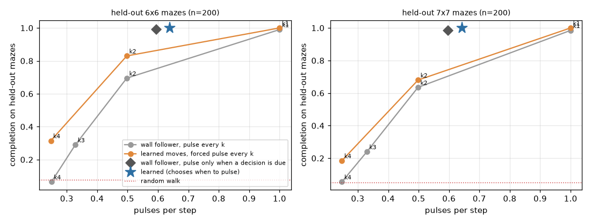
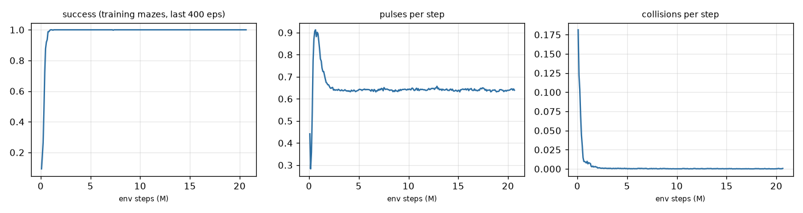
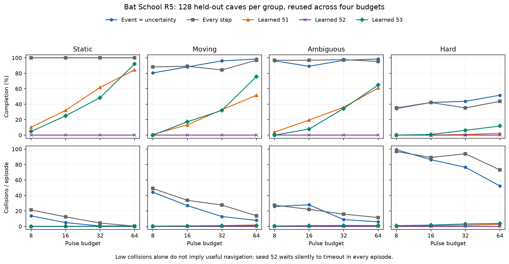

# Bat School: results

The run: one PPO + GRU training run (MLX). It used 256 parallel envs and 64-step rollouts, and went for
1262 iterations (20.7 M env steps) in 1081 s of wall time. The pulse cost was 0.02 and the seed was 0.
Evaluation used **200 held-out mazes per size** (5×5, 6×6, 7×7) with fixed seeds. The tests check by
layout hash that none of them is in the 3000-maze training pool, which holds sizes 4–6. 7×7 is bigger
than anything in training. All numbers below come from `results/eval.json` (main table, robustness,
budgets) and `results/pulse_analysis.json`, and training numbers from `checkpoints/bat_log.jsonl`. The
learned agent samples its actions. The greedy version matches completion exactly and is within ~3 % on pulses
and steps (also in eval.json).

## Headline: held-out mazes, training noise level (σ 0.03, 5 % ray dropout)

| 6×6 held-out (n=200) | completion | collisions / step | pulses / episode | pulses / step | steps (successes) |
|---|---|---|---|---|---|
| random walk | 0.075 | 0.210 | 0 | 0 | — |
| wall follower, pulse every step (k=1) | 0.990 | 0.005 | 53.3 | 1.00 | 51.7 |
| wall follower, k=2 | 0.695 | 0.094 | 49.4 | 0.50 | — |
| wall follower, k=3 | 0.290 | 0.153 | 55.6 | 0.33 | — |
| wall follower, k=4 | 0.065 | 0.230 | 51.9 | 0.25 | — |
| wall follower, pulse only when a decision is due (reviewer baseline) | 0.990 | 0.004 | 31.3 | 0.60 | 51.5 |
| **learned bat (chooses when to pulse)** | **1.000** | **0.000** | **29.0** | **0.64** | **45.3** |
| learned moves, forced pulse every step | 1.000 | 0.000 | 45.0 | 1.00 | — |
| learned moves, forced every 2 | 0.830 | 0.104 | 43.9 | 0.50 | — |
| learned moves, forced every 4 | 0.315 | 0.219 | 42.8 | 0.25 | — |
| ablation: learned, GRU state wiped every step | 0.575 | 0.002 | 78.8 | 0.69 | — |

On 5×5 the learned bat completes 1.000 with 19.6 pulses per episode. The k=1 wall follower completes
0.995 with 35.6 pulses. On **7×7 (larger than any training maze)** the learned bat completes 1.000 with
43.5 pulses, against 0.985 and 81.6 pulses for the k=1 wall follower. Random walk completes 0.095 on 5×5
and 0.050 on 7×7.

**In short:** the learned bat finds the moth in every held-out maze, with almost no collisions (2 bumps
in 200 episodes on 6×6, 0.0002 per step). It uses 46 % fewer pulses than a wall follower that pulses
on every step. **But most of that saving is the obvious rule "pulse after you move, not after you
turn".** A wall follower scripted with that rule (pulse only when its plan queue is empty, so a
decision is due next step; added in review) completes 0.990 with **31.3** pulses on 6×6, against the
bat's 29.0. That is 7 % more, not 46 % more. It is 8.6 % more on 5×5 (21.4 vs 19.6) and 8.4 % more on 7×7
(47.5 vs 43.5). Both pulse after essentially every forward move. The bat's remaining pulse edge comes
from its shorter routes: 45.3 vs 51.5 steps on successes (6×6), 12 % shorter. It also completes 1.000
vs 0.990 and bumps about 20× less often. So the learned schedule *rediscovered* the scripted rule. What learning
added is route quality and collision avoidance, not a cleverer pulse schedule.

## Robustness relative to fixed-rate sensing
- **Learned schedule vs the same policy forced to a fixed rate.** The learned bat pulses 0.64 of
  steps. If its moves are kept and pulses are forced every 2 steps (0.50 per step), 6×6 completion
  drops from 1.00 to 0.83 and collisions rise from 0.000 to 0.104 per step. Forcing a pulse on
  every step changes nothing except that it spends 55 % more pulses (45.0 vs 29.0). So *when* it
  pulses carries the result, not *how often*. At 0.64 pulses per step the fixed-rate wall follower would
  sit between its k=2 (0.695) and k=1 (0.99) points.
- **When does it pulse?** From `results/pulse_analysis.json`, 9068 decisions on 6×6 held-out mazes:
  - It pulses after **99.9 %** of forward moves (the view has changed).
  - It pulses after only **11.3 %** of turns. A turn just rotates a scene it heard one step earlier,
    so it re-uses the remembered echo.
  - It never goes two steps without an echo: after one silent step it pulses 100 % of the time.
  - It pulses after 99.9 % of actions that leave it facing rock, and 42 % of actions that leave it
    facing open corridor.

  Nobody programmed "skip the pulse after a turn". The pulse cost found that rule, and it works only
  because the GRU remembers. (Reviewer note: a hand-written wall follower gets the same rule in one line,
  because its plan queue is its memory. See the reviewer baseline above.)
- **Memory matters.** Wiping the GRU state before every step drops 6×6 completion from 1.00 to
  0.575. Forcing a pulse on every step does not rescue it (0.545). Collisions stay near zero (0.002),
  so the memoryless bat still avoids walls from one echo. What it loses is exploration: it re-walks
  corridors and times out. On 7×7 it falls to 0.455.
- **Noisier echoes (6×6, out of training distribution).** Completion:

  | echo noise σ / ray dropout | wall follower k=1 | wall follower k=2 | learned | learned forced k=1 | learned forced k=2 |
  |---|---|---|---|---|---|
  | 0.03 / 5 % (training) | 0.990 | 0.695 | **1.000** | 1.000 | 0.830 |
  | 0.10 / 5 % | 0.155 | 0.170 | **0.850** | 0.790 | 0.615 |
  | 0.20 / 5 % | 0.145 | 0.170 | **0.440** | 0.425 | 0.365 |
  | 0.03 / 30 % | 0.975 | 0.725 | **1.000** | 1.000 | 0.760 |
  | 0.10 / 30 % | 0.150 | 0.170 | **0.670** | 0.650 | 0.495 |

  Caveat: the wall follower's cliff at σ 0.1 mostly measures *its decoder*. It uses one hand-set
  threshold on the first time bin, tuned at σ 0.03, and noise at 0.1 crosses it. That decoder sees
  phantom walls and spins. A classical decoder that averaged bins or adapted its threshold would hold up
  better; I didn't build one. The fair comparison is learned vs learned-forced-k: at every noise
  level, the learned schedule beats the forced k=2 schedule by 7.5–24 points of completion.
- **Hard pulse budgets (6×6):**

  | budget (pulses per episode) | wall follower k=1 | wall follower k=2 | learned |
  |---|---|---|---|
  | 10 | 0.125 | 0.200 | **0.260** |
  | 20 | 0.245 | **0.470** | 0.450 |
  | 40 | 0.550 | 0.630 | **0.840** |

  The bat never saw a budget in training, and the budget is not in its observation (the "heard" flag
  just goes silent). It does not ration its pulses: once they run out, it navigates on memory and
  bumps. Even so, it leads at budgets of 10 and 40 and ties k=2 at 20.

## Training

Training-pool success went from 0.09 at iteration 5 to 0.94 by iteration 40 (0.66 M steps) and 1.00 by
iteration 60 (~1 M steps, 108 s). The pulse rate then fell from 0.86 (iteration 60) to 0.64 (iteration 200) and
stayed there. **Most of the 18-minute run was redundant:** the policy had converged by about 3.3 M steps
(4 min), which is why the 5-minute seed-1 run can reproduce it. Throughput was ~19 k env steps/s overall, measured **under load** (load averages
16.3 / 13.9 / 9.3 at launch, 9.3 / 13.1 / 12.3 at the end; ten builders were sharing the machine).

## What worked
- Precomputed ray distances per (maze, cell, absolute ray) make the echo model nearly free. Heading
  is a roll of the ray array. The vectorized env runs at over 100 k steps/s in numpy.
- The moth's echo channel gives the bat a reason to listen. Without it, "completion" would just be
  random coverage.
- A hand-written GRU cell lets the hidden state reset mid-rollout, so PPO-BPTT runs over 64-step
  segments.

## What didn't, and bugs found on the way
- **The first launch did not learn at all.** Entropy stayed flat at 1.78 of a 1.79 maximum for 50
  iterations. The cause: `mx.compile` on the acting function, without declaring `model.state` as an
  input, baked the *initial* weights into the graph as constants. Rollouts always came from the
  random policy, and PPO's ratio clipping froze learning. Fix:
  `partial(mx.compile, inputs=[model.state])`. The log of the aborted run is in
  `checkpoints/train_stdout_aborted_bug.txt`.
- **The first reward made a bat that spins in place** (smoke test). With collisions at −0.1 and only
  +0.03 for a new cell, turning on the spot forever was the safe local optimum: success fell from 12 %
  to 2 % while collisions dropped. Raising the new-cell bonus to 0.1, cutting collisions to 0.05 and
  raising the goal to +2 fixed it. This is the good kind of failure: the bat had learned that sitting
  still in the dark is safe.

## Honest caveats
- One seed and one pulse cost (0.02). No sweep over pulse costs, so the energy-vs-information curve
  is mapped only by forcing fixed rates at eval time.
- The observation includes elapsed-time fraction t/T, and T = 6 × cells (150 / 216 / 294 steps at
  5×5 / 6×6 / 7×7), so the bat could infer the maze *size* from two steps. **Reviewer check
  (`leak_check.py`, `results/leak_check.json`, `results/leak_check_seed1.json`):** with that feature
  zeroed, or computed against a fixed T = 216 for every size, both seeds still complete 1.000 at all
  three sizes. Pulses and steps change by at most 1.4 / 1.8 per episode (seed 1, 7×7), within noise.
  The bat does not use it.
- The bat gets one free pulse when an episode starts. It is added by the env for every agent and is not counted in
  pulses/episode for anyone (wall follower k=1 shows pulses/episode == steps).
- The world is discrete: cell-to-cell moves and 90° turns. The echo geometry is continuous
  (32 rays, sub-bin time-of-flight interpolation), but the motion is not.
- Pulses/episode for baselines include their few timeouts (e.g. 2 of 200 for wall follower k=1 on
  6×6). On successes only, wall follower k=1 uses 51.7 pulses, so the "46 % fewer" becomes 44 %.
- Why the learned routes are ~12 % shorter than right-hand wall following is **not measured**. My
  guess is that it hears the moth at longer range or off-axis (the baseline only reads the four
  cardinal sectors), or that it picks a better branch order.
- Speed numbers above were measured under load.

## Next steps
- Put the pulse budget in the observation and train with budgets, so the bat learns to ration pulses.
- Sweep the pulse cost to trace a real learned energy-vs-information curve.
- Remove t/T from the observation. Train with mixed noise levels.
- Continuous motion, uncertain reflections and materials, and moving moths (the "Go deeper" stage).

## Demo
- `media/bat_learned.gif`: held-out 6×6 maze 0, found in 28 steps.
  `media/bat_learned_7x7.gif`: held-out 7×7 maze 2, found in 34 steps.
- The left panel shows the maze, the bat (blue triangle, red after a bump), the trail, the moth, and
  red rays and rings on every pulse. The right panel shows the 8×12 rock and moth echo profiles the
  bat hears, which are blank on silent steps, plus P(pulse next).
- `media/wallfollow_k1.gif` succeeds in 26 steps on the same 6×6 maze.
  `media/wallfollow_k2.gif` (pulsing every other step) times out (216 steps) on the same maze.

## Addendum: second seed (run after the write-up; shorter run)
Seed 1 used the same config with a 5-minute cap, so it trained for less than a third of seed 0's wall time: 926 iterations, 15.2 M steps, 300 s
(`checkpoints/bat_seed1.*`, `results/eval_seed1.json`, `results/pulse_analysis_seed1.json`). It
**reproduces the headline**. On 6×6 held-out it completes 1.000 with 29.2 pulses per episode and 45
steps; seed 0 got 1.000, 29.0 and 45. On 7×7 it completes 1.000 with 41.7 pulses. Its pulse rule is
the same: it pulses after 99.9 % of forward moves and after 13.1 % of turns (seed 0: 11.3 %). Wiping
memory hurts it just as much (6×6: 0.520). Seed 1's moves depend more on its own pulse schedule:
forced pulsing every 2 steps gives 0.520 on 6×6, against 0.830 for seed 0.

## Review (cross-reviewer, 2026-10-22)
Main change: the headline pulse saving is now stated against a scripted wall follower
that pulses only when a decision is due (`wallfollow_event`, in `results/eval.json`). Against it, the bat's
pulse saving shrinks from 46 % to 7–9 %. The other numbers reproduced bit-for-bit.

## Round 5: a cave where deciding when to listen matters

### TL;DR (plain language; Claude review, 2026-10-24)

**The hand-built bats win easily, and this cave still doesn't make "when to
listen" the deciding skill.** On fresh caves, the two tuned classical schedulers
finish **82.2%** of runs (82.7% on a second fresh split). The learned bats that
worked finish about a quarter: **25.6% / 26.3%** (seeds 51/53) and **24.5%**
(seed 61, higher exploration bonus). Half of all learned training runs (**3 of
6**) never learned to fly: they stand still or turn on the spot without ever
sending a pulse until time runs out. Every learned run is below both classical
references in every one of its 16 group×budget cells.

- **Higher exploration rescued 1 of 2 seeds.** With the same seed and the same
  5,600 updates, entropy .015 → .06 took seed 61 from 0% to 24.5%. That is one
  pair; the other .06 seed (62) still failed. Overall, 2 of 4 runs at .015 and
  1 of 2 at .06 collapsed, too few to call it a rate change.
- **The learned bats don't schedule pulses well either.** Making them pulse on
  every step does as well (seed 53: identical episodes) or slightly better
  (seed 61: 24.8% vs 24.5%) in 2 of the 3 working runs. Only in seed 51 does
  forcing hurt (25.6% → 7.7%).
- **Why they lose: no working memory.** Learned successes are short (median
  17–26 steps) and mostly finish while the bat can still pulse every step.
  Classical bats keep a map from odometry. Their successes take a median 77–86
  steps, and 82% of them take more steps than the budget has pulses. Once the
  learned bats run out of echoes they are lost.
- **Waiting, listening twice and turning to listen** all happen, but the
  baselines do them too. The event scheduler sends about 70% of its pulses while
  stopped; the learned bats send 55–75% of theirs while turning. Echo-quality
  (Brier) gains for repeat listens are about the same size. It is a different
  style, not a better one.
- **Scheduling barely matters even for the classical bats.** Event-triggered vs
  pulse-every-step: 82.2% vs 81.4% (test) and 82.7% vs 83.0% (test_turn2). It
  saves about a quarter of the pulses but doesn't change completion.
- **The baselines may be stronger still.** The selected interval and
  repeat-listen settings sit on the upper edge of the search range, and the
  reserve setting sits near its lower edge. A wider search could only widen a
  lead they already have.

Numbers trace to `results/r5/{test,test_seed52,test_seed53}.json` (test split)
and `results/r5/t2_{control61,entropy61,entropy62}_test.json` (fresh
`test_turn2` split). See the follow-up and review subsections at the end of
this section.

### Turn 1 preparation (Astra, before any run)

Turn 1 prepares the experiment; **learned completion, collisions, sensing
advantage, learning speed and final demos are not measured**. No MLX import or
training was attempted by Astra. The original exhibit above is unchanged.

The NumPy-only suite passed **19 tests in 4.02 s**
(`logs/r5/numpy_tests_delivery.txt`), including full official split separation,
reciprocal moving shutters, exact pulse accounting, shared evaluation noise,
checkpoint/environment replay, baseline grids, metric counts, timeouts and GIF
rendering. The first run caught two train/test layout duplicates despite distinct
seeds; geometry-hash partitioning plus exclusion of original layouts fixed this
(`logs/r5/implementation_notes.txt`).

A final-code NumPy speed probe measured **2.674 s per paired full-validation
candidate**, with 32 caves/group and all four budgets; projected five-minute
search capacity is **111 paired candidates** (`results/r5/delivery_speed.json`).
This is a throughput/prototype-validation receipt, not a learned-method result.
The timed search guard was also exercised on the full validation grid: two
candidates per scheduler completed in **6.914 s** of a nine-second allowance
(`results/r5/delivery_tuner_check.json`); it refused to start a pair that could not
fit. The real search has a five-minute allowance and no candidate cap. The final
selection rule ranks completion first and cannot select a never-completing
policy over one with any completions; bounded safety/efficiency costs break
completion ties. Classical CLI validation completed all 16 cells for all three
reference methods (`results/r5/delivery_eval_check.json`). These are prototype
checks, not the final five-minute tuned comparison.

Next: Claude runs the forced-kill/resume MLX smoke, the full baseline search,
24 minutes of PPO, complete fresh/legacy evaluations and checkpoint-backed clips.
Report all hard groups, timeouts, pulse costs and failures.
Behavior/decoder-proxy improvements alone do not establish deliberate active
sensing. Append learned numbers only after tracing them to the run files.

### Turn 2 analysis of the first runs (Astra; numbers verified by Claude)

**Turn 2, 2026-10-24.** The harder cave did not produce a learned sensing advantage.
Learned seeds **51 / 52 / 53 complete 25.63% / 0% / 26.32%**, versus **82.23%**
for both tuned classical schedulers and **81.35%** for the classical every-step
reference. The learned agents collide less, but frequently fail to navigate at
all. Seed 52 collapses to silent waiting; seed 53 matches forced every-step
sensing on every recorded episode metric. The original exhibit above uses different physics and is not
contradicted by these harder R5 results.

#### Setup, provenance and full sweep

Each method receives the same observations and pulse limits, on 128 fresh caves
per group (static, moving, ambiguous, **hard moving+ambiguous**), at budgets
8/16/32/64 and a 320-step timeout. Thus each method has 2,048 episodes, with the
same 512 caves reused across budgets. Training uses 256 caves/group; validation
uses all 32/group × four budgets. Learned evaluation is greedy. Classical
controllers retain explicit maps from odometry; the neural policy must learn
memory. Information and episode budgets match; internal algorithms and training
compute do not.

Sources: [seed 51](results/r5/test.json), [seed 52](results/r5/test_seed52.json),
[seed 53](results/r5/test_seed53.json). `analyze_r5.py` recomputed every test row
from episode records, checked all group/budget cells, and matched checkpoint and
baseline SHA-256 receipts. Exact derived values, training summaries and source
hashes are in [turn2_analysis.json](results/r5/turn2_analysis.json); the
[full tables](results/r5/turn2_tables.md) include **every budget/group/seed's
completion, collisions, pulses, behavior, Brier gains and forced-pulse ablation**.
All audit assertions passed (`logs/r5/turn2_analysis_stdout.txt`). Baseline
episodes are identical across the three seed files; they are one fixed reference,
not three independent replications. Event and uncertainty also have identical
episodes, so the table combines them explicitly.

| Method | Successes / 2,048 | Completion % | Collisions / episode | Pulses / episode | WAIT / all steps % |
|---|---:|---:|---:|---:|---:|
| Event-triggered = uncertainty-triggered | 1,684 | 82.23 | 30.90 | 18.93 | 9.66 |
| Every step, classical flight | 1,666 | 81.35 | 37.05 | 25.79 | 1.60 |
| Learned seed 51 | 525 | 25.63 | 0.71 | 20.36 | 49.13 |
| Learned seed 52 | 0 | 0.00 | 0.00 | 0.00 | 100.00 |
| Learned seed 53 | 539 | 26.32 | 1.03 | 24.20 | 1.55 |

Every one of the **48 learned seed×group×budget cells** has lower completion
than each classical reference. More sensing helps seeds 51 and 53: their
across-group completion at budgets 8/16/32/64 is respectively
**3.71/16.21/32.81/49.80%** and **1.17/12.70/30.27/61.13%**; seed 52 is zero
at every budget. Static classical completion is already 100% at budget 8, so
this group still does not require a sophisticated sensing schedule. For moving
caves, event/uncertainty improves from **80.47% with 44.22 collisions** at budget
8 to **98.44% with 7.82** at 64. At 64, learned 51/53 reach only **51.56/75.78%**,
with **1.80/1.09 collisions**. On ambiguous caves at 64 the corresponding rates
are **98.44% classical versus 60.94/64.84% learned**; collisions are
**5.88 versus 1.03/1.05**. In the hard group, event/uncertainty rises from
**34.38% / 99.29 collisions** at 8 to **51.56% / 52.29** at 64, while learned
51/53 reach just **2.34/11.72%** at 64. Seed 52 has zero completion and collisions
in every group. See the full table for intermediate budgets and the every-step
reference. Classical curves need not be monotone: changing the budget changes
spacing and subsequent trajectories (e.g. ambiguous E/U dips at 16).

Collisions are nonlethal bumps and supply contact information in this simulator.
Completion-first selection permits a classical controller to use them heavily.
Conversely, counting fewer bumps while waiting out a timeout is not a useful
navigation win. No safety claim follows from the collision column alone.

#### Waiting, repeated listens and viewpoint changes

All behavior numbers below come from the same test episode records and pooled
sums in `turn2_analysis.json`; group detail and denominators are in
`turn2_tables.md`. Fractions of steps pool steps; Brier means pool **pair counts**,
not unweighted means of cell means.

- **Seed 51:** waits on 49.13% of steps, but has only **9 wait-and-listen actions
  in 2,048 episodes**. It double-listens in **649 episodes**, and **595 timeouts
  leave unused pulses**. Most waiting is silent inactivity, not active sensing.
  Forcing every-step pulses reduces completion from **25.63% to 7.71%** and
  increases pulses from **20.36 to 28.54/episode**. Its learned schedule matters
  to its own controller, but this intervention also changes observations and
  flight; it does not establish an optimal or generally superior schedule.
- **Seed 52:** all **2,048 episodes** consist of **320 WAIT steps, zero pulses,
  zero collisions, zero success**. There are no Brier pairs. Forced sensing
  spends each budget but still yields zero completion and all-WAIT behavior.
- **Seed 53:** waits on **1.55%** of steps; **517** wait-and-listen actions;
  double-listens in **1,017 episodes**. However, **every episode's pulse count
  equals min(steps, budget)**, and its entire episode records match the forced
  every-step ablation exactly. Repeats/view changes therefore do not demonstrate
  selective sensing. It has no timeouts with unused pulses.
- **Baselines do these behaviors too.** Event/uncertainty has **27,116**
  wait-and-listen actions and double-listens in **789 episodes**; classical
  every-step has **4,771** and **1,144** respectively. Event/uncertainty averages
  **4.73 double listens/episode** on hard caves; every-step averages **7.72**,
  versus **0.77 / 0 / 2.31** for learned 51/52/53. These counts are not unique
  evidence of an acquired information-seeking strategy.

There is some **local echo-quality improvement**, also present in baselines.
For moving caves, mean repeat/turn/translation Brier gains are:

| Method | Repeat gain (pairs) | Turn gain (pairs) | Translation gain (pairs) |
|---|---:|---:|---:|
| Event = uncertainty | +0.11481 (558) | +0.15842 (188) | +0.04323 (2,007) |
| Every step | +0.16364 (790) | +0.02811 (4,192) | +0.00288 (7,568) |
| Learned 51 | +0.16638 (301) | +0.06378 (4,657) | +0.02761 (6,218) |
| Learned 52 | no pairs | no pairs | no pairs |
| Learned 53 | +0.18511 (349) | +0.03674 (6,176) | +0.00355 (4,906) |

For ambiguous/hard caves, learned translation gains are **negative**:
51 **−0.01522/−0.01865**, 53 **−0.00374/−0.03517**; event/uncertainty is also
negative (**−0.07182/−0.06379**). Learned repeat gains are positive in all
noncollapsed groups; turn gains are positive in moving/ambiguous/hard, near zero
and slightly negative in static. These are observations from a fixed diagnostic
echo decoder, not the network's beliefs. Repeat means same position/heading
within two steps; a failed movement into a wall can qualify. Translation compares
only the same edge from opposite sides; turning compares four aligned directions.
Pairs are action-selected, affected by noisy-echo selection, regression to the
mean and obstacle freshness. They support occasional better echoes, **not a
causal claim that the bat intentionally repositioned or completed because of it**.

#### Seed 52: collapse evidence and remaining uncertainty

Source: each run's `logs/r5/{main,seed52,seed53}/{train.jsonl,validation.jsonl,summary.json}`
and selected checkpoint metadata, reconciled in `turn2_analysis.json`.

| Seed | Wall seconds | Updates | Environment steps | Selected update | Selected validation completion % |
|---|---:|---:|---:|---:|---:|
| 51 | 1,437.85 | 8,359 | 34,238,464 | 6,392 | 27.15 |
| 52 | 1,437.91 | 10,644 | 43,597,824 | 873 | 0.00 |
| 53 | 1,437.88 | 13,493 | 55,267,328 | 12,474 | 27.73 |

Each run used about **99.85% of its 24-minute allowance**. The aggregate rates
are **5.814 / 7.402 / 9.384 updates/s**, including validation. Claude reported
concurrent training/load variation; no load trace is saved here. The resulting
unequal work is a confound, but seed 52 received **more updates than seed 51**,
so a simple shortage of updates does not explain its failure.

Seed 52 has **zero completion at all 12 full validation snapshots**. Its best
score is **−0.0000406108** at update **873**, approximately **123.67 s** into the
run. This is the bounded cost tie-break among zero-completion policies, not a
negative completion rate. It cannot outrank even one extra validation success.
The selected policy's exact all-WAIT behavior is verified by test records.
Training shows prolonged entropy collapse: median joint action entropy is
**0.001453** over updates 501–1000, **0.00002954** over 4001–7000,
**0.00001777** over 7001–10000, and **0.000001148** over 10001–10644; minimum
**4.68×10⁻⁸**. There are late entropy spikes (last record **0.08654**), so it is
not permanently numerically frozen. Loss/entropy/gradient records are all finite,
and the optimizer reaches **127,728 steps**. The final recent-completion metric
is zero. No NaN/zero-norm failure is evident in these receipts.

The likely mechanism is a poor exploratory local optimum: a bat can avoid
collision and sensing penalties by waiting. Source-derived reward accounting,
**not a measured reward log**: silent timeout totals **−1.85** undiscounted
(320×−.005−.25); one −.08 collision cancels one +.08 novel-cell reward. PPO uses
this shaped reward, whereas selection ranks completion first. This mismatch and
low entropy are plausible contributors, not established causes. Original logs
lack rollout reward means, action histograms and separate policy/value losses,
so a reward/critic diagnosis cannot be confirmed. Seed 51 also has early low
entropy and recovers; seed 53 has zero validation completion through update
6,554, then **17.77% at 7,738**. Recovery is seed-sensitive; more wall time alone
is not an evidenced fix. Initial `train_completion_last400=1` for some runs is
also not 100% ability: before a 320-step timeout, a 32-step rollout's completed
episodes can only be successes, and the early denominator was not logged.

#### Demo selection and legacy comparison

The missing success category is **real within the declared demo stratum**, not
a selection bug. [media/r5_main.json](media/r5_main.json) uses the same seed-51
checkpoint hash and selected update 6,392 as `test.json`; it searches hard caves
at **budget 16**, which have **0/128 successes**. Its recorded first failure
matches that test episode exactly: cave **384**, timeout **320 steps**, **9/16
pulses**, **1 collision**, **281 WAIT steps**, **zero wait-and-listen actions**.
The preserved [failure GIF](media/r5_main_failure.gif) is the honest demonstration.
Seed 51 does have 525 successes overall, including only **four hard successes**
across all budgets (one at 32, three at 64); those are outside this clip selector.

Secondary source [legacy.json](results/r5/legacy.json), using old layout prefixes
with **new R5 physics**, gives seed-51 completion **26.71%**, forced pulses
**8.40%**, event/uncertainty **81.69%**, and every-step **82.03%**. Seeds 52 and 53
were **not measured on legacy**. This is not a reproduction of the original
physics experiment's near-perfect performance.

#### Baseline tuning audit

[baselines.json](results/r5/baselines.json) records **156 candidates per scheduler**
in **296.59 s** (98.86% of five minutes), with paired identical parameter samples
and **all 16 validation cells ×32 caves per candidate**: **159,744 episode
evaluations** across 312 trials. Both choose **candidate 71**, with validation
completion **83.79%** and score **0.8378347**. The neural method used one PPO
configuration across three seeds and 12 validation snapshots each. Classical
hyperparameter coverage was substantial, not a single hand-picked heuristic;
wall compute was nevertheless **five minutes versus about 72 neural minutes**,
so this is not an equal-training-compute experiment. Every-step inherits the
best validated classical flight controller and was not separately retuned.

| Parameter | Search range | Selected (both schedulers) |
|---|---|---:|
| Echo threshold | .16–.60 | .28154 |
| Wall threshold | .30–.65 | .40198 |
| Decoder temperature | .05–.24 | .07196 |
| Occupancy decay | .02–.30 | .18348 |
| Blend | .30–1 | .75979 |
| Interval | integers 1–6 | **6, upper bound** |
| Uncertainty threshold | .25–.95 | .89766 |
| Reserve/rationing | .05–1 | **.07275, near lower bound** |
| Caution | .20–.70 | .27924 |
| Repeat allowance | integers 0–3 | **3, upper bound** |
| Exploration coefficient | .20–4 | 2.23989 |
| Moth threshold | .12–.50 | .36376 |
| Route | least_visited / wall_follow | least_visited |
| Handedness | −1 / +1 | +1 |

This is **not evidence of a saturated optimum**: interval and repeat hit the
grid edge, reserve lies only 2.4% above its lower endpoint, and six of the ten
best event candidates use interval 6. Expanding interval/repeats and reducing
reserve is a sensible baseline-only follow-up on validation; it could widen the
existing classical lead. We did not weaken or retune a baseline on test.

Event and uncertainty are observably redundant here: **124/156 paired
candidates** have identical validation rows (32 differ, so the implementations
are not universally aliases), and the selected two have identical test episode
records. At the selected decay, after six unrefreshed steps the occupancy-based
uncertainty lower bound is analytically **1−(1−.18348)¹² ≈ .912**, above the
selected **.898** threshold; common novel/bump/blocked-crossing triggers also
request pulses. This explains why the extra threshold can fail to distinguish
schedules; it is a source-based explanation, with contact updates as an exception,
not a separately measured trigger attribution.

#### Next experiment and verification

The **Turn 2** runbook specifies an optional bounded diagnostic: fresh seed
61 paired at entropy .015/.06, **5,600 updates each**, identical seven full
validation checkpoints, fresh `test_turn2` seed **225400**; optional AC seed 62
is an explicitly unpaired robustness probe. Measured rates predict
**9.95–16.05 min/arm**, guarded at 16.5; the whole battery plan caps at **34.5 min**.
This isolates entropy strength at equal work, adds missing reward/action
telemetry, and prevents shared load from determining update counts. It cannot
establish multi-seed robustness from one pair or guarantee that 5,600 updates
suffice. Test scores remain **not measured**; original negative results stand.
*(Reviewer note: this follow-up has since been run by Claude, including the
optional seed 62; see "Turn 2 follow-up" below.)*

Turn-2 NumPy checks: **22 passed in 3.50 s**, including full fresh-split
separation, load-independent validation cadence, and rejection of partial or
unequally selected follow-up runs (`logs/r5/turn2_numpy_tests.txt`).
The original Claude smoke passed in **16.6 s** (`logs/r5/claude_smoke.log`),
including save/kill/resume/replay; the expanded turn-2 smoke and new MLX paths
are **not run by Astra**. Existing checkpoints, logs and media are preserved.

### Turn 2 follow-up: entropy pair and seed 62 (run by Claude, fresh `test_turn2`)

Run 2026-10-24 on AC power. The three arms ran **in parallel** (the runbook
listed them one after another), each for exactly **5,600 updates =
22,937,600 env steps = 67,200 optimizer steps**, with full validation at updates
1/1000/2000/3000/4000/5000/5600. Wall time was 631.9 / 637.5 / 633.8 s
(utilization 0.64 of the 16.5 min guard; `logs/r5/t2_*/summary.json`).
`check_turn2_r5.py` prints `MATCHED PAIR OK` and `--seed62` prints
`UNPAIRED SEED 62 BUDGET OK` (re-run by the reviewer; the gate has no saved
stdout). The expanded smoke passed in 17.5 s (`logs/r5/t2_smoke_stdout.txt`:
22 NumPy tests, `MLX CHECKS OK`, `RESUME OK`, `SMOKE R5 OK`). Seed 62 trained
alongside seed 61, so whether to run it could not depend on seed-61 test scores.
Each arm was evaluated once on `test_turn2` (seed 225400, hash partition 3, 128
caves/group, asserted disjoint from train, val and the R5 test). The classical
rows use the frozen `baselines.json` and are identical across the three files.

**Validation completion (%) at each snapshot** (`logs/r5/t2_*/validation.jsonl`):

| Arm | Seed | Entropy | u1 | u1000 | u2000 | u3000 | u4000 | u5000 | u5600 | Selected |
|---|---:|---:|---:|---:|---:|---:|---:|---:|---:|---|
| control61 | 61 | .015 | 0 | 0 | 0 | 0 | 0 | 0 | 0 | u1000, score −4.06e−5 (no completions) |
| entropy61 | 61 | .06 | 0 | 0 | 12.70 | 21.09 | 22.07 | **23.44** | 21.88 | u5000, score 0.2343 |
| entropy62 | 62 | .06 | 0 | 0 | 0 | 0 | 0 | 0 | 0 | u1000, score −4.06e−5 (no completions) |

**Fresh test_turn2, 2,048 episodes per method** (`results/r5/t2_*_test.json`):

| Method | Successes | Completion % | Collisions / ep | Pulses / ep | WAIT % of steps |
|---|---:|---:|---:|---:|---:|
| Event-triggered = uncertainty-triggered | 1,694 | 82.71 | 31.06 | 18.83 | 9.58 |
| Every step, classical flight | 1,700 | 83.01 | 34.77 | 25.20 | 1.76 |
| Learned control61 (.015) | 0 | 0.00 | 0.00 | 0.00 | 0.00 |
| **Learned entropy61 (.06)** | 501 | **24.46** | 0.77 | 22.46 | 8.51 |
| entropy61 forced every-step pulses | 507 | 24.76 | 0.97 | 24.44 | 11.30 |
| Learned entropy62 (.06) | 0 | 0.00 | 0.00 | 0.00 | 0.00 |

Entropy61 by budget 8/16/32/64 is **3.12/15.04/31.64/48.05%**, against
81.64/80.47/83.59/85.16% for event/uncertainty. By group
(static/moving/ambiguous/hard) it is **43.95/24.22/29.30/0.39%**, against
99.80/91.80/97.27/41.99%. It is below both classical references in all 16
cells. Its validation score (23.44%) carried over to test (24.46%), so the
selection was not luck on validation. On paired episodes, the learned pulse
schedule has **0** successes that forced every-step pulsing lacks, and forcing
has **6** that the schedule lacks. The schedule saves about 8% of pulses
(22.46 vs 24.44 per episode) at essentially the same completion.

**How the collapsed runs fail.** In every one of their 2,048 test episodes,
control61 and entropy62 take 320 steps with **zero pulses, zero collisions and
zero WAIT actions**. That differs from seed 52's all-WAIT policy. Their sampled
training actions at the selected update are almost all turns (control61 99.7%
turn-right at update 1000; entropy62 59% left, 21% right, 20% wait). The
reviewer's inference is that the greedy policy turns on the spot. The test
records don't count turns, so this is not directly measured.

**What the entropy bonus did and didn't do** (`logs/r5/t2_*/train.jsonl`). In
all three arms the sampled forward-move fraction fell from about 0.20 at
update 1 to **≤0.002 by update 20**, and backward moves fell the same way. The
bat learns in the first few dozen updates that moving costs bumps. At .06, joint
entropy stayed near ln 3 ≈ 1.1 (median 1.06/0.98 over updates 1–500 for seeds
61/62) because probability spread over left, right and wait. The bonus can be
met without ever moving, so a high entropy number did not mean useful
exploration. Entropy61 escaped: its forward fraction averaged 0.015 over
updates 1001–2000 and 0.04 after 3000, pulse requests rose to 0.10, and mean
reward rose from −0.0058 to −0.0026. Entropy62 kept high entropy until update
~4000 and never moved forward. Control61's entropy also wasn't numerically
frozen (median 0.3–0.67 after update 1000), so the seed-52 story ("entropy
collapses to ~0") doesn't describe every collapse here.

**Collapse tally across Round 5.** Collapsed: 3 of 6 learned runs (52, control61,
62). At entropy .015: 2 of 4 (51 and 53 learned, 52 and 61 didn't). At .06:
1 of 2. Every run that learned also showed zero validation completion for a
long stretch first: seed 51 until update ~1,582–2,278, seed 53 until
~6,554–7,738, entropy61 until ~1,000–2,000. The 5,600-update arms therefore
could not show a late recovery like seed 53's. "Collapsed" for control61 and
62 means "not escaped within 5,600 updates", not "can never escape". The
same-seed pair shows that a larger entropy bonus *can* change the outcome
(0% → 24.46%). With one pair and one failed .06 replicate, it doesn't show a
reliable fix.

### Is the learned listening behaviour different from the baselines'? (Claude review)

Different in kind, not better. Shares of each method's pulses by the previous
action, from episode records (`wait_listens`, `double_listens`, `turn_listens`,
`translate_listens` divided by total pulses; the categories overlap and don't
cover every pulse):

| Split | Method | Listen after WAIT | Double listen | Listen after turn | Listen after move |
|---|---|---:|---:|---:|---:|
| test | Event = uncertainty | 0.699 | 0.083 | 0.189 | 0.089 |
| test | Every step | 0.090 | 0.109 | 0.325 | 0.528 |
| test | Learned 51 | 0.000 | 0.022 | 0.747 | 0.231 |
| test | Learned 53 | 0.010 | 0.041 | 0.569 | 0.380 |
| test_turn2 | Event = uncertainty | 0.689 | 0.086 | 0.191 | 0.093 |
| test_turn2 | Every step | 0.095 | 0.114 | 0.323 | 0.523 |
| test_turn2 | Learned entropy61 | 0.027 | 0.059 | 0.548 | 0.391 |

The event scheduler stops and listens. The learned bats listen while turning
and almost never stop to listen. They do wait (seed 51 on 49% of steps), but
silently. Seed 51 also has 595 timeouts with pulses left unused (entropy61: 423).
On moving caves the repeat-listen Brier gain is similar across methods: learned
+0.166/+0.185/+0.141 (51/53/e61) vs event +0.115/+0.116 and every-step
+0.164/+0.167. The learned turn-listen gains (+0.034 to +0.064) are smaller than
the event scheduler's (+0.158/+0.157 over far fewer pairs). Repositioning to
re-hear a shared edge gives small positive gains on moving caves and negative
gains on ambiguous/hard caves for every method. None of these gains shows a
listening strategy that is meaningfully better than the baselines'.

The success timing explains the completion gap better than any listening
statistic. Learned successes have median **26 / 22 / 17 steps** (51/53/e61),
and for 53 and e61 **97%** of successes finish within the pulse budget
(steps ≤ budget). Classical successes have median **77–86 steps**, and
**82%** of event-triggered successes take more steps than the budget has
pulses. The classical controllers navigate from their odometry map and bumps
after the echoes run out. The learned GRU doesn't, so its completion is roughly
"caves short enough to finish while still pulsing". This also explains why
completion rises so steeply with budget for the learned bats.

### Review (Claude, 2026-10-24): what was checked and what changed

- **Every number in the Round 5 turn-2 section was recomputed** from episode
  records or training logs with a small NumPy script. That covers the headline
  table, per-budget and per-group cells, the 48-cell claim, hard successes
  (0/0/1/3), moving Brier table, behavior counts, the forced-pulse ablation,
  the training table, seed-52 entropy medians, the seed-53 validation recovery,
  the baseline audit (156 pairs, 296.59 s, candidate 71, 83.79% val, 124/156
  identical rows, 6 of top-10 at interval 6), legacy (26.71/8.40/81.69/82.03%)
  and the demo receipt. **All match; no numeric corrections.**
- **Corrections to framing.** The section had two `## Round 5` headers; they
  are now one section with this TL;DR first. README said the turn-2 follow-up
  "has not been run"; it has. The turn-2 collapses are not "silent waiting" like
  seed 52; see above.
- **Nothing selected on test.** Baselines were tuned on the `val` pool, and
  `eval_r5.py` refuses baselines whose manifest hashes differ from val. Learned
  checkpoints are the best full-validation snapshot (gate-checked). Pools are
  asserted disjoint. The entropy treatment *was* chosen after looking at the
  first test split (seed 52's collapse), which is why the follow-up is scored
  on the fresh `test_turn2` split. That split has now been looked at too.
- **Baselines are a floor, not a ceiling.** Interval (6) and repeat allowance
  (3) are at the upper search bounds, and reserve (.073) is 2.4% above its
  lower bound. The winner's margin over the runner-up is about 1 point of
  validation completion (83.79 vs 82.81%), and the runner-up uses repeat 0 and
  reserve .79, so the bound-hitting is suggestive rather than conclusive. A wider search might make the classical schedulers
  stronger. It cannot reverse the conclusion, because they already win every
  cell. The every-step reference was never retuned and still matches them.
- **Compute is not matched.** The classical search used 5 min. The six learned
  runs used about 72 + 32 = 104 min of PPO, and the three original seeds
  received unequal updates (8,359/10,644/13,493) because of shared-machine load.
- **Collisions favour the learned bats** (0.7–1.0 vs 31–37 bumps per episode;
  99.3 per episode for event on hard caves at budget 8 on test, 92.7 on test_turn2). Bumps are harmless and
  informative in this simulator. If they were costly or ended the episode, the
  ranking could change. **Not measured.**
- **Next steps.** (1) Give the learned agent the same odometry/visit-memory
  features the classical controllers build, to separate "can't remember" from
  "can't schedule". (2) Prevent the early no-forward collapse with a
  forward-move exploration floor or a gentler early bump penalty, rather than a
  larger entropy coefficient. (3) Widen the classical interval/repeat/reserve
  ranges on validation. (4) Add a costly-collision variant.
