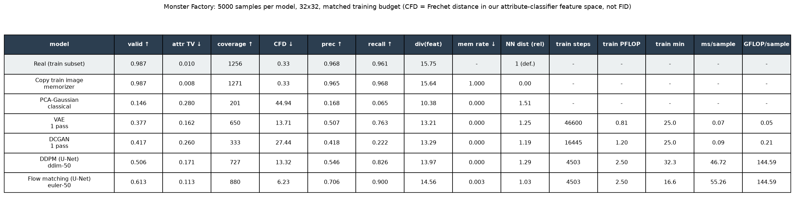
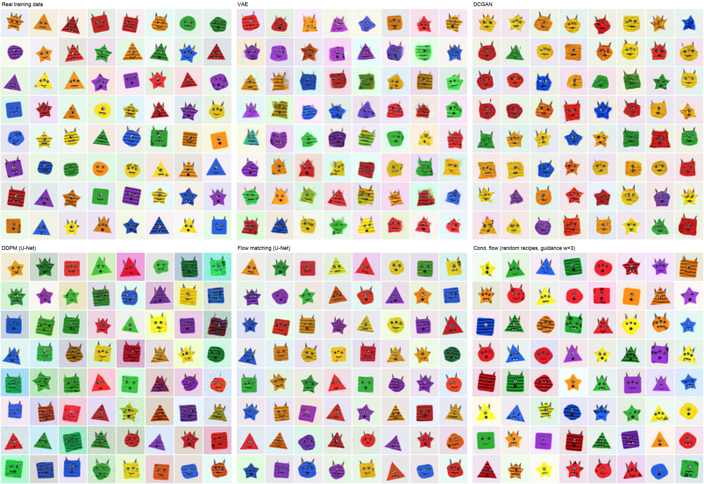
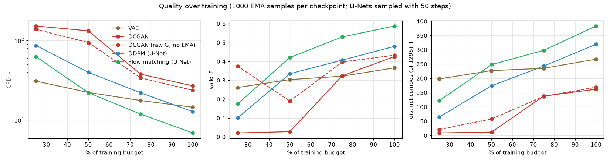
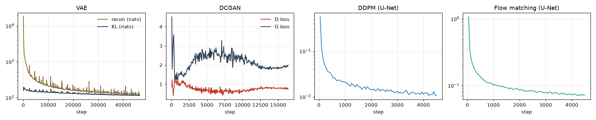
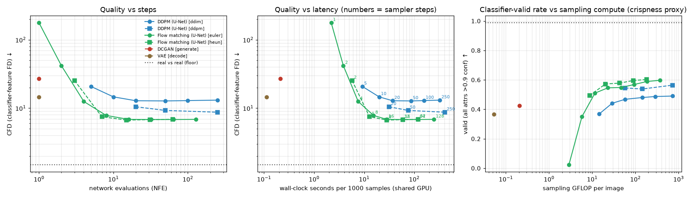
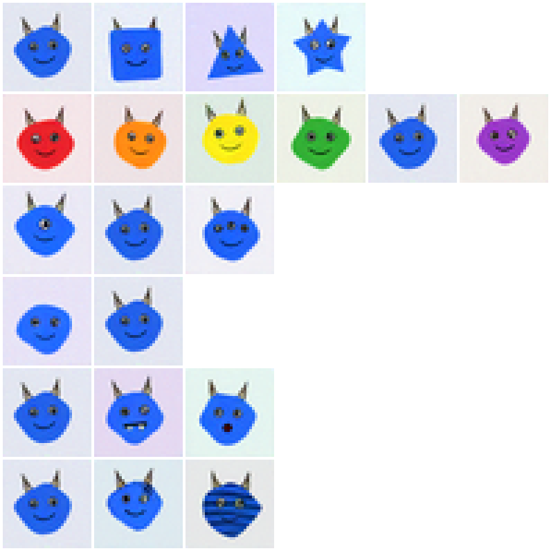
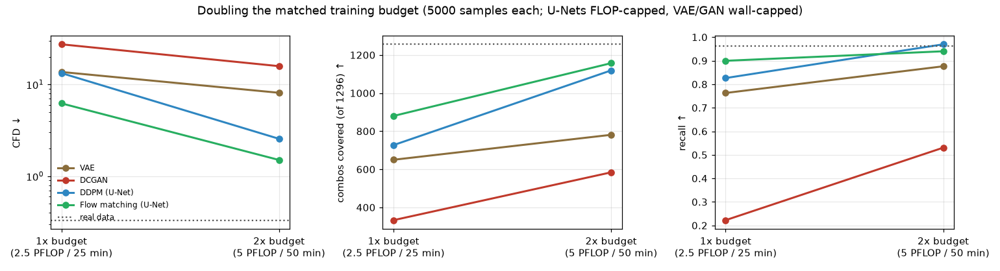
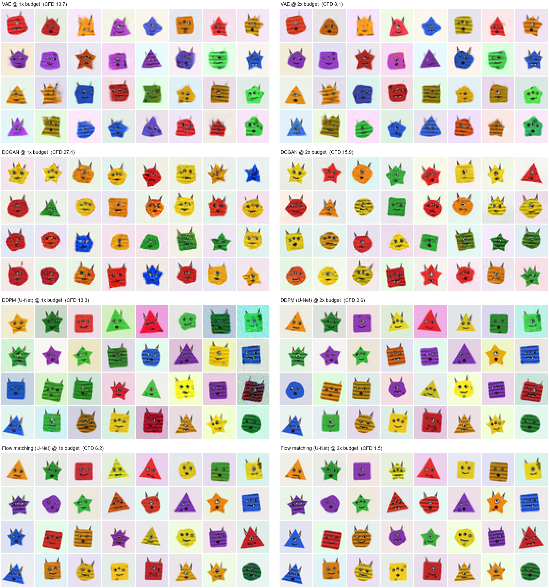

# RESULTS: Monster Factory (project 29)

**Status: done.** The first satisfying version works: flow matching produces recognizable, varied monsters. The tournament ran under the same explicit caps (FLOP-matched for DDPM vs flow; wall-matched for VAE and GAN, see below), and three go-deeper pieces are done too:
- attribute conditioning (97.9% all-six attribute accuracy)
- a 2× budget continuation of all four models
- a second training seed for DDPM and flow

All numbers below come from real runs on the shared M5 Max (12 other builders were using it). Seeds are fixed (data seed 0, training seed 0, sampling keys fixed per eval).

## Setup (decisions made without user input)
- **Data** (`data.py`): procedural monsters with 6 attributes, giving 4·6·3·2·3·3 = 1296 combos, plus continuous jitter in pose, scale, rotation, shade, background, wobble, spot placement and pupils. 32×32, **40,000 train / 8,000 test**, fixed split. The 64×64 renders exist but were not trained on (see "Not done").
- **Evaluator** (`train_classifier.py`): an MLX CNN with 6 attribute heads, trained once on real train data for 20 epochs. Held-out test accuracy per attribute: shape 99.99%, color 100%, eyes 99.98%, horns 100%, mouth 100%, pattern 98.6%. **All six right: 98.6%.** All six heads >0.9 confident on 97.5% of real test images.
  - A first 5-epoch version only reached 77.8% all-six (eyes 86%), so it was thrown away and retrained.
  - Its 256-d penultimate features give the **CFD**, a classifier-feature Fréchet distance. It is FID-like but uses **our** classifier, **not Inception**, so the numbers are not FID and are not comparable with published FIDs.
- **Generators** (`models.py`, `train_gen.py`), all from scratch in MLX:
  - **VAE**: 2.9M params, 128-d latent, Gaussian likelihood σ=0.15.
  - **DCGAN**: G 3.8M params, D 0.66M; BatchNorm in G, LayerNorm in D; non-saturating loss; Adam(2e-4, β1=0.5).
  - **DDPM**: a 6.5M-param U-Net (64·[1,2,2] channels, 2 res-blocks per level, attention at 8×8), ε-prediction, linear β schedule with T=1000.
  - **Flow matching**: the **identical U-Net** with a rectified-flow objective, x_t=(1−t)·noise+t·data, v=data−noise, t~U(0,1).
  - **Conditional flow matching**: the same U-Net plus 6 attribute embeddings and 15% null-token dropout, sampled with classifier-free guidance.

  All use batch 64 and EMA 0.999 weights. Every sample shown or measured comes from the EMA weights unless stated otherwise.
- **Matched training budget.** Every model got the same two caps, and whichever was hit first ended training:
  - **2.5 PFLOP** of estimated training compute: analytic forward FLOPs of conv/linear/attention ×3 for forward plus backward. For the GAN, D runs on real and fake, plus G forward, plus G-through-D.
  - **25 minutes** of training wall-clock.
- **Why 2.5 PFLOP and 25 min, not something larger:** the 4 shared GPU slots were saturated (about 20 queued `gpu_run` jobs), and my first slot only came free at 06:04 after waiting from 05:06. I cut the planned budget (4 PFLOP / 45 min) and wrote `session.py`/`queue.sh`, which keep a held slot busy with a resumable work queue.

| run | binding cap | steps | images seen | train PFLOP | train min | s/step (contention factor) |
|---|---|---|---|---|---|---|
| VAE | wall (25 min) | 46,600 | 2.98 M | 0.81 | 25.0 | 0.032 |
| DCGAN | wall (25 min) | 16,445 | 1.05 M | 1.20 | 25.0 | 0.091 |
| DDPM | **FLOP (2.5)** | 4,503 | 288 k | 2.50 | 32.3 | 0.43 |
| Flow matching | **FLOP (2.5)** | 4,503 | 288 k | 2.50 | 16.6 | 0.22 |
| Cond. flow | **FLOP (2.5)** | 4,503 | 288 k | 2.50 | 30.8 | 0.41 |

So **DDPM and flow are exactly compute-matched**: identical network, data, steps, batch, optimizer and EMA. Only the objective and sampler differ. VAE and GAN can't spend 2.5 PFLOP within 25 minutes because they are 8–32× cheaper per image. They are wall-matched instead, and saw 3.7–10× more images.

**One mid-run change:** contention slowed DDPM to 0.43 s/step against flow's 0.22, so it would have hit the 25-min wall before the FLOP cap. I raised DDPM's wall *safety* cap from 25 to 40 min mid-run (recorded in `runs/ddpm/config.json`) so the FLOP cap still binds and the steps match flow's. Conditional flow was launched with the 40-min safety cap from the start.

## Main comparison (5,000 samples per model, vs the 8,000-image real test set)

| model (sampler) | valid ↑ | attr TV ↓ | combos covered ↑ | CFD ↓ | precision ↑ | recall ↑ | mem. rate ↓ | NN-dist / real | s per 1k samples | GFLOP / sample |
|---|---|---|---|---|---|---|---|---|---|---|
| real train subset (reference) | 0.987 | 0.010 | 1256 | 0.33 | 0.968 | 0.961 | (1% by def.) | 1 | – | – |
| copy-a-train-image (memorizer) | 0.987 | 0.008 | 1271 | 0.33 | 0.965 | 0.968 | **1.000** | 0.00 | – | – |
| PCA-64 Gaussian (classical baseline) | 0.146 | 0.280 | 201 | 44.94 | 0.168 | 0.065 | 0.000 | 1.51 | – | – |
| VAE (1 pass) | 0.377 | 0.162 | 650 | 13.71 | 0.507 | 0.763 | 0.000 | 1.25 | 0.07 | 0.05 |
| DCGAN (1 pass) | 0.417 | 0.260 | 333 | 27.44 | 0.418 | **0.222** | 0.000 | 1.19 | 0.09 | 0.21 |
| DDPM (DDIM-50) | 0.506 | 0.171 | 727 | 13.32 | 0.546 | 0.826 | 0.0002 | 1.29 | 46.7 | 144.6 |
| **Flow matching (Euler-50)** | **0.613** | **0.113** | **880** | **6.23** | **0.706** | **0.900** | 0.0026 | 1.03 | 55.3 | 144.6 |

Wall-clock times come from a shared GPU, so use the GFLOP column for compute comparisons.

**How to read the columns:**
- **valid**: fraction of samples where all 6 classifier heads are >0.9 confident.
- **attr TV**: total-variation distance between predicted attribute marginals and the true marginals, averaged over the 6 attributes.
- **combos covered**: distinct predicted combos among valid samples.
- **precision / recall**: k-NN manifold precision and recall (k=3) in classifier-feature space.
- **mem. rate**: fraction of samples whose pixel-space nearest training image is closer than the 1st percentile of fresh-real-test→train NN distances. Exact float64 distances.
- **NN-dist / real**: median NN distance to train, relative to the same median for real test images.

**Headline (1× budget):** at equal training FLOPs, the same U-Net trained with **flow matching beats DDPM by a wide margin**: CFD 6.2 vs 13.3, valid 61% vs 51%, coverage 880 vs 727. The gap to DDPM-DDIM is far larger than seed-to-seed noise. Against DDPM's *best* sampler (ancestral-250, below) flow's lead is smaller: 6.8 vs 8.7 CFD at n=1,000 for Euler-32 (7.8 for Euler-8), so the 6.2-vs-13.3 headline partly reflects DDIM being a poor sampler for this ε-model. At 2× budget the gap narrows a lot (see go-deeper). The VAE ties DDPM-DDIM on CFD, despite blur, at 1/2700th of the sampling compute. The DCGAN is the clear loser on diversity: recall 0.22, only 333 combos.

Sample grids, with real data top-left: 

## Diversity and mode collapse (training stability)
 

Each checkpoint was evaluated on 1,000 EMA samples (U-Nets with 50 steps):

| model | metric | 25% | 50% | 75% | 100% |
|---|---|---|---|---|---|
| VAE | CFD | 30.9 | 22.3 | 17.6 | 14.5 |
| DCGAN (EMA) | CFD | 152.9 | 133.0 | 37.8 | 27.0 |
| DCGAN (EMA) | combos covered | **9** | **12** | 138 | 162 |
| DCGAN (raw G) | CFD | 139.1 | 94.6 | 34.1 | 23.7 |
| DCGAN (raw G) | combos covered | 21 | 58 | 137 | 169 |
| DDPM | CFD | 86.8 | 39.9 | 22.1 | 12.8 |
| Flow | CFD | 62.8 | 22.2 | 11.9 | 6.9 |

- **The GAN color-collapsed and then partly recovered** (preserved failure). For the first half of its budget it produced near-identical brown, mostly horned monsters (shape still varies a little).
  - *Reviewer caveat:* the 9–12 combos figure is confounded. Coverage only counts classifier-valid samples, and only 2–3% of EMA samples were valid at 25–50% (≈20–30 of 1,000), which caps coverage near that number. The raw generator covered 21 and 58. The collapse is real (see the GIF), but "9–12 combos" overstates how precisely it was measured. See frames 8–15 of `media/training_progress.gif`; the 40% frame shows all 20 tiles as near-identical brown monsters.
  - It recovered after about 50%, but finished with recall 0.22 and a strong color bias: blue 7% and purple 3% of samples, against about 17% each in the data.
  - G/D losses (`media/loss_curves.png`) show a G-loss hump around steps 4k–10k during the collapse, then settle. The loss curve alone would not tell you the samples were collapsed.
  - Ruled out: **BatchNorm eval-vs-train mode** and **EMA averaging**. On 1,000 samples from the final checkpoint, EMA/eval gives CFD 26.0, EMA/train-mode BN 25.6, raw/eval 23.0 and raw/train 23.0. Recall is 0.26–0.28 in all four cases.
- **VAE:** the most stable, with a monotone curve, and the best of all models early (CFD 31 at 25%). It plateaus on blur: shapes and colors are right, but mouths and patterns smear.
- **DDPM and flow:** both are still improving steeply at 100% of the budget, so neither has converged at this size. Flow is ahead at every checkpoint. Neither showed loss spikes (gradient norm was clipped at 1).

## Quality–latency (sampling steps vs quality vs compute)

1,000 samples per point, so absolute values are not comparable with the 5,000-sample table. Compare within this table only.

| sampler | NFE | CFD | valid | GFLOP/img | s / 1k (shared GPU) |
|---|---|---|---|---|---|
| flow Euler 1 / 2 / 4 | 1 / 2 / 4 | 177.6 / 41.8 / 12.5 | 0.02 / 0.35 / 0.51 | 2.9 / 5.8 / 11.6 | 2.2 / 3.8 / 7.6 |
| **flow Euler 8** | 8 | **7.8** | 0.55 | 23 | 15 |
| flow Euler 16 / 32 / 128 | 16 / 32 / 128 | 6.9 / 6.8 / 6.9 | 0.55 / 0.57 / 0.60 | 46 / 93 / 370 | 28 / 58 / 249 |
| **flow Heun 4** | 7 | **7.5** | 0.57 | 20 | 13 |
| flow Heun 8 | 15 | 6.7 | 0.58 | 43 | 28 |
| DDPM DDIM 5 / 10 / 20 / 50 / 250 | same | 20.8 / 14.6 / 12.9 / 12.8 / 13.1 | 0.37 / 0.44 / 0.47 / 0.48 / 0.49 | 14–723 | 9–323 |
| DDPM ancestral 20 / 50 / 250 | same | 10.5 / 9.3 / **8.7** | 0.55 / 0.54 / 0.56 | 58 / 145 / 723 | 31 / 76 / 412 |
| VAE decode | 1 | 14.5 | 0.37 | 0.05 | 0.11 |
| DCGAN | 1 | 27.0 | 0.43 | 0.21 | 0.21 |
| real vs real (floor) | – | 1.49 | 0.99 | – | – |

- **Flow saturates at about 8–16 Euler steps.** Heun-4 (7 NFE) matches Euler-8. Beyond 16 steps nothing improves.
- **DDPM: the stochastic ancestral sampler beats deterministic DDIM** (8.7 vs 13.1 at 250 steps, 10.5 vs 12.9 at 20). DDIM plateaus at 20 steps on a worse value. My reading: this undertrained ε-model has small systematic errors, and the injected noise corrects them while DDIM accumulates them. It shows up visually as tinted backgrounds and leftover speckle in DDIM samples.
- **Equal steps are not equal compute, and neither is equal wall time.** One NFE costs 2.9 GFLOP for both U-Nets, but a VAE or GAN sample costs 0.05–0.2 GFLOP. Flow with Euler-8 (23 GFLOP) matches or beats DDPM's best (ancestral-250, 723 GFLOP): **~31× less sampling compute** (8 vs 250 NFE of the same network). The quality edge at that point (7.8 vs 8.7 CFD, n=1,000) is about the size of seed-to-seed spread, so read it as "at least as good", not clearly better. The VAE nearly matches DDPM-DDIM's CFD (14.5 vs 12.8) for about 1/2700th of the sampling compute.

## Attribute accuracy (conditional flow matching, go-deeper)
`eval_cond.py` asked the conditional model for **every one of the 1296 combos**, 2 samples each, with 20 Euler steps, then read the attributes back with the evaluator:

| guidance w | all-6 correct | shape | color | eyes | horns | mouth | pattern | valid | CFD* | mem. rate |
|---|---|---|---|---|---|---|---|---|---|---|
| 0 (plain conditional) | 81.8% | 99.8% | 100% | 99.5% | 99.7% | 95.9% | 86.5% | 0.78 | 2.51 | 0.0046 |
| 1 | 96.5% | 100% | 100% | 99.9% | 100% | 99.7% | 96.8% | 0.92 | 1.35 | 0.0062 |
| **3** | **97.9%** | 100% | 100% | 99.8% | 100% | 99.9% | 98.2% | 0.93 | 2.07 | 0.0008 |

\* CFD here uses n=2592 samples with perfectly uniform combos, so it is not comparable with the n=5000 table.

- Chance level for all six is 1/1296 = 0.08%. The evaluator's own all-six accuracy on real images is 98.6%, so w=3 is close to the evaluator ceiling.
- Guidance trades a little distribution match for accuracy: CFD is best at w=1 and worse at w=3.
- Conditioning also makes samples cleaner. With no guidance, valid rises from 0.61 (unconditional) to 0.78 under the same budget, because the model no longer has to decide on the fly which of 1296 combos it is drawing.
- Single-attribute sweeps: 

## Go-deeper: seed variance (DDPM vs flow at 1× budget)
DDPM and flow were trained a second time with `--seed 1`, which changes init, data order and noise keys. Budget was the same 2.5 PFLOP, again FLOP-bound at 4,503 steps; the wall safety cap was 40 min and was not reached (18 train-min each, on a quieter GPU). Scored with the same 5,000-sample eval (`results/main_eval_seed1.json`):

| model | CFD seed 0 / seed 1 | valid | combos | precision | recall |
|---|---|---|---|---|---|
| DDPM (DDIM-50) | 13.32 / 14.16 | 0.506 / 0.497 | 727 / 677 | 0.55 / 0.52 | 0.83 / 0.79 |
| Flow (Euler-50) | 6.23 / 7.11 | 0.613 / 0.615 | 880 / 859 | 0.71 / 0.71 | 0.90 / 0.89 |

- The seed-to-seed spread is about ±0.5 CFD and ±25 combos. The flow-vs-DDPM gap (about 7 CFD, 150+ combos) is far outside it.
- VAE vs DDPM-DDIM at 1× (13.7 vs 13.3) **is** within seed noise: call that a tie.

## Go-deeper: doubling the matched budget (2×)
Each model's exact final state was continued: weights, EMA, Adam state, RNG and counters. Each model got the same cap again, 5 PFLOP / 50 train-min in total. The U-Nets had an 80-min wall safety cap instead, so the FLOP cap binds for them as at 1×. The runs are `runs/*_x2`, scored on 5,000 samples with the same samplers as the main table (`results/main_eval_x2.json`).

| model | binding cap | total steps | images seen | PFLOP | CFD 1× → 2× | valid 1× → 2× | combos 1× → 2× | recall 1× → 2× | mem. rate 2× |
|---|---|---|---|---|---|---|---|---|---|
| VAE | wall 50 min | 117,965 | 7.5 M | 2.05 | 13.7 → **8.1** | 0.38 → 0.43 | 650 → 781 | 0.76 → 0.88 | 0.0004 |
| DCGAN | wall 50 min | 43,702 | 2.8 M | 3.20 | 27.4 → **15.9** | 0.42 → 0.56 | 333 → 584 | 0.22 → 0.53 | 0.0016 |
| DDPM (DDIM-50) | FLOP 5.0 | 9,006 | 576 k | 5.00 | 13.3 → **2.6** | 0.51 → 0.76 | 727 → 1119 | 0.83 → 0.97 | 0.0020 |
| Flow (Euler-50) | FLOP 5.0 | 9,006 | 576 k | 5.00 | 6.2 → **1.5** | 0.61 → **0.84** | 880 → **1157** | 0.90 → 0.94 | 0.0072 |

For comparison, real data scores CFD 0.33, valid 0.99, 1256 combos and recall 0.96.

The GAN and VAE ran faster in their second session (less contention). They got 27k and 71k extra steps in the same 25 minutes, against 16k and 47k in the first session. Wall-capped budgets buy more steps when the machine is quiet.

Sampler sweep at 2× (1,000 samples per point, so compare only within this table; `results/sweep_x2.json`):

| sampler | NFE | GFLOP/img | CFD | valid |
|---|---|---|---|---|
| flow Euler 4 / 8 / 16 / 50 | 4 / 8 / 16 / 50 | 12 / 23 / 46 / 145 | 9.6 / 4.0 / **2.7** / 2.2 | 0.66 / 0.76 / 0.83 / 0.83 |
| flow Heun 4 | 7 | 20 | 4.7 | 0.78 |
| DDPM DDIM 20 / 50 | 20 / 50 | 58 / 145 | 3.3 / 3.2 | 0.72 / 0.75 |
| DDPM ancestral 50 / 250 | 50 / 250 | 145 / 723 | 3.4 / **2.4** | 0.80 / 0.84 |
| real vs real | – | – | 1.49 | 0.99 |

**What doubling the compute changed:**
- **The ranking holds, but the flow-vs-DDPM gap shrinks.** At 2× compute, DDPM's best sampler (ancestral-250, CFD 2.4) nearly matches flow Euler-50 (2.2) and beats flow Euler-16 (2.7). So most of flow's 1× advantage was **faster convergence per training FLOP**.
- **What remains is cheaper sampling.** Flow Euler-16 (46 GFLOP) roughly equals DDPM ancestral-250 (723 GFLOP), about **16× less sampling compute** for similar quality. At 1× the same comparison was ~31×.
- **A better flow model wants more steps.** At 1× flow saturated at 8 Euler steps. At 2× Euler-8 is clearly worse than Euler-16 (4.0 vs 2.7), because a sharper learned velocity field is less straight and needs finer integration.
- **The GAN keeps recovering** from its early collapse (recall 0.22 → 0.53, 584 combos) but is still last. The VAE improves steadily but stays blurry.
- **Memorization stays below the 1% real-data rate** for every model. Flow's rate grew from 0.26% to 0.72%, and its median NN distance is 1.01× that of real test images. Worth watching if training continues much longer.

The same noise gives the same monster at 1× and 2× for the deterministic samplers, so the right column shows what extra training fixed.

## Memorization
- No generator memorizes by this test. The detector is pixel-space L2 nearest neighbor (exact float64) against all 40k training images and flags samples closer to a training image than 99% of fresh real monsters are, so ~1% of real test images are flagged by construction.
  - Every generator is at or below that 1%: VAE 0%, GAN 0%, DDPM 0.02%, flow 0.26%, cond-flow 0.08–0.6%.
  - The detector itself works: the copy-a-train-image memorizer scores 100%.
  - Limit: pixel L2 is sensitive to background tint and position jitter, so a shifted or re-tinted near-copy could pass. The feature-space NN distance (`nn_feat_med_rel` in the JSON) partly covers this, and the visual pairs below agree.
- The closest-to-train samples per model (`media/memorization_pairs.png`) are simple plain-colored monsters next to a *similar* training monster. They differ in eye count, mouth, rotation or background, so they are neighbors, not copies.
- Flow's median NN distance is 1.03× that of real test images: it lands as close to the training set as fresh real data does, no closer. VAE, GAN and DDPM sit 1.2–1.3× further away because of blur and artifacts.

## Baselines
- **PCA-64 Gaussian** (classical, no training loop): CFD 44.9, precision 0.17, recall 0.07. Its samples are blurry ghost-monsters (`media/samples_pca.png`). Every learned generator beats it by 1.6–7× on CFD.
- **Copy-a-train-image**: the memorizer sanity check. It gets perfect quality numbers and is flagged 100% memorized.
- **VAE**: the learned baseline. It is matched on wall-clock rather than FLOPs (explained in the budget section).

## Surprises and caveats (please read before quoting numbers)
1. **`valid` is a crispness proxy, not human recognizability.** The PCA-Gaussian scores 14.6% valid while being unrecognizable: the classifier is overconfident out of distribution. Many of flow's "invalid" samples look fine to a human (`media/valid_vs_invalid.png`, rows 1–2 = flow valid/invalid, 3–4 VAE, 5–6 GAN).
   - The pattern head reads texture noise as "spots". Adding Gaussian noise with σ=16/255 to real test images flips 31% of *plain* monsters to "spots"; σ≤8/255 is harmless.
   - That is why every generator over-predicts "spots" (63–84% of samples vs 33% in the data) and why pattern dominates attr-TV. Generated bodies are not perfectly flat-colored.
   - CFD and precision catch what `valid` misses, so read the columns together.
2. **Precision, recall and CFD depend on sample size.** Flow's precision is 0.71 at n=5000 but 0.92 at n=1000 in the sweep, and the real-vs-real CFD floor is 0.33 at n=5000 but 1.49 at n=1000. Compare rows only within one table.
3. **Wall time is contention-dependent.** The same U-Net ran at 0.22 s/step (flow) and 0.43 s/step (DDPM) at different hours. Sampling latencies are from a shared GPU as well. FLOP columns are the reliable ones.
4. **GAN snapshot vs sample grid.** The fixed-noise snapshots in the training GIF look more mode-collapsed than random grids at the end. Those 64 noise vectors happen to sit in the yellow/orange mode.
5. **EMA lag.** EMA 0.999 with only 4.5k U-Net steps means early snapshots (≤1k steps) still contain about 37% of the random init. This is why the first U-Net GIF frames are noisier than the raw model.

## Not done / not measured
- 64×64 training: not done. The renders exist in `data/monsters.npz` (`x64_*`). This was skipped because of GPU-queue time.
- Latent diffusion and conditional GAN/VAE variants: not done.
- Human evaluation: not measured. Only the eyeball checks described above.
- Variance across seeds: measured only for DDPM and flow, with 2 seeds each (see above). VAE and GAN have one seed.

## Next steps
- Train longer than 2×. Every model was still improving even at 2×.
- Try a cosine or v-prediction DDPM. The linear-β ε-model at 4.5k steps is weak with DDIM.
- Train a GAN with spectral norm or R1 to see whether the early collapse goes away.
- Retrain the evaluator with noise augmentation so "spots" is not triggered by texture artifacts.
