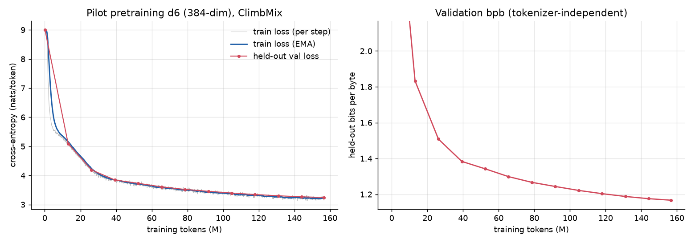

# Results · Nanochat on MLX (bring-up + pilot)

Machine: Apple M5 Max (128 GB), macOS 27, mlx 0.32.4, **shared with ~12 other builders**
(4, later 8, GPU slots via `../bin/gpu_run`). All throughput numbers were measured under that contention
and are lower bounds on what the chip does alone.

**Status: done** (first satisfying version). Everything below comes from real runs on
2026-10-22 between 04:57 and 10:25 (plus the reviewer's idle-GPU re-measurements at 10:32–10:36, marked "review"). Each SFT/eval result is a single run unless it says
otherwise. The **Round 5** section at the end comes from runs on 2026-10-24 (seeds 51–53, two turns).

## Headline numbers (the Measure items)

| measure | result |
|---|---|
| held-out loss (pilot) | val **3.243 nats/token, 1.167 bits/byte** after 157M tokens (d6, 16.9M params, 52 min). Review fix: the byte counts over-counted 136 partial-UTF-8 tokens; corrected **1.1685 bits/byte** (re-evaluated on `pilot/last`, same 0.52M val tokens) |
| training throughput | pilot mean **51k tok/s** (5.7 TFLOP/s model FLOPs), 10-step readings ranged 30k–127k depending on other jobs; peak 9.3 GB. Reviewer re-measured d6 on an idle GPU (10:32): **214k–230k tok/s** (24–25 TFLOP/s), so the pilot ran at roughly ¼ of the chip's speed. Efficiency pass (§2b, real accumulation-4 step, idle): d6 **217–234k tok/s** with the new fused-CE default (+6–11% over the old code in the same runs), **~203k sustained** once the laptop GPU throttles; d12 handoff config **~42k tok/s sustained** |
| MFU estimate | ~~30–39%~~ **Overstated method, see §2 review note.** The 30–39% divides contended model FLOP/s by a contended matmul "peak" (12.3 TFLOP/s). The pilot itself logged 14.1 TFLOP/s bursts, above that "peak". The idle bf16 matmul peak is **60.3 TFLOP/s**. Against that, the pilot's mean is **~9%** and idle-GPU d6/d8/d12 benches are **~40–52%** |
| first-token latency | **5.7 / 6.1 / 8.0 ms** for 16 / 128 / 512-token prompts (batch 1, pilot model, contended). Reviewer re-run on an idle GPU: **0.9 / 1.2 / 1.6 ms** |
| generation speed | **183–206 tok/s** decode with KV cache vs 81–118 tok/s recomputing without a cache (contended). Reviewer re-run on an idle GPU: **1310–1357 tok/s** with the cache, 580–1151 without |
| app responsiveness | **10–23 ms per sandbox decision** (median; a ~80-token prompt prefill plus ~4 decoded tokens) |
| action validity | **100%** on seen and on held-out delivery pairs (SFT LM, 8000 episodes); MLP baseline 77% / 82% |
| task success | SFT LM **100% on held-out pair combinations** vs **0%** for the non-language MLP baseline (72% on seen pairs); 3-delivery tasks: 4% (a documented shortcut failure). **Caveat (review):** the needed `put I in C` action is a word-for-word copy of the task line (358/358 held-out `put` steps), and the MLP's flat 28-way output head never saw the 5 held-out `put` classes as targets, so its 0% is guaranteed by construction. Read this as "copying from the prompt suffices", not as compositional reasoning (§4) |
| pretraining vs scratch | identical at 8000 SFT episodes (both 100%); with 300 / 1000 episodes, pretrained averages 26% / 34% held-out success vs 15% / 6% from scratch (5 seeds each, very high variance) |

## 1. Bring-up checks

| check | result |
|---|---|
| tokenizer | byte-level BPE, 8192 vocab (incl. 9 specials), trained on 100M chars in 10 s. Held-out compression **4.02 bytes/token** (gpt2: 4.64, cl100k: 4.80, both with ~5–12× larger vocabularies) |
| data | ClimbMix shards 0–11 → **760M train tokens**; shard 6542 (first 20k docs) → **14.8M val tokens** |
| overfit one batch | d2 model, 150 steps on one fixed batch: loss **9.01 → 0.31** (`logs/overfit_one_batch.log`; `train.py --overfit-one-batch`) |
| checkpoint/resume | 60-step run vs 30 + kill + resume 30 (grad-accum path): per-step losses **bit-identical** (max diff 0.0) |
| KV cache | greedy decode with cache == naive full recompute (unit test); chunked prefill max logit diff 7e-4 (fp32) |
| causality | changing token t leaves logits < t unchanged (unit test) |
| smoke | `./smoke.sh` end to end (pretrain, resume, SFT, MLP, eval, pytest) in ~52 s |

## 2. Throughput benchmark (`bench.py`, `media/bench.json`)

Measured 08:25–08:29 inside a gpu_run slot **while 7 other slots were busy**. The 15-minute load
average was 8.7 and had been about 30 earlier, per the orchestrator. Synthetic tokens; each
measured step is a full forward, backward and MuonAdamW update, timed over 10 steps after
3 warm-up steps. "TFLOP/s" counts model FLOPs only (6·N_matmul + 12·h·d_head·T per token,
upstream's formula). The MFU denominator is a measured dense 8192² matmul in the same dtype at
the same time: **12.3 TFLOP/s bf16, 10.2 TFLOP/s fp32**.
That denominator is also depressed by contention. At 05:05, with a quieter GPU, the same
matmul measured **16.7 TFLOP/s** bf16 and d4 trained at **199k tok/s** (8.75 TFLOP/s) versus
72k tok/s here. Treat every absolute number in this table as a contended lower bound. The
ratios between rows are more trustworthy.

| model | params | dtype | mx.compile | B×T | tok/s | TFLOP/s | MFU vs measured peak | peak mem |
|---|---|---|---|---|---|---|---|---|
| d4 | 7.3M | bf16 | yes | 16×1024 | 72,525 | 3.19 | 26% | 4.1 GB |
| d4 | 7.3M | bf16 | no | 16×1024 | 52,129 | 2.30 | 19% | 3.4 GB |
| d4 | 7.3M | fp32 | yes | 16×1024 | 67,619 | 2.98 | 29% | 5.8 GB |
| d4 | 7.3M | fp32 | no | 16×1024 | 43,328 | 1.91 | 19% | 4.7 GB |
| d6 | 16.9M | bf16 | yes | 16×1024 | 34,142 | 3.79 | 31% | 5.2 GB |
| d6 | 16.9M | bf16 | no | 16×1024 | 27,704 | 3.07 | 25% | 4.5 GB |
| d6 | 16.9M | fp32 | yes | 16×1024 | 29,713 | 3.29 | 32% | 7.8 GB |
| d6 | 16.9M | fp32 | no | 16×1024 | 22,523 | 2.50 | 24% | 7.0 GB |
| d8 | 33.6M | bf16 | yes | 16×1024 | 18,458 | 4.18 | 34% | 6.5 GB |
| d8 | 33.6M | bf16 | no | 16×1024 | 14,718 | 3.33 | 27% | 6.1 GB |
| d8 | 33.6M | fp32 | yes | 16×1024 | 14,411 | 3.26 | 32% | 10.5 GB |
| d8 | 33.6M | fp32 | no | 16×1024 | 11,283 | 2.56 | 25% | 10.2 GB |
| d10 | 59.6M | bf16 | yes | 16×1024 | 10,040 | 4.07 | 33% | 8.7 GB |
| d10 | 59.6M | bf16 | no | 16×1024 | 8,525 | 3.45 | 28% | 8.1 GB |
| d10 | 59.6M | fp32 | yes | 16×1024 | 8,740 | 3.54 | 35% | 14.9 GB |
| d10 | 59.6M | fp32 | no | 16×1024 | 7,828 | 3.17 | 31% | 13.6 GB |
| d8 | 33.6M | bf16 | yes | 32×1024 | 20,914 | 4.74 | 39% | 12.5 GB |

> **Review note (10:32, idle GPU, load average 1.6; one 10-step `bench_train` each, so treat
> these as single readings).** The bf16 8192² matmul measured **60.3 TFLOP/s** (twice; fp16 60.8,
> fp32 43.1), not 12.3 or 16.7. Same code, bf16, compiled:
> d6 B=16 **214k tok/s (23.8 TFLOP/s, 39%)**, d6 B=32 230k (25.5, 42%), d8 B=32 133k (30.0, 50%),
> d12 B=16 47k (31.1, 52%), all vs 60.3. The "MFU vs measured peak" column above divides one
> contended number by another contended number taken at a different moment. The pilot log
> itself shows 14.1 TFLOP/s at steps 1030–1050, which is 115% of that 12.3 "peak". Keep the
> ratios between rows (compile and dtype effects). Don't use the MFU column or the absolute
> tok/s as properties of the chip. The FLOPs-per-token formula (6·N_matmul + 12·L·h·d·T,
> excluding embeddings) matches upstream `estimate_flops`.

Takeaways:
- **mx.compile is worth 1.2–1.5×** at every size, and it costs ~0.5 GB of extra peak memory.
- **bf16 vs fp32 is only 1.07–1.3× faster**, but it uses ~40% less memory. Master weights
  stay fp32 either way. Only the matmuls change dtype, so the gap is smaller than on CUDA.
- MFU against the measured matmul peak is ~30–39% for d6 and up (bf16, compiled). The
  remaining time goes to attention, norms, softcap/CE in fp32, the optimizer and kernel launches.
- Peak memory at the pilot config (d8, B=32×1024) is 12.5 GB, far under the 40 GB allowance.
  d10 fp32 needs 14.9 GB at B=16.

## 2b. Efficiency pass (2026-10-22 afternoon; details in `efficiency/REPORT.md`)

Stopped early at 14:07 because the user needed the machine. The last d6 plateau run was killed and discarded; everything below finished before that.

The measurements ran 12:51–14:04 on an idle GPU: no other projects' `gpu_run` jobs, and a
1-minute load average of 1.9–4.8, recorded per run. A new harness (`efficiency/bench_step.py`)
times the **real** training update. That means 4 accumulated micro-batches from the real
loader, MuonAdamW, compile and bf16, the same `make_update` function `train.py` calls.
Candidates and the baseline are interleaved window by window in one process. `bench.py`
updated the optimizer after every 16-row batch, which overweights it about 8×. In a real
update the optimizer is only 1.7% (d6) / 4% (d12) of the time.

| config | baseline (pilot code) | final (default now) | MFU vs 60.3 TFLOP/s cold peak |
|---|---|---|---|
| d6, 32×1024, accum 4 (pilot), interleaved | 205k / 211k tok/s (two runs) | **217k / 234k tok/s (+6.2% / +10.6%)** | 38–39% → **40–43%** |
| d6, sustained plateau after ~5 min | not measured | **~203k tok/s** | 37% |
| d12, 16×1024, accum 8 (handoff), interleaved | 42.6k tok/s | **43.3k tok/s (+1.9%, noise level)** | 47.0% → 47.5% |
| d12, handoff config, sustained plateau (7 min) | not measured | **~42.0k tok/s = 27.7 TFLOP/s** | 46% |

- **Kept and on by default:** a fused logit-softcap + cross-entropy Metal kernel
  (`fused_ce.py`, `--ce-mode kernel`). It gives the same math within bf16 reorder noise
  (parity in `efficiency/parity.json`), +6–11% at d6, about +2% at d12, and 2.6 GB less peak
  memory at d6. `--ce-mode ref` restores the pilot's exact path.
- **Discarded, no measurable gain** (all within ±2%): on-device accumulation with one host sync,
  a 2× device batch, a fused QKV GEMM, batched Muon, and `addmm` Newton–Schulz. The 512×512
  SDPA backward tiles gave a consistent but small +2.7% (d6) / +1.8% (d12), below the 3% gate;
  they remain an opt-in env knob. The 256 tiles were 5–10% slower. Two training-changing
  options were benchmarked but stay off: bf16 capped logits were slower than the kernel, and
  fewer Muon iterations gave no measurable speedup.
- **Surprise: thermal throttling dominates the numbers.** This is a MacBook Pro M5 Max. Over
  about 4 minutes of load, tok/s falls by about 20% (d12: 52k in the first window, then a 42k
  plateau), and the matmul "peak" measured right after a run reads 38–51 TFLOP/s instead of 60.
  The §2 review note's 214–230k (d6) and 47k (d12) were fresh-GPU 10-step readings. For sizing
  a multi-hour run, use the plateau.
- Headroom estimate: d12 runs at about 61% of the same-moment (throttled) matmul peak. The
  remaining time is fused SDPA (22–25% of a step) and many small compiled elementwise ops.
  No single uncovered op justified another custom kernel.

## 3. Pilot pretraining (`run_pilot.sh` → `checkpoints/pilot/last`, `media/loss_curve.png`)

`run_pilot.sh` sized the run from the benchmark measured inside the same slot. Under the
contention at 08:29, d8 would have reached only ~4 tokens per parameter in the budget, so the
script fell back to **d6**, which got ~11 tokens per scaling parameter (upstream trains at 12).

| | |
|---|---|
| model | d6: 6 layers, 384-dim, 3 heads × 128, seq 1024, vocab 8192. **16.9M params** (13.8M "scaling" params = matrices + lm_head) |
| optimizer | MuonAdamW (Muon lr 0.02·0.5, AdamW embed 0.3·0.5·√(768/384), …), WD 0.98 (upstream's D_ref/D scaling), warmup 40, warmdown 65% |
| batch | 131,072 tokens/step (32 × 1024 × 4 micro-batches), bf16 matmuls, mx.compile |
| steps / tokens | **1,195 steps = 156.6M tokens** (0.21 epoch of the 760M tokens downloaded) |
| wall time | **51.7 min** (planned for 90 min at the 08:29 throughput; the GPU got quieter mid-run) |
| throughput | mean **51k tok/s** (median 54k; 10-step readings ranged from 30k to 127k with the load from other jobs) = 5.7 TFLOP/s model FLOPs. An idle M5 Max does ~214k tok/s on d6 (review note, §2) |
| peak memory | **9.3 GB** |
| held-out val loss | 9.00 → **3.243 nats/token** |
| held-out val bpb | 3.24 → **1.167 bits/byte** (fixed first 0.52M tokens of the val shard: 16 batches × 32 × 1024). Corrected byte counts give **1.1685** (review fix in `tokenizer.token_bytes`; every bpb in the table below is ~0.12% low for the same reason) |

| step | tokens | val loss | val bpb |
|---|---|---|---|
| 100 | 13M | 5.093 | 1.833 |
| 300 | 39M | 3.845 | 1.384 |
| 600 | 79M | 3.520 | 1.267 |
| 900 | 118M | 3.345 | 1.204 |
| 1195 | 157M | 3.243 | 1.167 |

Train loss tracks val loss closely: no overfitting, which is expected at 0.2 epoch. The curve
is still going down at the end, so the model is undertrained by design.

Sample generations (greedy, `checkpoints/pilot/step_*/samples.json`, also in the demo):
- step 298 (39M tokens): "The capital of France is *a 20th century, and the 19th century, the 19th century…*"
- step 1195 (157M tokens): "Once upon a time, *there was a fascinating world called "crustacean" that was named after the French word "crustacean"…*"
- "The most important thing about water is *the water. The water is the water…*". Greedy
  repetition loops persist at every checkpoint. These are fluent-ish English fragments from a
  17M-parameter model, not knowledge.

## 4. The tiny job: Grid Courier (`sandbox.py`, `sft.py`, `eval_sandbox.py`)

**World.** A 5×5 grid holds 3 items (from key, apple, gem, coin, book, cup) and 2 containers
(box, basket, chest). Each task asks for one or two deliveries, for example "put the gem in the
basket, then put the key in the box". The action language has 28 strings: `move
north|south|east|west`, `pick <item>`, `put <item> in <container>`. An action is invalid if it
is malformed or illegal in the current state, for example walking into a wall, picking from
the wrong cell or putting into the wrong container. An invalid action uses up one of the
40 allowed steps and leaves the state unchanged. Every observation is the full text state,
so the task is Markov, and each step is one single-turn chat in upstream's format:
`<|bos|><|user_start|>{state}<|user_end|><|assistant_start|>{action}<|assistant_end|>`, with
loss only on the action tokens.

**Data and splits.** Training uses expert traces from 8000 episodes (115,510 step examples,
8.9M tokens). **5 of the 18 (item, container) delivery pairs never appear in training tasks**,
though every item and container does. Evaluation episodes use disjoint, fixed seeds:
- `test_seen`: new layouts, built only from seen pairs.
- `test`: **held-out combinations**, at least one unseen delivery pair.
- `test3`: **three deliveries** (out of distribution in length; training tasks have at most
  two). The expert needs 25.9 steps on average and at most 39, inside the 40-step limit.

**Policies, matched where it matters:**
- `expert`: the scripted optimal policy that generated the traces (upper bound).
- `random`: uniform over currently legal actions.
- `mlp` (**the non-language baseline**): a 151k-parameter MLP over a 307-dim one-hot
  encoding of exactly the information in the text. It is trained on the same 115,510 expert
  (state, action) pairs for 30 epochs (41 s; 95.4% next-action accuracy on held-out layouts).
- `lm`: the pilot after SFT (3 epochs, 1,626 steps, 6.5 min), greedy decoding with the KV cache.
- `lm_constrained`: the same model, with the output forced to be one of the 28 action strings
  (argmax of the sequence log-prob). That guarantees well-formedness, not legality.
- `lm[scratch]`: the same architecture and SFT recipe from random init, with no pretraining.

Success / action validity (episodes). Latency is the median ms per decision on the shared GPU.

| policy | seen pairs | **held-out pairs** | 3 deliveries | ms/decision |
|---|---|---|---|---|
| expert | 100% / 100% (200) | 100% / 100% (200) | 100% / 100% (100) | 0.0 |
| random legal action | 1% / 100% (200) | 1% / 100% (200) | 0% / 100% (100) | 0.0 |
| **MLP baseline** | 72% / 77% (200) | **0%** / 82% (200) | 1% / 76% (100)¹ | 0.4 |
| **LM: pilot + SFT** | **100% / 100%** (200) | **100% / 100%** (200) | **4%** / 45% (100) | 14.6 |
| LM: pilot + SFT, constrained | 100% / 100% (200) | 100% / 100% (200) | 4% / 45% (100) | 10.1 |
| LM: scratch + SFT | 100% / 100% (200) | 100% / 100% (200) | 0% / 29% (100) | 22.8 |
| LM: scratch + SFT, constrained | 100% / 100% (200) | 100% / 100% (200) | 0% / 30% (100) | 12.2 |

¹ The MLP's fixed-size input encodes only the first two deliveries, so it cannot see the third one. Its 3-delivery cell is N/A by construction, not a measured failure.

The SFT'd language model solves every held-out delivery combination in the optimal number of
steps (15.3 on average, the same as the expert). The non-language MLP, trained on the same
traces, gets 72% on seen combinations and **0%** on unseen ones. On held-out pairs it
confidently emits a training-time pairing such as `put gem in box`. That action is invalid,
and a deterministic policy then repeats it until time runs out.

**Review caveat: what this comparison does and doesn't show.**
- *The MLP's 0% is structural.* Its input factors item and container one-hots, so it can
  *represent* an unseen pair. But its output is a flat softmax over the 28 action strings,
  and the 5 held-out `put` actions (`put gem in basket`, …) appear **0 times** among the
  115,510 training targets. Those output classes only ever received negative gradient, so the
  MLP cannot emit them, and every held-out task needs one. The 0% is guaranteed by the design
  of the output head, not learned. A fair non-language baseline would use a factored head
  (verb × item × container) or a pointer to the task slots. That has not been run.
- *The LM's 100% is string copying.* In every held-out episode checked (358/358 `put` steps
  over 200 test episodes), the required action `put I in C` is the task line's
  `put the I in the C` with the two "the"s dropped. The tokenized output factors into
  `put` + item + `in` + container, so the LM only has to copy two words it can see. It also
  succeeds without pretraining. "The sandbox is easy and copying suffices" is the honest
  reading, not "the LM learned compositional reasoning".
- *No leakage found.* Over the 8,000 training episodes: 0 tasks with a held-out pair, 0
  observations containing a held-out "I in C" string, 0 held-out `put` targets. 0 of 3,065
  held-out-test observations are identical to any training observation.

Pretraining is **not** what makes this work at full data: the scratch model also reaches 100%
on seen and held-out pairs. Pretraining buys sample efficiency instead (next table). Constrained
decoding changes almost nothing, because the SFT'd models never produce malformed text. Every
invalid action is a well-formed but illegal move.

### Data efficiency: pretrained vs scratch at 300 / 1000 training episodes

The same SFT recipe and roughly the same token budget per run (~7M tokens: 20 epochs of 300
episodes or 6 epochs of 1000), 100 eval episodes per split.

| episodes | init | seeds | success seen pairs (per seed) | success held-out pairs (per seed) | mean seen | mean held-out | final SFT val loss (mean) |
|---|---|---|---|---|---|---|---|
| 300 | pretrained | 5 | 50 / 0 / 56 / 46 / 55 | 32 / 0 / 23 / 33 / 41 | **41%** | **26%** | 0.106 |
| 300 | scratch | 5 | 31 / 39 / 1 / 35 / 0 | 24 / 36 / 2 / 12 / 0 | **21%** | **15%** | 0.135 |
| 1000 | pretrained | 5 | 75 / 28 / 79 / 0 / 52 | 61 / 19 / 61 / 0 / 31 | **47%** | **34%** | 0.080 |
| 1000 | scratch | 5 | 11 / 19 / 10 / 3 / 0 | 8 / 9 / 8 / 3 / 0 | **9%** | **6%** | 0.112 |

(`summarize.py`. Seed 0 comes from `run_extra.sh`, seeds 1–4 from `run_seeds.sh`. A seed
changes the init and data order; the training episodes are the same.)

- **With little data, pretraining helps on average: 41% vs 21% (300 episodes) and 47% vs 9%
  (1000 episodes) on seen pairs. Held-out pairs: 26% vs 15% and 34% vs 6%.** Pretrained models
  also reach lower SFT val loss (0.106 vs 0.135 and 0.080 vs 0.112).
- **Variance between seeds is huge.** One pretrained seed scores 0% at each data size; 0–79%
  is the full range. Five seeds give the direction, not a tight estimate.
- From scratch, 1000 episodes did *worse* than 300 at the same ~7M-token budget (6 vs 20
  epochs). In ~400 steps the scratch model underfits the larger set (val loss 0.112).
- At 8000 episodes both reach 100%. So pretraining shows up as **sample efficiency**, not as a
  higher ceiling, on this task.
- Bookkeeping: seed 2's 300-episode eval JSON was overwritten by a concurrent run writing
  the same file. Its numbers were recovered verbatim from `logs/seeds2.log`
  (`media/sandbox_eval_seeds_s2.json`).

### The good kind of failure: 3-delivery tasks

All LMs fail on three deliveries (best 4%). In the transcripts we read (`media/episode_transcripts.md`, the demo's "test3" episodes),
the failures look like a specific shortcut rather than general confusion. In training,
the container in the *second* delivery is always the **last container named in the task
string**. On 3-delivery tasks the model applies that rule to the second delivery. In one
episode it walks to the basket correctly (the navigation reads the right coordinates) and then
says `put key in box`, the last container in the sentence. In another it delivers the gem to
the basket instead of the chest. Then, because the policy is deterministic and the invalid
action leaves the state unchanged, it repeats the same invalid action until the 40-step limit.
The small-data models show two more failure loops that never happen at full data:
oscillating `move north` / `move south` forever, and walking into a wall instead of emitting
`put`.

## 5. Handoff to the M4 Pro mini (**extrapolation, not measured**)

None of these numbers were measured on the M4 Pro. They extrapolate from this port's
measured M5 Max throughput:
- **Efficiency-pass update (14:05, idle M5 Max, corrected harness; supersedes the M5 Max
  inputs below).** At the exact handoff config (d12, `--device-batch 16 --total-batch 131072`,
  so accumulation 8, with the fused-CE default), the M5 Max sustains **~42,000 tok/s = 27.7
  model TFLOP/s** once thermally settled. The first minute runs at about 52k. On the M5 Max
  that would be ~12B tokens in 80 h. **Mini extrapolation (not measured):** tokens in 80 h ≈
  mini tok/s × 288,000. At the ratios discussed below, ~1/15–1/8 of the M5 Max plateau gives
  2.8–5.3k tok/s, about **0.8–1.5B tokens** for d12 (9–17× its 91M scaling params). The
  rule-of-thumb ⅓–½ ratio would give 14–21k tok/s, about 4–6B tokens. The table's 2 / 3 / 4
  TFLOP/s columns correspond to 3.0k / 4.5k / 6.1k tok/s for d12, which is 1/14, 1/9 and 1/7
  of this plateau. Measure on the mini with the corrected harness and size from the **last**
  windows, not the first:
  `../.venv/bin/python efficiency/bench_step.py --depth 12 --B 16 --accum 8 --variants kernel --windows 10 --per-window 4`
  (about 3–4 min on the mini; prints per-window tok/s; a Mac mini may throttle less than this
  laptop).
- Model FLOP throughput here was **4–5 TFLOP/s under heavy contention** (bench, 08:29) and
  **~9 TFLOP/s when the GPU was quieter** (d4 bench at 05:05: 8.75; pilot end phase: 8.9).
  The pilot averaged 5.7.
- An M4 Pro has roughly half the GPU cores of an M5 Max and an older GPU generation.
  **Assumption: 2–4 TFLOP/s sustained model FLOPs on the mini**, with nothing else running.
  Replace this with a 2-minute measurement first:
  `../.venv/bin/python bench.py --depths 8,10,12 --quick`.
- **Review note: the assumed M4 Pro : M5 Max ratio, stated explicitly.** On an *idle* M5 Max the
  reviewer measured d12 at **31 TFLOP/s model FLOPs (47k tok/s, B=16)**; see the §2 review note.
  So 2–4 TFLOP/s on the mini assumes the mini reaches **~1/15–1/8 of an idle M5 Max** (or about
  ⅓–½ of the *contended* 4–9 TFLOP/s above, which is what the original text was implicitly
  scaling). A common rule of thumb says an M4 Pro has ⅓–½ of an M5 Max's GPU throughput. That
  would mean ~10–15 TFLOP/s and **~4.5–6.8B tokens for d12 in 80 h**, enough for d14–d16 at 12×.
  The M5 Max's per-core matmul accelerators (60 TFLOP/s bf16 matmul measured) make the
  ⅓–½ rule doubtful for matmul-bound training. The M4 Pro GPU's spec-sheet FP16/FP32 peak is
  on the order of 8–9 TFLOP/s (not measured here), so 2–4 TFLOP/s sustained is the more
  plausible range. The 2-minute `bench.py` run on the mini decides it. Size `--num-iterations`
  from that measurement and not from this table.
- The table below assumes nothing else is using the mini's GPU. The last paragraph of this
  section says the mini is currently running upstream nanochat (PyTorch). If that run is still
  going, the throughput here will be lower.
- Arithmetic (checked): tokens = TFLOP/s × 10¹² × 80 h × 3600 s/h ÷ FLOPs/token. For d12,
  FLOPs/token = 660.6M (`GPT.estimate_flops`), and 3 × 10¹² × 288,000 ÷ 6.606 × 10⁸ = 1.31B tokens,
  which is 14.3× the 91.2M scaling params.
- Budget: Thursday afternoon to Monday morning ≈ 90 h of wall time. Assume **80 h of training**
  after setup, evals and checkpoints.

Tokens reachable in 80 h (vocab 8192, seq 1024; FLOPs/token from `GPT.estimate_flops`):

| model | params (total / scaling) | 2 TFLOP/s | 3 TFLOP/s | 4 TFLOP/s |
|---|---|---|---|---|
| d8 | 34M / 29M | 2.5B tok (87×) | 3.8B (130×) | 5.1B (173×) |
| d10 | 60M / 54M | 1.4B (26×) | 2.1B (39×) | 2.8B (52×) |
| **d12** | **98M / 91M** | 0.87B (10×) | **1.3B (14×)** | 1.7B (19×) |
| d14 | 150M / 142M | 0.57B (4×) | 0.86B (6×) | 1.1B (8×) |

(×) = tokens per scaling parameter. Upstream's default horizon is 12×.

**Suggested target: d12 (~98M params, GPT-2-small class) for ~1.3B tokens**, which sits at
upstream's ratio if the mini sustains ~3 TFLOP/s. Fall back to d10 if the measured throughput
is nearer 2 TFLOP/s. How to run it:
1. `python data.py --download 24 && python data.py --tokenize` (≈1.5B tokens, ~2.2 GB of parquet).
2. `python efficiency/bench_step.py --depth 12 --B 16 --accum 8 --variants kernel --windows 10 --per-window 4`
   (the real training step; `bench.py` overweights the optimizer). Take the plateau tok/s from
   the last windows and pick `--num-iterations = tok/s × 0.85 × 80 h / 131072`.
3. `python train.py --depth 12 --total-batch 131072 --device-batch 16 --num-iterations N --save-every-min 20 --sample-every 2000 --out checkpoints/d12 --resume`.
   Wrap it in a shell loop that reruns on exit: resume is bit-exact and `last/` is rewritten
   every 20 min. Expected peak memory is ~12–20 GB, extrapolated from d10 = 8.7 GB at B=16.
4. Then the same `run_post.sh` steps (SFT + sandbox evals) against `checkpoints/d12/last`.

Things to change for a multi-day run: evaluate on more val tokens (`--eval-batches 64`), keep
`--sample-every` checkpoints only as weights, and consider a larger vocab (16k–32k, like
upstream) once the model is ≥100M parameters. The mini is currently running upstream nanochat
(PyTorch); this port is an MLX alternative, not a continuation of that run.

## 6. Inference (`engine.py`, `media/inference_bench.json`)

Batch 1, pilot model (d6), greedy decoding, random prompts, median of 3, measured during
other jobs.

| prompt tokens | first-token latency | decode tok/s (KV cache) | tok/s without cache |
|---|---|---|---|
| 16 | 5.7 ms | 206 | 81 |
| 128 | 6.1 ms | 195 | 89 |
| 512 | 8.0 ms | 183 | 118 |

At 17M parameters, decoding is bound by Python overhead and kernel launches, not by FLOPs:
~5 ms/token regardless of context. That is why the cache only buys 1.5–2.5× here.
*Review note:* these numbers were measured during heavy contention. Re-run on an idle GPU
(10:33, same command): first token **0.91 / 1.19 / 1.62 ms**, KV-cache decode **1357 / 1347 / 1310
tok/s**, no cache 1151 / 835 / 580 tok/s, so ~0.75 ms/token. The no-cache column times only 32
tokens and is noisy: in the contended run it got *faster* with longer prompts. Treat the
cache-speedup ratio as rough. Token-for-token check by the reviewer: KV-cache greedy equals
no-cache greedy on the SFT model (bf16 and fp32, sandbox prompt) and on the pilot (fp32). In bf16
the pilot diverged once at an exact top-2 logit tie, which is numerics, not a bug.
Two-chunk prefill with an offset gives identical logits in fp32, so the causal mask is
aligned correctly with the cache. The next
steps are `mx.compile` on the single-token decode step and async evaluation in place of a
`.item()` sync per token.

## 7. Deviations, surprises, gaps

- **Data:** the brief says FineWeb-Edu; upstream nanochat moved to `karpathy/climbmix-400b-shuffle`
  in March 2026, so this port follows upstream (same parquet layout, last shard = val).
- **GPU queue:** the bench + pilot job queued in `gpu_run` from 05:13 to 08:25, with every slot
  held by other projects' long jobs. At 07:31 the orchestrator offered a reserved slot
  (`GPU_SLOT=reserved_nanochat`). Launching on it was **denied by this session's permission
  classifier**, so the pilot was relaunched in the normal 8-slot queue and acquired a slot at
  08:25. Because of that wait, `run_pilot.sh` sizes the run from the clock (`PILOT_END=10:30`)
  and from the throughput measured in the same slot. It picked **d6 rather than the planned
  d8**: under contention d8 would have reached only ~4 tokens/param. Contention then dropped
  and the run finished in 52 min, not 90. Because the schedule is fixed up front, the
  run couldn't use the spare time.
- Tokenization (CPU only, 4 threads, `nice`) ran outside the lock after it had sat in the queue.
- **Contention dominates every throughput number.** The same d4 config measured 199k tok/s at
  05:05 and 72k tok/s at 08:26. The orchestrator reported a load average of ~30 around 07:30.
- **Surprise: pretraining was not needed for the full-data job.** A randomly initialised model
  with the same SFT recipe also reached 100% on held-out pairs. The sandbox is too easy at 8000
  episodes. Pretraining only shows up in the low-data runs, and those vary a lot between seeds.
- **Surprise: constrained decoding is a no-op here.** SFT'd models never emit malformed
  actions, only well-formed illegal ones. Restricting outputs to *legal* actions would make
  validity 100% by construction, so it was not counted as a result.
- **Not done (Go-deeper stage):** RL post-training, value embeddings, smear/backout,
  sliding-window attention, BOS-aligned best-fit packing, CORE/MMLU-style evals, and a
  batched multi-episode engine.
- Tokenizer quirk: HF `tokenizers` always splits the literal special-token strings
  (`<|bos|>` etc.) out of raw text, even with `add_special_tokens=False`. Web text that contains
  them gets real special ids. This is rare and was left alone.
- Weight decay follows upstream's `0.28·√(B/B_ref)·D_ref/D` scaling, which gives 0.98 for this
  short run. That is large, but it was not tuned.
- Checkpoint files (updated in review): the final pilot weights
  `checkpoints/pilot/last/model.safetensors` (67 MB) and the demo/eval SFT model
  `checkpoints/sft/last/model.safetensors` (67 MB) are committed, along with the MLP
  baseline. Ignored but kept on disk: `pilot/last/optim.safetensors` (93 MB, so `--resume`
  works only on this machine), `pilot/step_*`, `sft_scratch`, and all data-efficiency/seed
  models. Every number here can be regenerated with `run_pilot.sh` → `run_post.sh` →
  `run_extra.sh` → `run_seeds.sh`.

## 8. Next steps
1. Run the d12 handoff config on the mini after a ~4-minute `efficiency/bench_step.py` measurement there (§5); size from the plateau.
2. Make the sandbox harder before it says anything about pretraining: train on 1–2
   deliveries with mixed container orders, so the "last container named" shortcut doesn't
   work, then test 3–4 deliveries. Add partial observability or distractor text.
3. RL post-training (GRPO-style, reward = task success) starting from the low-data SFT models,
   compared with SFT-only on held-out combinations: the doc's Go-deeper step.
4. Compiled single-token decode, and batched episodes for faster evaluation.

## Round 5: A tiny model that must revise a plan

**TL;DR (Claude review, 2026-10-24).**
- **The redesigned courier world removed the copying shortcut.** Parcels and destination
  bindings must be found by looking. Deliveries can fail (a locked receptacle, a parcel that
  moves), a request can change mid-episode, and tests use 3–4 deliveries in new orders. The
  command the model must emit never appears in its prompt.
- **A symbolic planner reading the same notebook solves 100% of test episodes.** Every
  stratum, disruption and seed. So the task can be solved from the observations.
- **A factored MLP solves about 61%.** It is perfect on seen compositions and degrades on
  held-out pairs, reversed order and 3–4 deliveries.
- **The 17M-parameter language models solve 10–23%, and fail even on seen compositions.**
  They had seven minutes of SFT, about 4–5 passes over the data.
- **Pretraining did not help.** Pretrained→SFT was below scratch→SFT on all three seeds.
- **A success-filtered fine-tune did no better than an equal-time continued-SFT control.**
- **The cause is not a formatting bug.** The LMs pick the correct next command only 77–96%
  of the time even under teacher forcing. Their worst command is `SEND` (choosing which
  receptacle carries the requested label): 23–89%. One wrong command usually starts a loop:
  the world does not change after an illegal command, so a greedy policy sees the same
  prompt and repeats it, often for the rest of the 64-step budget. That loop is why
  invalid-action rates are 66–88%. They are nearly all well-formed commands that are
  illegal in the current state; the decoder can only emit the 27 grammar commands.
- **Turn 2 changed the picture very little.** It fixed the validation monitor (32 → 597
  rows) and drew fresh test seeds. Seed means for turn 1 → turn 2: MLP 0.617 → 0.608,
  scratch 0.221 → 0.225, pretrained 0.117 → 0.100.

Sources for this TL;DR and the tables below:
- headline numbers: `results/r5/<tag>/eval.json`, field `summary.<method>.all`
- derived diagnostics: [`results/r5/review_t2_diagnostics.json`](results/r5/review_t2_diagnostics.json),
  produced by `r5_review_analysis.py` (NumPy/JSON only, 47 s; log in `logs/r5/claude_review_analysis.log`)

### Setup in one paragraph

**World.** Three rooms, four parcels, three receptacles. Requests name a parcel and a
label; commands name a parcel and a receptacle. Episodes have at most 64 steps and a
27-command grammar. Design is in [DESIGN_R5.md](DESIGN_R5.md).

**Training data.** 4,096 planner demonstrations (40,169 steps) with one or two deliveries
in ascending parcel order. 20% of them start with one random action.

**Test.** Five strata (seen, held-out pairs, reversed order, 3 or 4 deliveries) × four
disruption conditions (none, locked, missing, redirect) × 4 replicates = 80 paired
scenarios per run. Every method sees the same scenarios.

**Learners.** Each got seven minutes:
- pilot d6 (16.9M parameters) → SFT
- the same architecture from scratch → SFT
- a 2×256 factored MLP over one-hot notebook features (its learning-rate search is inside
  its seven minutes)

**Post-training.** 2.5 minutes each, from the pretrained-SFT parent:
- success-filtered behaviour cloning on the model's own temperature-0.7 successes
- an equal-time continued-SFT control

**Runs.** Turn 1: tags `battery_s51`, `ac_s52`, `ac_s53`, test seeds from 81,241,000.
Turn 2: tags `t2_ac_s51/52/53`, fresh test seeds from 91,024,000. All on AC, with other
projects training at the same time. Suites took 1,625–1,692 s against a 1,950 s guard
(`results/r5/<tag>/finished.json`).

### Headline (turn 2, fresh seeds 91,024,000+, 80/80 paired scenarios per run)

| method | seed 51 | seed 52 | seed 53 | mean | invalid-action rate | mean steps (of 64) |
|---|---:|---:|---:|---:|---:|---:|
| symbolic planner (also the teacher) | 100% | 100% | 100% | 100% | 3.9% | 12.8 |
| factored MLP | 58.75% | 48.75% | 75.0% | 60.8% | 54.6–72.1% | 32.0 |
| scratch → SFT | 26.25% | 25.0% | 16.25% | 22.5% | 66.0–78.4% | 51.8 |
| pretrained → SFT (extra data) | 5.0% | 13.75% | 11.25% | 10.0% | 68.5–81.5% | 58.7 |
| pretrained SFT → success-filtered BC | 5.0% | 15.0% | 20.0% | 13.3% | 68.2–83.1% | 56.8 |
| pretrained SFT → continued-SFT control | 5.0% | 18.75% | 13.75% | 12.5% | 78.9–87.8% | 57.1 |

Source: `results/r5/t2_ac_s5{1,2,3}/eval.json`, field `summary.<method>.all`; seed means
and step means are in `review_t2_diagnostics.json` → `runs.<tag>.eval`. The planner's
3.9% invalid actions are the intended failed `SEND`/`TAKE` that reveal a disruption.

Success by stratum, mean of the three turn-2 seeds (source: `runs.<tag>.eval.methods.<m>.by_split`):

| method | seen | held-out pairs | reversed order | 3 deliveries | 4 deliveries |
|---|---:|---:|---:|---:|---:|
| planner | 1.00 | 1.00 | 1.00 | 1.00 | 1.00 |
| MLP | 1.00 | 0.77 | 0.58 | 0.40 | 0.29 |
| scratch SFT | 0.54 | 0.31 | 0.19 | 0.06 | 0.02 |
| pretrained SFT | 0.15 | 0.25 | 0.06 | 0.04 | 0.00 |
| reward | 0.29 | 0.21 | 0.13 | 0.04 | 0.00 |
| control | 0.27 | 0.21 | 0.13 | 0.02 | 0.00 |

Each cell is 16 episodes per seed. The seeds share scenarios, so these are noisy.

**Disruptions, pooled over the three turn-2 seeds.** There are 180 assigned-disruption
episodes per method: the same 60 scenarios × 3 training seeds, **not 180 independent
worlds**. "Recovery" means finishing the affected delivery. The step counts include
resolved cases only.

| method | exposed / 180 | success given exposure | recovery rate | recovery steps | unresolved |
|---|---:|---:|---:|---:|---:|
| planner | 180 | 100% | 100% | 3.63 | 0 |
| MLP | 156 | 67.3% | 95.5% | 3.59 | 7 |
| scratch SFT | 153 | 23.5% | 72.5% | 3.49 | 42 |
| pretrained SFT | 120 | 13.3% | 36.7% | 4.23 | 76 |
| reward | 136 | 14.7% | 39.7% | 3.81 | 82 |
| control | 146 | 12.3% | 44.5% | 3.06 | 81 |

Source: `review_t2_diagnostics.json` → `turn2_pooled_recovery`. LMs often never reach the
disruption (exposure 120–153 of 180), so "success given exposure" is a selected subset.
The MLP usually recovers from the disruption itself, then fails later in long tasks.

### Why the language models fail (turn-2 metrics)

1. **They never learned the training distribution.** The final full-validation
   teacher-forced exact-command accuracy (MLX log, `done` line of
   `logs/r5/t2_ac_s5x/<arm>.log`) was:

   | seed | pretrained | scratch | reward | control | MLP |
   |---|---:|---:|---:|---:|---:|
   | 51 | 0.766 | 0.940 | 0.789 | 0.789 | 1.000 |
   | 52 | 0.911 | 0.958 | 0.916 | 0.903 | 1.000 |
   | 53 | 0.876 | 0.913 | 0.916 | 0.911 | 1.000 |

   Two-delivery rows are 3–11 points worse than one-delivery rows. I re-computed the
   seed-51 pretrained number with the FP32 NumPy reference (no KV cache): **0.7672** vs
   MLX **0.7655**, NLL 0.0853 vs 0.0853. So the MLX metric is right. Over the last
   third of the allowance, validation accuracy was flat or noisy for most arms (the
   seed-52 arms were still rising), and none reached 0.97.
   - **Pretrained arms underfit.** Last-quarter mean train loss was 0.042–0.085 per
     supervised token.
   - **Scratch arms fit training better** (0.007–0.023), with a modest gap to validation
     NLL (0.015–0.038).

   Source: `logs/r5/t2_ac_s5x/{pretrained,scratch}.log`.

2. **The weak command is the indirect lookup.** FP32 NumPy teacher-forced accuracy by
   target verb on all 597 validation rows (`runs.<tag>.teacher_forced_numpy_fp32`):

   | verb | how it is chosen | accuracy |
   |---|---|---:|
   | `INSPECT` | trivial | 0.995–1.0 |
   | `TAKE` | item named in the request | 0.88–1.0 |
   | `GO` | which room, read from a number in the notebook | 0.78–0.96 |
   | `SEND` | which receptacle has the requested label | **0.23–0.89** |

   For pretrained-SFT, `SEND` was 0.23 / 0.73 / 0.74 across seeds 51/52/53; for scratch,
   0.88 / 0.89 / 0.84. That lookup is exactly what the redesign was meant to require.

3. **Errors compound, and the models cannot recover from their own.** I labelled every
   test-trace step with the teacher's command for that same notebook. The planner is a
   function of the notebook, so its label is valid from any state.
   Source: `turn2_pooled_closed_loop` (240 episodes per method).

   | | MLP | scratch | pretrained | reward | control |
   |---|---:|---:|---:|---:|---:|
   | agreement with the teacher before the first divergence | 0.956 | 0.906 | 0.881 | 0.893 | 0.897 |
   | agreement after the first divergence | 0.030 | 0.009 | 0.006 | 0.006 | 0.006 |
   | episodes that never diverged (all succeeded) | 134 | 47 | 23 | 30 | 30 |
   | success after a divergence | 11.3% | 3.6% | 0.5% | 1.0% | 0.0% |
   | median longest run of one repeated command | 1 | 43 | 52 | 53 | 53 |

   The repeat runs are the "stuck" signature. 52–81% of LM episodes contain the same
   command ≥10 times in a row, mostly an illegal `SEND`. A wrong `SEND` or `TAKE` leaves
   the notebook unchanged except the clock and `feedback illegal`, so a greedy policy
   repeats it. The training data almost never shows this state after the model's own
   mistake: only 661 of 40,169 training steps follow an illegal action, all from the 20%
   random first action. The count is 661 in each turn-2 `data/train.npz`
   (`review_t2_diagnostics.json` → `train_states_after_illegal_feedback`). This is classic exposure bias
   plus a deterministic decoder.

   - **The first divergence** is usually a `GO` (wrong room) or a `SEND` (deliver
     elsewhere, or to the wrong receptacle).
   - **The MLP diverges differently.** All 106 of its first divergences fall on the
     out-of-distribution strata, none on seen; 79 of them are on `TAKE` (source:
     `turn2_pooled_closed_loop.mlp.first_divergence_split_verb_success`). It is 100% on
     seen compositions in all six runs.

4. **Pretraining did not help under this recipe.** Pretrained-SFT was below scratch-SFT
   on 3/3 seeds, both teacher-forced (above) and closed-loop. The mechanism is not
   isolated. What the logs show:
   - It is not a lack of updates. Seed-51 pretrained ran the *most* updates (13,325 vs
     11,905 for scratch) yet ended with last-quarter mean train loss 0.085 vs 0.007.
   - Seed-52 pretrained had a validation spike (NLL 0.25 at step 5,483).
   - Both inits used the same untuned constant AdamW LR (3e-4, no warmup or decay). The
     pilot itself was trained with Muon.

   A plausible reading is that this LR/optimizer is a poor fit for the pretrained
   weights. Untested. ClimbMix web text has little to offer a terse numeric notebook.

5. **Updates depended on load.** These are updates inside the 7-minute arms. The
   steps/s pairs are the first and last warmed rates (`runs.<tag>.train`).

   | arm | seed 51 | seed 52 | seed 53 |
   |---|---:|---:|---:|
   | pretrained SFT updates | 13,325 | 12,067 | 9,709 |
   | scratch SFT updates | 11,905 | 11,736 | 10,174 |
   | pretrained steps/s | 38.5 → 32.4 | 32.0 → 29.3 | 19.9 → 23.6 |
   | scratch steps/s | 30.0 → 28.9 | 29.0 → 28.5 | 24.7 → 24.7 |
   | turn-1 pretrained updates | 8,898 | 11,874 | 12,343 |
   | turn-1 scratch updates | 11,064 | 11,829 | 12,122 |

   - At batch 16, the turn-2 SFT arms saw 3.9–5.3 passes over the 40,169 training steps.
   - The MLP made ~1.0M updates at batch 256 (thousands of passes).
   - Wall utilization was 0.98 and peak memory 2.14 GB.
   - Update count does not explain the ranking: seed-51 pretrained had the most updates
     and the worst accuracy.

6. **The reward fine-tune had real but noisy data and no measurable effect.**
   - The same pretrained-SFT checkpoint at temperature 0.7 succeeded on 59/255, 57/199
     and 65/217 train-distribution rollouts. All successes were kept and re-verified.
   - Those 502–1,079 accepted transitions include **389 / 84 / 3 illegal commands**.
     Success-filtered BC also imitates the retries.
   - The fit got 2,434 / 2,235 / 1,525 updates (half replay), against 4,059 / 3,776 /
     3,148 for the control.
   - Reward vs control success: 5.0 vs 5.0%, 15.0 vs 18.75%, 20.0 vs 13.75%. That is a
     null result at n = 80. Teacher-forced accuracy was unchanged
     (0.789 / 0.916 / 0.916 vs 0.789 / 0.903 / 0.911).

   Sources: `results/r5/t2_ac_s5x/reward/manifest.json`, `reward_fit.log`, `sft_control.log`.

7. **Decoding mode is a confound, not tested.** The 23–30% sampled success on the
   training distribution is well above the same checkpoint's greedy 6–19% on the "seen"
   stratum. The seeds differ, so this is not a matched comparison. Sampling (or any
   loop-breaking) may matter as much as more training. That should be measured, not assumed.

### Fairness and selection checks

- **Same observations.** Every policy reads the same notebook. LMs see it as text
  (`r5_world.prompt`); the MLP sees one-hot features of the same fields
  (`r5_world.features`); the planner reads the dict. No legality mask is given to anyone.
  LM decoding is grammar-constrained to the 27 commands; the MLP takes the argmax over the
  same 27.
- **The planner is a fair ceiling but not an independent baseline.** It generated every
  demonstration. Its "tuning" chose among 12 configurations on train-split seeds
  4,000,000–4,000,015; all 12 had success 1.0, and the tie was broken on length (9.80
  steps; `data/manifest.json` → `planner`). The design says "validation", but this is a
  separate non-test range, so no leak. It shows the notebook is sufficient; it is not a
  learned competitor.
- **The MLP baseline is fair, and if anything favoured.** It can represent every command
  (27 factored commands). It got a 3-LR search (selected 3e-3 / 3e-3 / 1e-3 by
  validation NLL; `mlp_tuning.json`). It got a hand-engineered input and orders of
  magnitude more updates in the same wall-clock. The LMs got one untuned LR. Neither
  learner ever saw populated queue slots 3–4 in training, so the long strata are
  out-of-distribution input for both. Budgets are matched in wall-clock only, not in
  samples or FLOPs.
- **No test-set selection.** I checked each of these:
  - The LMs are last-at-budget: the evaluated step equals the `done` step, per
    `eval.json` → `identities`.
  - MLP LR was selected on validation NLL only.
  - Reward rollouts use seeds 6,000,000+ (at most 365 attempted).
  - Test seeds are 91,024,000–91,024,319 (turn 2) and 81,241,000–81,241,319 (turn 1 /
    turn-2 secondary). They are disjoint from training (1M+), validation (5M+) and
    planner tuning (4M+).
  - Turn-1 test results motivated turn 2, but turn 2 changed only monitoring code, and
    its headline uses fresh seeds.
  - The reference probe on seed 81,241,001 was a diagnostic, not a selection.

### Turn 1 vs turn 2

| method | turn-1 seeds 51 / 52 / 53 | mean | turn-2 seeds 51 / 52 / 53 | mean |
|---|---|---:|---|---:|
| planner | 100 / 100 / 100% | 1.000 | 100 / 100 / 100% | 1.000 |
| MLP | 60.0 / 56.25 / 68.75% | 0.617 | 58.75 / 48.75 / 75.0% | 0.608 |
| scratch SFT | 7.5 / 20.0 / 38.75% | 0.221 | 26.25 / 25.0 / 16.25% | 0.225 |
| pretrained SFT | 8.75 / 3.75 / 22.5% | 0.117 | 5.0 / 13.75 / 11.25% | 0.100 |
| reward | 10.0 / 0.0 / 16.25% | 0.088 | 5.0 / 15.0 / 20.0% | 0.133 |
| control | 7.5 / 6.25 / 42.5% | 0.188 | 5.0 / 18.75 / 13.75% | 0.125 |

Sources: turn 1 is `results/r5/{battery_s51,ac_s52,ac_s53}/eval.json` (seeds 81,241,000+);
turn 2 is `results/r5/t2_ac_s5x/eval.json` (seeds 91,024,000+). Same simulator,
demonstrations, architectures and budgets. Turn 2 changed only validation monitoring,
the replay verification and the test-seed range. Seed-to-seed spread (e.g. turn-1
control 6.25–42.5%) is larger than any method gap among the four LM arms.

**The turn-2 secondary evaluation on the old 81,241,000 range is incomplete. Do not use it
as a test.** It requested 80 paired scenarios in a 0.8-minute allowance and finished only
**35 / 36 / 31** of them, with `complete: false`, n = 1–2 per cell, and 0 / 2 / 3 partial
blocks excluded (`results/r5/t2_ac_s5x/secondary.json`; 45 s elapsed). The allowance was
under-sized in the runbook: LM episodes that run to 64 steps take about 0.3 s each.
Partial numbers point the same way (MLP 0.42–0.58, scratch 0.23–0.26, pretrained
0.00–0.22; source `runs.<tag>.secondary`). The turn-1 secondary runs used 1 episode per
cell (20 scenarios) and did complete.

### Audit and verification carried over from Astra's turn 2

These checks hold, and I re-checked the parts marked.
- **No serialization mismatch.** A CPU audit checked 512 training rows and all 597
  validation rows against regenerated observations: prompt bytes and tokens, BOS and
  separators, action tokens, EOS, target shift, assistant-only mask and features
  (`results/r5/turn2_audit.json`). All retained episodes re-execute to their saved
  outcomes.
- **Turn-1 validation bug.** Turn-1 `validate()` used only the first 32 rows, all
  single-delivery, against 298/299 one/two-delivery rows in the full set. Turn 2 logs all
  597 rows (verified in every turn-2 log).
- **Turn-1 seed-51 pretrained, NumPy FP32 reference.** First-32 NLL 0.02707, full-set NLL
  0.03934, exact-command accuracy 87.44% overall and 81.94% on two-delivery rows
  (`results/r5/turn2_reference_s51.json`). The 32-row turn-1 monitor (val NLL 0.027) hid
  this.
- **Decoder parity.** The turn-2 smoke compared padded teacher forcing with cached and
  full decoding on the retained seed-51 model, FP32 and BF16. All 16 checks agreed
  (max logit difference 0.0155 FP32 / 0.0925 BF16). Kill/resume max difference was 0 for
  weights and RNG and 1.8e-12 for optimizer state; the next RNG draw was exact
  (`results/r5/smoke_20261024_152154/{smoke.json,decode_trained.json}`; `R5 SMOKE OK`,
  5.7 s, `logs/r5/claude_t2_smoke.log`). The runner's turn-1 fix to `r5_checkpoint.restore`
  (MLX 0.32 `mx.random.state` has no item assignment; now an in-place key update) is
  retained.
- **Turn-1 pooled table.** The turn-1 pooled recovery table (planner 180/180 exposed;
  MLP 68.8% success given exposure; LMs 9.7–26.8%) is in
  `results/r5/turn2_pooled_turn1.json`.

### What worked, what didn't, surprises

- **Worked.**
  - The redesign. The planner proves the notebook is sufficient.
  - The MLP is no longer zero by construction: it scores 100% on seen compositions.
  - The remaining LM failures are real prediction errors, not a pipeline bug. Parity,
    audit, FP32 reference and replay all agree.
- **Didn't work.**
  - Seven-minute SFT of a 17M LM on 40k steps. It learns `INSPECT`/`TAKE` but not the
    label→receptacle lookup, and it gets stuck repeating illegal commands.
  - Pretraining didn't help.
  - Success-filtered BC from ~60 successes per seed didn't help.
- **Surprises.**
  - Pretrained was below scratch on every seed.
  - The MLP's 100%-validation / 100%-seen policy still collapses on 4 deliveries
    (0.29). That is a generalisation failure, separate from the LMs' fitting failure.
  - Sampled rollouts during reward collection succeeded far more often than greedy test
    rollouts on the same distribution.

### Caveats

- One budget (7 + 2.5 minutes) on a shared GPU, three training seeds, 80 shared scenarios.
  Differences among the four LM arms are within seed noise.
- LM learning rate, schedule, batch and decoding were not tuned; the MLP's LR was.
- The planner is the teacher, so "planner 100%" is an expert ceiling, not a competing
  learner.
- Pooled tables reuse the same 80 scenarios across seeds.
- The turn-2 secondary is partial (see above).
- Checkpoint weights (`*.safetensors`) are git-ignored. Reproducing the demo needs the
  local `checkpoints/r5_t2_ac_s5x/<method>/selected` directories (about 194 MB per LM
  selection).

### Next steps

1. **Break the greedy loop first.** Re-evaluate the existing checkpoints with temperature
   sampling, or with "never repeat a command that just returned `illegal`". This is
   evaluation-only and cheap, and separates the decoding confound from model quality.
2. **Train to convergence before comparing inits.** Run an LR sweep (e.g. 1e-4/3e-4/1e-3
   with warmup and cosine) for both LMs inside the same allowance as the MLP. Train until
   validation exact-command accuracy is ≥99%; on AC, use longer runs (≤45 min).
3. **On-policy correction.** DAgger-style relabelling of the LM's own states with the
   planner (the planner labels any notebook). Unlike terminal-success BC, it directly
   targets the off-path states where agreement drops to under 1%.
4. **Filter replay.** If reward fine-tuning stays, drop illegal transitions from accepted
   successes, or weight by advantage.
5. **Fix the secondary allowance** (about 2.5 minutes for 80 scenarios), or request
   1 episode per cell.

> **Storage note (orchestrator, 2026-10-24).** The full `results/r5/<tag>/eval.json` and `secondary.json`
> files (18–23 MB each, with per-episode traces) stay on the workbench and are gitignored. Every field except
> `episodes` is committed as `eval_summary.json` / `secondary_summary.json` in the same folder, so all summary
> numbers above trace to committed files; per-episode diagnostics are in `results/r5/review_t2_diagnostics.json`.
